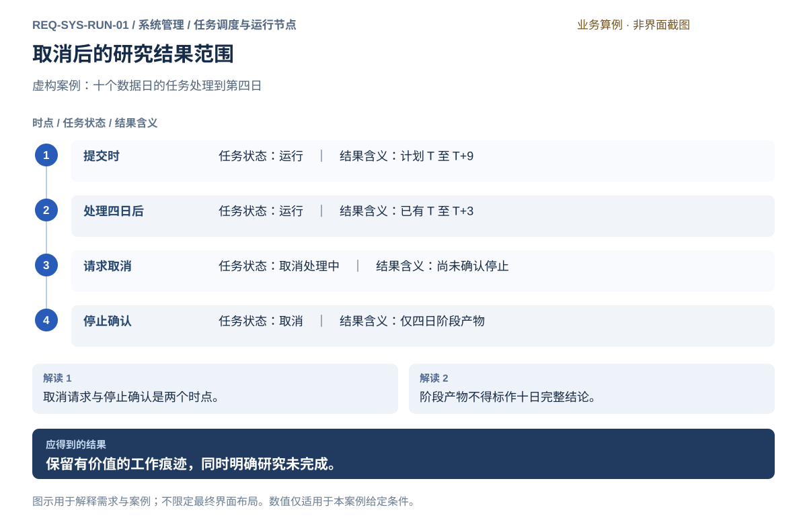
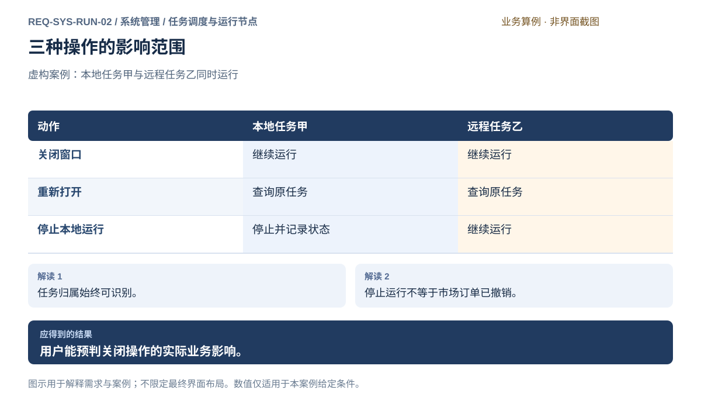
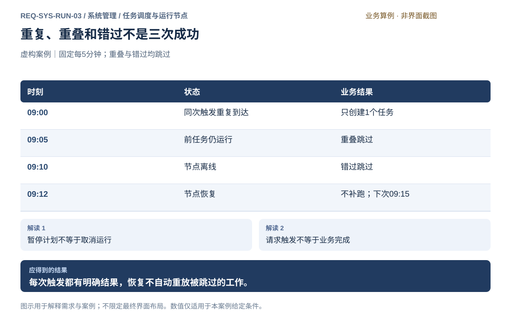
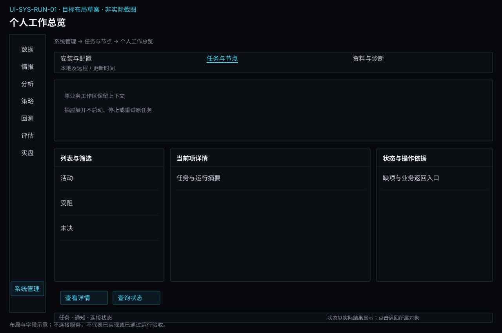
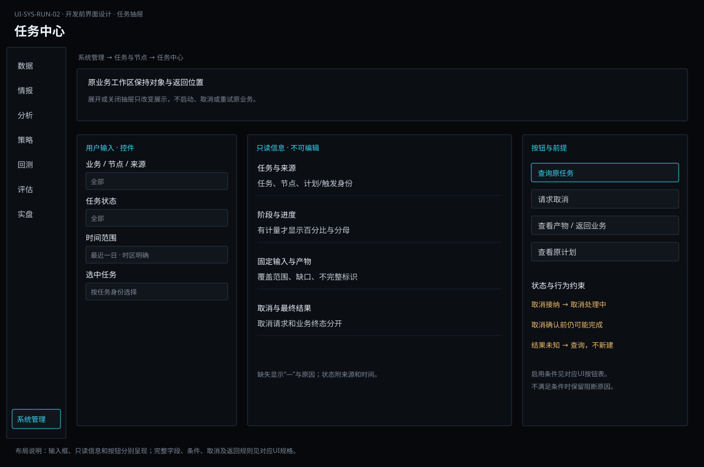
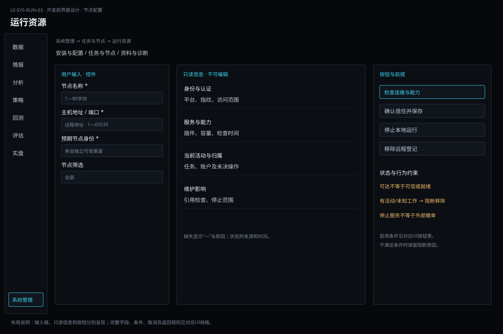
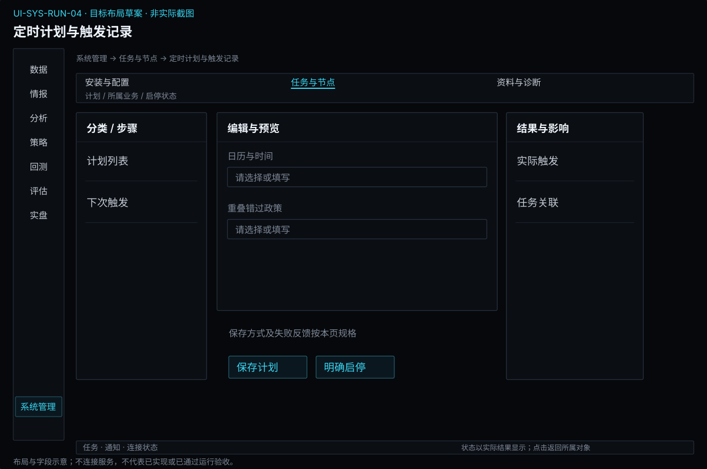

# 任务调度与运行节点

[返回上级](README.md) · [需求总纲](../../README.md) · [界面阅读指南](../../common/screens.md) · [跨模块流程](../../workflows/README.md)

开发前需求与设计规格 · 2026-10-20。定义目标功能、操作流程、界面和验收判据；规格决定、运行配置与外部条件分别记录。

**归属：** 系统管理 / 任务调度与运行节点。本页集中保存业务需求、详细功能、案例、界面对应和验收；通用规则见[通用规范](../../common/README.md)。

## 需求导航

- [REQ-SYS-RUN-01 管理长时研究任务并识别不完整结果](#req-sys-run-01)
- [REQ-SYS-RUN-02 明确本地与远程工作的归属及关闭影响](#req-sys-run-02)
- [REQ-SYS-RUN-03 按业务授权调度任务并核对每次触发](#req-sys-run-03)

## 计划、触发与业务任务分开

| 对象         | 关键字段                                                        | 状态拥有者                                         |
| ------------ | --------------------------------------------------------------- | -------------------------------------------------- |
| 定时计划     | 业务定义引用、节点、时区、日历、周期、起止、错过/重叠约定、预算 | 系统调度负责启用/暂停/到期及下一次时间             |
| 一次触发     | 计划身份、应执行时刻、实际提交、受理结果及任务引用              | 系统调度负责未提交/已提交/待核实/已受理/跳过的记录 |
| 业务任务     | 固定输入或按规则解析后的实际范围、依赖、运行位置、阶段和产物    | 所属业务执行流程确认运行、取消、失败和完成         |
| 任务中心视图 | 上述对象的引用与最后可确认状态                                  | 汇总显示，不成为第二个可独立修改的状态来源         |

用户在业务模块定义内容，在系统管理配置时间。动态范围如“上一交易日”必须有明确日历和求值规则，每次触发保留实际解析范围；不能随页面打开时间改变原输入。计划编辑明确从何时影响未来触发，不追溯修改已有任务。

启用前预览触发时刻、时区和业务日，说明休眠、服务停止和远程离线的影响。涉及夏令时的日历时区须说明重复/不存在时刻的处理，不支持的条件明确拒绝。首期策略清单待评审，不凭默认值开启无限并行或无限补跑。

重复触发与提交反馈丢失按同次身份核对，不盲目新建业务任务；只有业务明确允许、安全且范围固定的重试/有限补跑才可执行。暂停计划不取消已运行任务，取消任务也不必停掉未来计划，动作后果分别展示。

本轮公共调度面向数据采集、情报处理及分析回测任务。交易时序属于策略和实盘，仍要求授权、实时账户状态及逐笔检查；不能通过系统定时任务直接补发交易命令。

## REQ-SYS-RUN-01 管理长时研究任务并识别不完整结果

**领域：** 系统管理 / 任务调度与运行节点　 **建议优先级：** P1核心必要　 **需求状态：** 开发前设计规格（具体决定与运行配置见本条DEC）

### 目标与场景

研究任务可能持续较长时间，使用者需要知道正在做什么、占用哪些资源，以及能否停止。系统应区分完成、失败、取消与结果待核实，避免中途输出被当作完整研究结论。

**使用者与场景：** 同时准备数据、计算研究结果并查看交易信息的个人使用者。

**触发条件：** 提交预计不能立即结束的研究工作，或决定停止该工作。

### 前置条件

- 任务的输入与运行位置已明确。
- 提交前能说明预期产物及本次工作范围。

### 输入与含义

| 输入           | 含义与单位                         | 约束                                                 |
| -------------- | ---------------------------------- | ---------------------------------------------------- |
| 任务名称与范围 | 本次研究要处理的数据区间与工作内容 | 提交后保持可追溯；更改范围须形成新的明确任务。       |
| 资源限制       | 使用者允许的并行工作或资源使用额度 | 系统说明可控制的范围；未约定时不得表示存在无限资源。 |

### 正常操作与反馈

1. 使用者确认范围和运行位置后提交。
2. 系统给出可识别的任务记录和当前阶段。
3. 使用者查看已处理范围、等待原因及资源占用。
4. 使用者请求取消，系统先显示取消正在处理。
5. 系统确认停止后标记取消，并说明已保留的阶段产物。
6. 只有全部必要步骤完成的产物才能标为完成。

### 业务规则

- 不能可靠估计进度时显示阶段与已处理量，不虚构百分比或剩余时间。
- 排队、运行、取消处理中、取消、失败和完成具有不同含义。
- 取消是请求，收到请求不等于已停止。
- 阶段产物须标明覆盖范围与不完整原因，不直接参与完整结果比较。
- 取消研究任务不得被解释为撤销订单或关闭交易。

### 输出与状态影响

- 带状态、范围和时间的任务记录。
- 完整产物或明确标识的阶段产物。

### 异常与继续方式

| 发生什么         | 应怎样表现                                       | 使用者如何继续                         |
| ---------------- | ------------------------------------------------ | -------------------------------------- |
| 存储空间不足     | 停止无法继续的步骤并标为失败，保留已形成的记录。 | 释放空间后由使用者决定重新提交。       |
| 无法联系运行位置 | 标记状态待核实，不假定任务完成或取消。           | 恢复联系后核实原任务状态再决定下一步。 |

### 案例：研究到一半时取消

**虚构案例条件：** 虚构案例：计划处理案例日 T 至 T+9，共十个数据日；已完成四日后请求取消。

1. 任务记录显示已处理四日。
2. 取消请求被确认执行，任务停止。

**预期结果：**

- 状态为取消；保留范围为 T 至 T+3；不生成覆盖十日的完整报告。

### 可观察验收条件

| 编号                | 给定                         | 当       | 则                                             |
| ------------------- | ---------------------------- | -------- | ---------------------------------------------- |
| REQ-SYS-RUN-01-AC01 | 任务正在处理且只完成部分范围 | 查看结果 | 阶段产物明确显示已覆盖范围且不能冒充完整结果。 |
| REQ-SYS-RUN-01-AC02 | 已提交取消请求但尚未确认停止 | 查看任务 | 显示取消处理中，不提前显示已取消。             |
| REQ-SYS-RUN-01-AC03 | 运行位置失联                 | 查询任务 | 显示待核实，并保留原任务身份供恢复后核实。     |

### 决定与配置约束

- **DEC-SYS-RUN-01-01**：**规格决定**。默认1项计算，最多2项研究并行；资料规模和参考设备见非功能基线；队列可用容量在准入时明确显示。容量不够明确排队或拒绝，不能挤占必要交易控制。

### 详细功能

### FR-SYS-RUN-01-01 提交长任务并在任务中心定位

**目标与结果：** 使用者提交研究后获得一条可识别的工作记录，知道任务归属、输入范围和预期产物。重复点击不能产生多个意图相同但无法辨别的运行，明确新建运行仍保留独立记录。

**触发：** 研究页提交长任务后打开任务中心，或工作总览点击进行中的任务。

**输入与约束：** 任务名称、输入范围和运行位置来自已确认提交内容；用户备注可选，不以可重复名称作为唯一身份。

**目标操作与反馈：**

1. 提交后查看任务记录、排队或运行状态。
2. 在任务中心按类型、位置或状态筛选并选中该任务。
3. 展开详情核对输入摘要及预期结果，必要时返回所属研究。

**异常与边界：**

- 提交结果待核实时保留原提交身份，不通过再次点击复制任务。
- 筛选无匹配时提供清除条件，不将无结果理解为任务已删除。
- 由定时触发提交时保留计划及触发身份；任务中心引用业务执行状态，不将已调度或已受理显示为完成。

**验收条件：**

- **FR-SYS-RUN-01-01-AC01**：同一提交请求重复操作只定位到同一记录。
- **FR-SYS-RUN-01-01-AC02**：两次明确的新运行具有独立记录，且各自显示实际输入与归属。

**界面对应：** [UI-SYS-RUN-01 个人工作总览](#ui-sys-run-01)；[UI-SYS-RUN-02 任务中心](#ui-sys-run-02)；[UI-ANA-EDA-01 研究问题与样本计划](../analysis/exploration.md#ui-ana-eda-01)。

### FR-SYS-RUN-01-02 查看真实阶段、资源与结果完整性

**目标与结果：** 长任务不能只留下无法解释的转圈。使用者能看见当前阶段、已处理范围、等待原因以及阶段产物是否完整，从而决定继续等待、减少并行工作或取消。

**触发：** 任务中心选中排队、运行或已结束的任务。

**输入与约束：** 读取阶段、处理范围、资源信息和更新时间；没有可靠总量时百分比为空，预计剩余时间不凭空生成。

**目标操作与反馈：**

1. 查看当前阶段与最后反馈时间。
2. 展开范围明细，区分已处理、未处理及失败范围。
3. 查看阶段产物说明，确认其是否满足完整结果条件。

**异常与边界：**

- 无法估计进度时显示已处理量，不固定卡在虚构百分比。
- 资源信息失联时标明旧时间，不能继续显示为即时占用。

**验收条件：**

- **FR-SYS-RUN-01-02-AC01**：十日任务只处理四日时，结果明确覆盖四日，不能标作十日完整报告。
- **FR-SYS-RUN-01-02-AC02**：等待资源时能看到排队原因，完成状态只在必要产物已形成后出现。

**界面对应：** [UI-SYS-RUN-02 任务中心](#ui-sys-run-02)；[UI-SYS-RUN-03 运行资源](#ui-sys-run-03)。

### FR-SYS-RUN-01-03 取消研究并区分请求与实际停止

**目标与结果：** 使用者可以终止不再需要的研究，同时了解取消对已完成资料的影响。请求收到与任务停止分别可见，取消不会被误解为撤销交易订单或删除研究记录。

**触发：** 任务中心选中仍在排队或运行的研究任务并点击取消研究。

**输入与约束：** 明确任务身份、范围及阶段；确认文案列出保留的阶段产物。没有选择任务时操作不可用。

**目标操作与反馈：**

1. 查看取消对象及保留内容说明。
2. 确认后进入取消处理中，禁止重复创建取消意图。
3. 收到停止结果后显示已取消及实际覆盖范围。

**异常与边界：**

- 无法联系运行位置时显示取消结果待核实，不提前称已停止。
- 取消时任务已经完成则展示实际完成结果，不倒改成取消。

**验收条件：**

- **FR-SYS-RUN-01-03-AC01**：停止确认前显示取消处理中，用户仍可查看已有范围。
- **FR-SYS-RUN-01-03-AC02**：取消十日任务后四日资料被保留且标为阶段产物，没有发出任何交易撤单。

**界面对应：** [UI-SYS-RUN-02 任务中心](#ui-sys-run-02)；[UI-COM-SEC-01 凭据与访问用途](../../common/security.md#ui-com-sec-01)。

### FR-SYS-RUN-01-04 核实失联任务并决定后续工作

**目标与结果：** 研究失联不等于失败或停止。使用者恢复联系后应先找回原任务状态，再决定继续查看、取消或明确新建运行，避免产生多份同时运行的未知工作。

**触发：** 任务中心出现结果待核实提示，或运行资源恢复可用后点击核实状态。

**输入与约束：** 原任务身份、原运行位置和最后确认阶段；核实只查询原任务，不采用相同名称猜测其他记录。

**目标操作与反馈：**

1. 查看失联时点与最后确认事实。
2. 请求核实并显示查询过程，保留原归属。
3. 根据已确认状态恢复跟踪，或保留待核实说明及后续路径。

**异常与边界：**

- 远程仍不可达时保留已有信息，不自动转为本地重跑。
- 查询范围不足时不把未查到判为任务从未存在。

**验收条件：**

- **FR-SYS-RUN-01-04-AC01**：恢复后查到原任务已完成时关联其结果，不创建第二个运行。
- **FR-SYS-RUN-01-04-AC02**：核实失败时原记录保留且重跑须作为独立明确意图。

**界面对应：** [UI-SYS-RUN-02 任务中心](#ui-sys-run-02)；[UI-SYS-RUN-03 运行资源](#ui-sys-run-03)；[UI-COM-SEC-01 凭据与访问用途](../../common/security.md#ui-com-sec-01)。

## REQ-SYS-RUN-02 明确本地与远程工作的归属及关闭影响

**领域：** 系统管理 / 任务调度与运行节点　 **建议优先级：** P0安全必要　 **需求状态：** 开发前设计规格（具体决定与运行配置见本条DEC）

### 目标与场景

使用者必须知道任务和账户工作实际发生在哪里，以及关闭窗口会影响什么。研究和交易均应支持具备条件的本地独立使用；选择远程资源后也不能失去对运行归属和状态的理解。

**使用者与场景：** 在本机工作，或使用 Linux x86_64 远程资源的个人使用者。

**触发条件：** 选择运行位置、关闭桌面窗口或主动停止某处工作。

### 前置条件

- 本地和已授权远程资源可以分别识别。
- 任务或账户会话已有明确的运行归属。

### 输入与含义

| 输入     | 含义与单位                           | 约束                                       |
| -------- | ------------------------------------ | ------------------------------------------ |
| 运行位置 | 具体本机或远程资源的用户可识别名称   | 提交前明确选择；不得因失联静默换到另一处。 |
| 关闭意图 | 关闭窗口、停止指定工作或停止本地运行 | 分别说明影响，不把关闭窗口等同于撤单。     |

### 正常操作与反馈

1. 使用者查看本地及可用远程资源。
2. 系统说明各位置的可用条件和已有工作。
3. 使用者确认位置并启动任务。
4. 系统在任务与账户记录中持续展示归属。
5. 关闭窗口时，系统说明后台工作的持续状态。
6. 再次打开后查看并核实原位置上的工作。

### 业务规则

- 远程资源只支持 Linux x86_64，并服务于桌面使用。
- 本地具备数据、账户和授权条件即可独立研究与交易。
- 关闭桌面窗口不停止后台服务；明确停止是另一项操作。实盘以有人值守为前提，关闭前展示活动账户、未决订单及监控缺口，不能将后台运行描述为无人值守许可。
- 停止本地运行不会停止远程工作；其影响范围必须可见。
- 关闭窗口、停止运行和网络失联均不代表已被市场接受的订单已撤销。
- 重连只核实原工作状态，不自动重发交易指令或复制任务。

### 输出与状态影响

- 带运行归属的工作清单。
- 关闭或停止操作的实际影响说明。

### 异常与继续方式

| 发生什么                   | 应怎样表现                               | 使用者如何继续                             |
| -------------------------- | ---------------------------------------- | ------------------------------------------ |
| 远程位置失联               | 保留归属，标为状态未知或待核实。         | 联系恢复后查询原工作，不自动改成本地运行。 |
| 停止本地运行时仍有交易工作 | 说明失去本地监控的影响及订单不等于撤销。 | 使用者先核实交易状态，再明确决定是否停止。 |

### 案例：关闭窗口后的两处工作

**虚构案例条件：** 虚构案例：本机有研究任务甲，远程资源乙有研究任务乙；使用的是已安装软件。

1. 关闭桌面窗口。
2. 重新打开后核实两处工作。
3. 随后明确停止本地运行。

**预期结果：**

- 关闭窗口后两处工作继续；停止本地运行仅影响本地工作，远程任务乙保持运行。

### 可观察验收条件

| 编号                | 给定                         | 当               | 则                                   |
| ------------------- | ---------------------------- | ---------------- | ------------------------------------ |
| REQ-SYS-RUN-02-AC01 | 本地使用条件齐备             | 没有配置远程资源 | 仍可进行本地研究及获授权的本地交易。 |
| REQ-SYS-RUN-02-AC02 | 已安装软件的后台任务正在运行 | 只关闭窗口       | 后台任务继续，重新打开可核实原任务。 |
| REQ-SYS-RUN-02-AC03 | 本地与远程均有工作           | 明确停止本地运行 | 远程工作不被停止，界面说明影响边界。 |

### 决定与配置约束

- **DEC-SYS-RUN-02-01**：**规格决定**。管理已登记本地或可信Linux节点的能力、状态及业务归属；不做远程资源采购、账单和可用时段销售。配额作为节点配置明示。

### 详细功能

### FR-SYS-RUN-02-01 查看本地与远程资源能力和可用性

**目标与结果：** 使用者能判断工作可以放在哪里，区分本机与获授权的远程资源。可用性、权限和容量均有时点，缺少远程资源不会阻断本地条件已满足的研究和交易。

**触发：** 工作总览选择运行资源，或任务提交时查看可用位置。

**输入与约束：** 资源名称、类型、平台及访问状态；本机由当前设备识别，远程仅 Linux x86_64，名称不作为唯一身份。

**目标操作与反馈：**

1. 查看本地与已登记远程资源列表。
2. 选择资源，查看支持用途、容量信息及更新时间。
3. 检查或重新核实连接，再将符合条件的资源用于新任务。

**异常与边界：**

- 资源未授权时不暴露不可访问资料，说明需要的访问条件。
- 容量未知时显示未知，不按零使用率或无限容量解释。

**验收条件：**

- **FR-SYS-RUN-02-01-AC01**：只有本机时仍显示明确本地入口，不要求先增加远程资源。
- **FR-SYS-RUN-02-01-AC02**：远程平台不在范围内时明确拒绝将其选作运行位置。

**界面对应：** [UI-SYS-RUN-03 运行资源](#ui-sys-run-03)；[UI-SYS-RUN-01 个人工作总览](#ui-sys-run-01)。

### FR-SYS-RUN-02-02 为工作选择归属并保持一致

**目标与结果：** 工作提交前应明确归属，之后每条任务与账户运行信息都能辨认位置。连接异常不能导致系统悄悄换地方继续执行，使用户无法判断已有任务和交易活动在哪里。

**触发：** 新研究或账户工作选择运行位置，或任务中心查看归属。

**输入与约束：** 目标位置来自用户明确选择；可沿用最近普通选择作为候选，但提交摘要必须再次显示且不得替代交易授权。

**目标操作与反馈：**

1. 选择位置并查看所需数据、权限与资源条件。
2. 确认摘要中的位置后提交工作。
3. 在总览和任务详情核对同一归属并查看状态。

**异常与边界：**

- 提交后改变位置须形成新工作，不直接转移正在执行的任务。
- 原位置失联时保留原归属并进入核实流程，不自动复制到本地。

**验收条件：**

- **FR-SYS-RUN-02-02-AC01**：任务详情与资源页显示一致归属和可关联身份。
- **FR-SYS-RUN-02-02-AC02**：远程失联后没有出现未经确认的本地替代运行。

**界面对应：** [UI-SYS-RUN-03 运行资源](#ui-sys-run-03)；[UI-SYS-RUN-02 任务中心](#ui-sys-run-02)；[UI-SYS-RUN-01 个人工作总览](#ui-sys-run-01)。

### FR-SYS-RUN-02-03 关闭窗口后明确后台仍在运行

**目标与结果：** 已安装软件的窗口关闭只结束当前显示，后台工作继续。使用者在关闭前和重新打开后都能理解这一影响，不将窗口消失当作研究已停止、交易已撤销或持仓已经清零。

**触发：** 关闭桌面窗口，或从工作总览查看退出与后台说明。

**输入与约束：** 读取本地及已知远程的任务、策略和账户活动摘要；未知状态明确标识，不据此作安全保证。

**目标操作与反馈：**

1. 查看本次关闭仅关闭窗口的说明及活动摘要。
2. 存在未保存普通草稿时先处理保存或放弃选择。
3. 关闭后再次打开总览，查询原位置上的工作。

**异常与边界：**

- 关闭窗口不自动停止服务、撤单或平仓。
- 重新打开时不能确认某位置状态，则显示待核实，不冒称工作正常。

**验收条件：**

- **FR-SYS-RUN-02-03-AC01**：关闭并重新打开后能定位原研究任务，未产生重复启动。
- **FR-SYS-RUN-02-03-AC02**：存在在途订单时说明其仍可能成交，关闭动作没有隐含交易指令。

**界面对应：** [UI-SYS-RUN-01 个人工作总览](#ui-sys-run-01)；[UI-SYS-RUN-03 运行资源](#ui-sys-run-03)。

### FR-SYS-RUN-02-04 明确停止指定位置的工作并核对影响

**目标与结果：** 使用者需要主动停止运行时，必须辨认操作对象和影响范围。停止本地运行不影响远程工作，并且不能被解释为外部订单已经撤销；研究、策略和账户活动的结果分别确认。

**触发：** 运行资源页选择本机后点击停止本地运行，或进入相关工作处理停止。

**输入与约束：** 目标位置及相关活动清单；危险动作不默认选中，不允许使用总览的普通关闭按钮代替。

**目标操作与反馈：**

1. 检查目标位置、活动任务和仍可能成交的订单提示。
2. 按需要先进入任务或账户页面核对状态，再返回明确停止。
3. 提交后查看停止处理中、已停止或待核实结果。

**异常与边界：**

- 尚有交易活动时明确告知停止监控的影响，不把说明当作撤单指令。
- 无法确认停止结果时保留待核实，不自动重启替代工作。

**验收条件：**

- **FR-SYS-RUN-02-04-AC01**：停止本地运行后远程任务没有被停止。
- **FR-SYS-RUN-02-04-AC02**：结果显示各项实际影响，并保留已有资料与操作记录。

**界面对应：** [UI-SYS-RUN-03 运行资源](#ui-sys-run-03)；[UI-SYS-RUN-02 任务中心](#ui-sys-run-02)；[UI-LIV-RUN-01 账户连接与交易授权](../live/operations.md#ui-liv-run-01)；[UI-COM-SEC-01 凭据与访问用途](../../common/security.md#ui-com-sec-01)。

### FR-SYS-RUN-02-05 登记可信节点并处理信任失效与移除

**目标与结果：** 资源可达与身份可信分别确认，防止任务发往同名错误节点。

**触发：** 添加远程资源、证书/身份变化、访问撤销或移除资源。

**输入与约束：** Linux x86_64节点地址、可核对的节点身份、双向认证与访问范围、服务能力；秘密只在本地安全配置流程产生。

**目标操作与反馈：**

1. 建立节点草稿并核对身份依据，验证双向认证、平台和能力；失败保留草稿且不可调度。
2. 身份发生变化时停止对该身份的新任务/控制请求并要求重新核验；展示远端运行状态是否仍未知。
3. 移除前列出活动任务和账户执行归属；有活动或未知工作时阻止直接移除并引导核对，移除登记不等于停止远端服务。

**异常与边界：**

- 地址同名或连通不代表信任有效，不自动接受陌生证书。
- 连接中断不自动迁移任务或接管账户；公共调度不授予交易权限。

**操作案例：** 节点N地址未变但身份变了，界面要求核验；不会因为IP相同把实盘控制发到新身份。

**验收条件：**

- **FR-SYS-RUN-02-05-AC01**：节点身份变更后新任务被拒绝，旧远端任务保持实际或未知状态而非已取消。
- **FR-SYS-RUN-02-05-AC02**：存在账户执行归属且无法确认停止时移除操作被阻断并提供业务入口。

**界面对应：** [UI-SYS-RUN-03](#ui-sys-run-03)。

## REQ-SYS-RUN-03 按业务授权调度任务并核对每次触发

**领域：** 系统管理 / 任务调度与运行节点　 **建议优先级：** P1核心必要　 **需求状态：** 开发前设计规格（具体决定与运行配置见本条DEC）

### 目标与场景

让周期性采集和研究可以按明确时间执行，同时区分计划、触发、受理和业务完成。

**使用者与场景：** 兼顾期货研究、实盘和运行维护的个人用户。

**触发条件：** 在数据、情报或研究模块形成可调度任务定义，再进入调度设置。

### 前置条件

- 对象、所属业务模块和允许操作的范围明确。
- 涉及运行、费用或资料变更的条件已由用户明确配置；案例仅供评审。

### 输入与含义

| 输入         | 含义与单位                                                 | 约束                                                               |
| ------------ | ---------------------------------------------------------- | ------------------------------------------------------------------ |
| 业务任务定义 | 所属模块、固定输入或明确范围计算规则、目标节点、预算及授权 | 业务模块拥有任务含义与执行条件；调度引用它，不解释或改写业务参数。 |
| 时间规则     | 时区、日历/交易日条件、频率、起止时间、下一触发时间        | 预览实际时刻与业务日；不能把本机显示时区当作执行时区。             |
| 执行约定     | 错过、重叠、暂停、重复触发及失败继续方式                   | 启用前明确可选处理；无定义不自动补跑、并发或重试。                 |

### 正常操作与反馈

1. 在数据、情报或研究模块形成可调度任务定义，再进入调度设置。
2. 选择位置、时区、周期、错过与重叠处理，预览下一批触发时间和范围。
3. 确认授权及预算后启用，查看计划状态及每次触发记录。
4. 到期交给业务模块检查并受理，关联真实任务身份与结果。
5. 暂停或修改计划时说明对未来触发及已运行任务的不同影响。

### 业务规则

- 系统只决定何时请求执行；数据授权和额度、LLM预算、回测风险配置等仍由业务模块检查。
- 调度启用可涵盖明确范围内后续触发，不要求每次重复确认；超出已确认范围或费用预算时阻断，不偷偷扩张授权。
- 同一计划同一应执行时刻形成可识别的触发记录；重复投递先核对原受理结果，不创建第二个业务任务。
- 本轮支持周期性数据、情报、分析与回测任务的需求，不提供任意脚本或交易指令定时重放。策略定时调仓由策略定义和实盘运行负责。
- 错过执行可按业务支持的明确策略跳过或有限补跑；交易命令不能因调度恢复而补发，结果不明先查询原任务。
- 任务未结束时下一触发按已确认重叠策略处理；不能默认无限并行或堆积。暂停计划只停止后续触发，取消已运行任务是独立动作。
- 安装版关闭Terminal窗口不等于停止服务和计划；主机休眠/关机、服务停止或远程不可达影响执行，明确运行位置与缺口。客户端离线不能提供离机告警，实盘须保持有人值守；远程运行按自身状态核对。

### 输出与状态影响

- 让周期性采集和研究可以按明确时间执行，同时区分计划、触发、受理和业务完成。
- 可追溯的操作结果、责任归属、时间与异常说明。

### 异常与继续方式

| 发生什么                   | 应怎样表现                       | 使用者如何继续                           |
| -------------------------- | -------------------------------- | ---------------------------------------- |
| 节点离线或机器休眠导致错过 | 记录错过时刻和影响，不假装已执行 | 恢复后按计划明确规则跳过或预览有限补跑。 |
| 业务受理反馈丢失           | 显示本次触发待核实及原身份       | 查询原任务结果后决定后续，禁止盲目新建。 |

### 案例：重复、重叠和错过不是三次成功

**虚构案例条件：** 虚构案例：每5分钟触发一次；明确重叠跳过、错过跳过。09:00收到同次触发两次，首任务至09:07才结束；09:10主机离线，09:12恢复。

1. 核对09:00重复触发。
2. 核对09:05与09:10触发记录。
3. 09:12恢复后查看下一次时间。

**预期结果：**

- 09:00只形成1个业务任务。
- 09:05重叠跳过，09:10错过跳过；09:12不补跑，下一次09:15。

### 可观察验收条件

| 编号                | 给定                           | 当       | 则                             |
| ------------------- | ------------------------------ | -------- | ------------------------------ |
| REQ-SYS-RUN-03-AC01 | 09:00同次触发两次              | 业务受理 | 只关联同一个业务任务。         |
| REQ-SYS-RUN-03-AC02 | 09:05前任务未结束且规则为跳过  | 触发     | 记录重叠跳过，不新增并行任务。 |
| REQ-SYS-RUN-03-AC03 | 09:10离线、09:12恢复且错过跳过 | 恢复调度 | 不补跑，下一次09:15。          |

### 决定与配置约束

- **DEC-SYS-RUN-03-01**：**规格决定**。每天、每交易日固定时刻或最短1分钟间隔；显式时区/日历，默认不重叠不补跑；错过记录后可人工批准一次有限补跑，未决触发先核对，禁止交易命令补发。

### 详细功能

### FR-SYS-RUN-03-01 从业务任务创建计划并预览时间

**目标与结果：** 把业务任务与时间规则明确绑定。

**触发：** 从业务页选择创建计划。

**输入与约束：** 固定业务定义或明确的时间范围计算规则、运行位置、时区、日历、频率。

**目标操作与反馈：**

1. 从业务页选择创建计划。
2. 核对任务内容与每次输入范围，选择时间规则和节点。
3. 预览下一批实际触发时刻及业务日。

**异常与边界：**

- 不复制可独立修改的业务任务定义。
- 计划不是任意命令执行器，不创建账户发单计划。

**验收条件：**

- **FR-SYS-RUN-03-01-AC01**：时区与交易日条件随预览一起显示。
- **FR-SYS-RUN-03-01-AC02**：输入范围不明确时不能启用计划。

**界面对应：** [UI-SYS-RUN-04 定时计划与触发记录](#ui-sys-run-04)。

### FR-SYS-RUN-03-02 确认授权预算及错过重叠行为

**目标与结果：** 让周期执行范围可控。

**触发：** 核对必要条件及计划覆盖范围。

**输入与约束：** 业务授权、费用预算、资源额度、重叠与错过规则。

**目标操作与反馈：**

1. 核对必要条件及计划覆盖范围。
2. 选择业务支持的错过和重叠策略。
3. 确认并启用，查看有效时间和下一触发。

**异常与边界：**

- 缺风险配置仍阻断回测，调度不放行。
- 无定义的补跑或超预算不得默认执行。

**验收条件：**

- **FR-SYS-RUN-03-02-AC01**：重叠跳过时前任务不被自动取消。
- **FR-SYS-RUN-03-02-AC02**：超出批准预算阻断并说明，不静默消费。

**界面对应：** [UI-SYS-RUN-04 定时计划与触发记录](#ui-sys-run-04)。

### FR-SYS-RUN-03-03 关联每次触发与唯一业务受理结果

**目标与结果：** 避免重复触发产生重复任务。

**触发：** 查看触发记录与交付阶段。

**输入与约束：** 计划身份、应执行时刻、提交/受理状态、业务任务身份、实际结果时间。

**目标操作与反馈：**

1. 查看触发记录与交付阶段。
2. 收到重复触发或反馈不明时核对原受理身份。
3. 跳转业务任务确认实际进度和产物。

**异常与边界：**

- 已触发或已受理不能标成业务完成。
- 未知结果不自动新建替代任务。

**验收条件：**

- **FR-SYS-RUN-03-03-AC01**：案例09:00两次到达只关联1个任务。
- **FR-SYS-RUN-03-03-AC02**：业务失败保持触发已受理及业务失败两个事实。

**界面对应：** [UI-SYS-RUN-04 定时计划与触发记录](#ui-sys-run-04)；[UI-SYS-RUN-02 任务中心](#ui-sys-run-02)。

### FR-SYS-RUN-03-04 暂停修改计划并处理离线缺口

**目标与结果：** 明确计划生命周期与已有工作关系。

**触发：** 暂停或修改计划并预览未来影响。

**输入与约束：** 计划状态、执行位置、错过记录、正在运行任务、生效条件。

**目标操作与反馈：**

1. 暂停或修改计划并预览未来影响。
2. 查看已有任务，需取消时独立请求。
3. 恢复后按明确规则核对错过范围和下一执行时刻。

**异常与边界：**

- 关闭窗口不暗示已暂停后台计划。
- 交易指令不因恢复、补跑或重复通知自动发出。

**验收条件：**

- **FR-SYS-RUN-03-04-AC01**：09:12恢复不补跑被约定跳过的09:10。
- **FR-SYS-RUN-03-04-AC02**：暂停计划后原任务保留状态，不能直接显示已取消。

**界面对应：** [UI-SYS-RUN-04 定时计划与触发记录](#ui-sys-run-04)；[UI-SYS-RUN-02 任务中心](#ui-sys-run-02)；[UI-SYS-RUN-03 运行资源](#ui-sys-run-03)。

## 目标界面设计

## UI-SYS-RUN-01 个人工作总览

**业务目标：** 在同一工作空间中并列掌握研究、交易与后台活动，进入下一项具体工作并理解关闭窗口的影响。

### 页面形态与目标布局

**规格范围：** 本条定义目标布局、字段、动作和业务状态，设计图与以下操作规则共同作为开发依据。

**界面形态：** 底部抽屉视图。

**目标到达路径：** 系统管理 → 任务与节点 → 个人工作总览。系统管理入口打开同一全局抽屉，底部状态区提供快捷入口。从业务详情进入时携带固定对象身份和返回位置。

| 区域 | 要显示的内容 |
| --- | --- |
| 顶部上下文 | 本地及远程 / 更新时间 |
| 列表、分类或步骤区 | 活动 / 受阻 / 未决 |
| 主要工作区 | 任务与运行摘要 |
| 选中项详情或检查区 | 缺项与业务返回入口 |
| 主要动作区 | 查看详情 / 查询状态 |

**区域联动与返回：** 输入、只读展示与动作按下方分表定义；选中对象、查询条件及返回位置保持一致，导航不隐式执行业务。保存、取消及离开适用本页的具体规则。

**窗口与空间：** 从底部展开并保留原工作区；列表及详情独立滚动，关闭抽屉不取消业务，返回所属业务时收起抽屉。

**状态设计范围：** 只采用下方状态表及关联FR适用于本页的状态；缺失值、来源时效、阻断原因与可执行下一步必须明确。字段与动作按本页交付约定核对。

### 目标操作规格

1. 打开总览并按业务、运行位置和关注范围定位工作。
2. 查看对象状态、时效与未决原因，进入原业务页处理。
3. 返回重新查询；关闭抽屉仅恢复原工作区。

**操作案例：** 远端失联时旧运行显示最后可靠状态及待核实，不能在总览变成已完成或自动重启。

### 业务验收要求

- **UI-SYS-RUN-01-AC01**：研究与交易入口并列，交易缺项不会隐藏已经可用的研究。
- **UI-SYS-RUN-01-AC02**：重新打开可查询原任务，未自动生成新任务或重发交易。
- **UI-SYS-RUN-01-AC03**：关闭窗口前明确后台继续与订单可能成交，不显示全部已停止。

### 字段与操作交付约定

本页是全局只读总览抽屉。它汇集工作和未决问题，所有业务控制由原责任页面执行。

#### 用户输入

| 字段 | 类型、默认值与必填条件 | 合法范围及变更影响 |
| --- | --- | --- |
| 业务模块 / 运行位置 | 单选筛选，默认全部已登记可读范围；可选 | 节点只取本机和已登记节点；切换不迁移任务或账户 |
| 关注范围 | 多选筛选，默认活动、受阻、未决；可选 | 可扩展查看已结束项；未读数量与业务严重程度分别筛选 |
| 选中工作 | 列表单选，首次不强制选中；可选 | 仅改变详情，不启动、恢复或取消工作 |

#### 只读展示

| 信息 | 来源与含义 | 缺失或陈旧时 |
| --- | --- | --- |
| 研究、任务、运行与账户摘要 | 原业务对象身份、所属模块、模式、位置、状态 | 来源不可达时保留最后可靠状态并显示时间，不记为零或空闲 |
| 受阻与未决项 | 缺失数据、风险/授权限制、未确认操作及对应原因 | 无可靠结论标待核实；不能以通知已读移除限制 |
| 运行与通知可达性 | 本地/远程服务、应用内及桌面提醒条件 | 桌面关闭、主机休眠等影响单列，不承诺离机监控 |

#### 按钮与动作

| 动作 | 启用条件 | 结果及失败反馈 |
| --- | --- | --- |
| 查询状态 | 存在可查询来源 | 查询同一对象；部分失败显示失败来源和最后核对时间，不创建替代任务 |
| 查看详情 / 补齐条件 | 选中对象有责任入口 | 携带对象身份、位置、账户及返回地址进入原业务页；总览不提供一键恢复、重试或停止全部 |
| 关闭抽屉 | 始终可用 | 返回原工作区焦点，后台任务不被取消 |
| 关闭 Terminal 窗口 | 按窗口关闭规则 | 有交易或活动工作时显示运行位置、未决订单、后台继续及通知可达限制；关闭不等于撤单或结束服务 |

#### 适用状态与离开

| 状态 | 页面行为 |
| --- | --- |
| 首次无工作 | 显示各业务入口与准备缺项；没有必填表单或“创建总览”动作 |
| 筛选无匹配 | 展示过滤范围和清除筛选；仍保留全局关键风险提示 |
| 查询中 / 部分节点失联 | 更新可用来源，失联来源单列陈旧程度；不清空已知事实 |
| 全部不可达 / 操作未决 | 显示来源与上次核对时间，只允许查询和返回责任页核实 |

抽屉没有业务草稿，离开不出现保存/放弃。重新打开恢复筛选和选中身份并刷新状态。默认实盘使用方式为有人值守，后台继续运行不构成无人值守或离机告警承诺。

### 对应功能需求

- [FR-COM-REL-01-01 并行研究期间保持关键交互响应](../../common/reliability.md#fr-com-rel-01-01)
- [FR-COM-REL-01-02 呈现行情时效而不掩盖上游延迟](../../common/reliability.md#fr-com-rel-01-02)
- [FR-COM-REL-01-04 中断后保留已保存资料并核对原工作](../../common/reliability.md#fr-com-rel-01-04)
- [FR-COM-UX-01-06 离开未保存草稿前作明确选择](../../common/interaction.md#fr-com-ux-01-06)
- [FR-SYS-SET-01-01 核对设备支持范围与首次可用条件](setup.md#fr-sys-set-01-01)
- [FR-SYS-SET-01-04 完成准备后进入明确的工作入口](setup.md#fr-sys-set-01-04)
- [FR-SYS-RUN-01-01 提交长任务并在任务中心定位](#fr-sys-run-01-01)
- [FR-SYS-RUN-02-01 查看本地与远程资源能力和可用性](#fr-sys-run-02-01)
- [FR-SYS-RUN-02-02 为工作选择归属并保持一致](#fr-sys-run-02-02)
- [FR-SYS-RUN-02-03 关闭窗口后明确后台仍在运行](#fr-sys-run-02-03)
- [FR-SYS-REC-01-01 查看个人资料范围和引用关系](records.md#fr-sys-rec-01-01)

## UI-SYS-RUN-02 任务中心

**业务目标：** 定位长时任务，理解真实进度和结果完整性，明确取消及失联后的核实。

### 页面形态与目标布局

**规格范围：** 本条定义目标布局、字段、动作和业务状态，设计图与以下操作规则共同作为开发依据。

**界面形态：** 底部抽屉视图。

**目标到达路径：** 系统管理 → 任务与节点 → 任务中心。系统管理入口打开同一全局抽屉，底部状态区提供快捷入口。从业务详情进入时携带固定对象身份和返回位置。

| 区域 | 要显示的内容 |
| --- | --- |
| 顶部上下文 | 业务 / 状态 / 来源筛选 |
| 列表、分类或步骤区 | 任务列表 / 所属节点 |
| 主要工作区 | 实际阶段 / 部分结果 / 触发来源 |
| 选中项详情或检查区 | 取消状态 / 失败及未知 |
| 主要动作区 | 返回业务 / 明确取消 |

**区域联动与返回：** 输入、只读展示与动作按下方分表定义；选中对象、查询条件及返回位置保持一致，导航不隐式执行业务。保存、取消及离开适用本页的具体规则。

**窗口与空间：** 从底部展开并保留原工作区；列表及详情独立滚动，关闭抽屉不取消业务，返回所属业务时收起抽屉。

**状态设计范围：** 只采用下方状态表及关联FR适用于本页的状态；缺失值、来源时效、阻断原因与可执行下一步必须明确。字段与动作按本页交付约定核对。

### 目标操作规格

1. 按业务、状态、节点和时间筛选，选中原任务查看阶段、固定输入和产物。
2. 需要取消且任务允许时，确认对象后请求取消，等待业务确认。
3. 查看产物或返回责任模块；定时任务可返回原计划及触发记录。

**操作案例：** 十日任务处理四日后请求取消，先显示取消处理中；最终若取消成功保留四日阶段结果，若已完成则如实显示完成。

### 业务验收要求

- **UI-SYS-RUN-02-AC01**：十日任务处理四日后取消，展示取消处理中直至确认，并保留四日阶段结果。
- **UI-SYS-RUN-02-AC02**：失联任务仍显示原位置和时点，核实不创建重复运行。
- **UI-SYS-RUN-02-AC03**：筛选零匹配与全部无任务说明不同，清除筛选可找回原记录。

### 字段与操作交付约定

任务中心只查询已有任务并对允许取消的任务发出独立取消请求；它不编辑任务定义。“取消”是按钮，“结果”和“来源”是只读信息。

#### 用户输入

| 字段 | 类型、默认值与必填条件 | 合法范围及变更影响 |
| --- | --- | --- |
| 业务 / 节点 / 来源 | 单选筛选，默认全部；可选 | 来源为手动或定时；从业务或计划进入时预置对应身份，只过滤查询 |
| 任务状态 | 多选筛选，默认全部；可选 | 排队、运行、取消处理中、完成、失败、已取消、待核实；部分产物另有完整性标识，不自动等同完成 |
| 时间范围 | 起止日期时间及显示时区，默认最近一日；可选扩展 | 起点早于终点，显示过滤采用的创建时间口径；改变范围不重复提交任务 |
| 选中任务 | 列表单选；首次不选中 | 任务身份不可自由改写，所有详情和按钮绑定同一任务 |

#### 只读展示

| 信息 | 来源与含义 | 缺失或陈旧时 |
| --- | --- | --- |
| 任务身份、所属业务、执行位置 | 原业务任务与受理身份；定时任务另列计划和应执行时刻 | 计划被移除仍保留历史来源标识，不补造新计划 |
| 阶段、已处理范围、耗时、资源 | 有可靠计量时显示分母与单位；无可计算百分比只显阶段 | 不用动画百分比冒充进度；断连显示最后更新时间与待核实 |
| 输入与产物 | 固定输入摘要、已完成范围、缺口、不完整标识及产物入口 | 无产物不显示下载；部分结果不能标完整研究结论 |
| 取消请求与业务终态 | 取消请求时间、接纳情况、最终任务结果分别显示 | 取消与完成竞态按业务最终事实呈现，不把按钮点击标已取消 |

#### 按钮与动作

| 动作 | 启用条件 | 结果及失败反馈 |
| --- | --- | --- |
| 查询状态 | 已有任务身份；查询中防重 | 核对原任务，无响应保留待核实，不创建新任务 |
| 请求取消 | 任务支持取消，状态可取消且没有未决取消请求 | 确认对象和阶段后提交，显示取消处理中；获得业务确认才标已取消，已经完成则显示完成及取消未生效原因 |
| 查看产物 / 返回业务 | 有产物或可定位责任对象 | 携带任务、输入及结果身份进入责任页面；部分产物明确缺口 |
| 查看计划 | 来源为定时且有计划身份 | 跳转计划及原触发记录；暂停计划与取消任务分别执行 |
| 清除筛选 / 关闭 | 始终可用 | 仅改变展示；关闭抽屉不发送取消 |

#### 适用状态与离开

| 状态 | 页面行为 |
| --- | --- |
| 无任务 / 无匹配 | 分别提供业务入口或清除筛选，不要求填写“取消”或“结果” |
| 排队 / 运行 / 部分产物 | 展示真实阶段，按取消能力启用按钮；已产生证据可查看 |
| 取消处理中 | 保留任务身份和进度，禁用重复取消，允许查询；可能继续产生业务结果 |
| 失败 / 完成 / 已取消 | 展示终态及产物完整性；再次运行须回业务页形成明确的新任务 |
| 失联 / 结果待核实 | 只查询原任务和查看最后证据；禁止以默认重试新建替代任务 |

无可保存的业务表单，离开不弹草稿确认。返回恢复筛选、任务身份和滚动位置后查询状态；请求被接纳后抽屉关闭不影响其执行。

### 对应功能需求

- [FR-COM-REL-01-01 并行研究期间保持关键交互响应](../../common/reliability.md#fr-com-rel-01-01)
- [FR-COM-REL-01-03 及时反馈取消请求并保留停止等待](../../common/reliability.md#fr-com-rel-01-03)
- [FR-COM-REL-01-04 中断后保留已保存资料并核对原工作](../../common/reliability.md#fr-com-rel-01-04)
- [FR-COM-UX-01-04 统一选择菜单的可读背景和展开位置](../../common/interaction.md#fr-com-ux-01-04)
- [FR-ANA-EDA-01-03 将实验归入问题并记录尝试目的](../analysis/exploration.md#fr-ana-eda-01-03)
- [FR-ANA-EVL-01-02 对冻结合成信号进行样本外验证](../analysis/evaluation.md#fr-ana-evl-01-02)
- [FR-ANA-EVL-01-03 运行因子评价并核对有效样本](../analysis/evaluation.md#fr-ana-evl-01-03)
- [FR-BKT-EXP-02-01 审阅固定条件并提交独立回测](../backtest/experiments.md#fr-bkt-exp-02-01)
- [FR-BKT-EXP-02-02 观察执行并显式取消回测](../backtest/experiments.md#fr-bkt-exp-02-02)
- [FR-BKT-EXP-03-02 提交批次并处理独立失败与取消](../backtest/experiments.md#fr-bkt-exp-03-02)
- [FR-SYS-RUN-01-01 提交长任务并在任务中心定位](#fr-sys-run-01-01)
- [FR-SYS-RUN-01-02 查看真实阶段、资源与结果完整性](#fr-sys-run-01-02)
- [FR-SYS-RUN-01-03 取消研究并区分请求与实际停止](#fr-sys-run-01-03)
- [FR-SYS-RUN-01-04 核实失联任务并决定后续工作](#fr-sys-run-01-04)
- [FR-SYS-RUN-02-02 为工作选择归属并保持一致](#fr-sys-run-02-02)
- [FR-SYS-RUN-02-04 明确停止指定位置的工作并核对影响](#fr-sys-run-02-04)
- [FR-SYS-RUN-03-03 关联每次触发与唯一业务受理结果](#fr-sys-run-03-03)
- [FR-SYS-RUN-03-04 暂停修改计划并处理离线缺口](#fr-sys-run-03-04)
- [FR-SYS-REC-01-02 预览备份范围并验证备份结果](records.md#fr-sys-rec-01-02)
- [FR-SYS-REC-02-01 用可理解的错误解释影响和下一步](records.md#fr-sys-rec-02-01)
- [FR-SYS-REC-02-02 按对象与时间检索关键操作记录](records.md#fr-sys-rec-02-02)
- [FR-SYS-REC-02-03 把操作意图和确认结果排成可核对时间线](records.md#fr-sys-rec-02-03)
- [FR-LIV-RUN-03-02 配置并检查独立模拟验证](../live/operations.md#fr-liv-run-03-02)
- [FR-LIV-RUN-04-01 明确启动策略并防止重复运行](../live/operations.md#fr-liv-run-04-01)
- [FR-DAT-PRC-01-05 核对加工结果并交接发布](../data/processing.md#fr-dat-prc-01-05)
- [FR-DAT-ACQ-01-04 显式更换或断开数据来源](../data/acquisition.md#fr-dat-acq-01-04)
- [FR-DAT-ACQ-02-03 启动取数并控制后续请求](../data/acquisition.md#fr-dat-acq-02-03)
- [FR-DAT-ACQ-02-04 核对部分结果并显式继续未完成范围](../data/acquisition.md#fr-dat-acq-02-04)

## UI-SYS-RUN-03 运行资源

**业务目标：** 识别本机与获授权远程资源，决定新工作放在哪里，并理解停止某位置的影响。

### 页面形态与目标布局

**规格范围：** 本条定义目标布局、字段、动作和业务状态，设计图与以下操作规则共同作为开发依据。

**界面形态：** 模块内配置工作区。

**目标到达路径：** 系统管理 → 任务与节点 → 运行资源。从业务详情进入时携带固定对象身份和返回位置。

| 区域 | 要显示的内容 |
| --- | --- |
| 顶部上下文 | 节点 / 身份信任 / 可用状态 |
| 列表、分类或步骤区 | 机器列表 / 当前位置 |
| 主要工作区 | 服务与能力 / 当前活动 |
| 选中项详情或检查区 | 账户归属 / 维护影响 |
| 主要动作区 | 验证身份 / 管理服务 |

**区域联动与返回：** 输入、只读展示与动作按下方分表定义；选中对象、查询条件及返回位置保持一致，导航不隐式执行业务。保存、取消及离开适用本页的具体规则。

**窗口与空间：** 使用主窗口内的模块配置工作区；分类、编辑和结果区域独立滚动，保留模块导航与主要动作。凭据输入按用途打开上下文对话框。

**状态设计范围：** 只采用下方状态表及关联FR适用于本页的状态；缺失值、来源时效、阻断原因与可执行下一步必须明确。字段与动作按本页交付约定核对。

### 目标操作规格

1. 选择本机或登记远程节点，核对独立身份依据、平台、认证与能力。
2. 查看活动任务、账户归属和维护影响，再决定是否确认信任或维护。
3. 维护动作独立确认，返回后核对原位置的结果；失联先核实，不自动接管。

**操作案例：** 同一地址的节点身份变化时阻断新控制；存在未知任务或账户归属时不能移除登记。

### 业务验收要求

- **UI-SYS-RUN-03-AC01**：远程失联时原任务归属仍为该远程，未创建本地替代任务。
- **UI-SYS-RUN-03-AC02**：选择用于新工作只更新提交摘要，不直接启动。
- **UI-SYS-RUN-03-AC03**：停止本地运行不会停止远程，也不会隐含撤单或清空持仓。

### 字段与操作交付约定

本页维护资源登记与信任，展示服务能力和执行归属。节点可达不等于身份可信、业务就绪或账户已授权。

#### 用户输入

| 字段 | 类型、默认值与必填条件 | 合法范围及变更影响 |
| --- | --- | --- |
| 节点名称 | 文本，新增为空，必填 | 1—80字符、非纯空白；同名不作为身份依据 |
| 主机地址 / 端口 | 主机名或IP、整数端口，新增为空，远程必填 | 端口1—65535；地址改变使连接和信任核对结果失效，不迁移既有业务 |
| 预期节点身份 | 从独立可信渠道取得的身份/指纹，新增为空，确认信任前必填 | 必须与展示的远端身份一致，不能把首次连接返回值自动当可信依据 |
| 节点筛选 | 本机/远程、信任状态、可用状态；默认全部 | 只过滤登记列表；本机身份只读，不通过远程表单修改 |

#### 只读展示

| 信息 | 来源与含义 | 缺失或陈旧时 |
| --- | --- | --- |
| 平台、身份、认证与访问范围 | 远程必须为 Linux x86_64，身份和双向认证分别核对 | 未核验/身份变更时停止新控制请求，保留旧活动待核实 |
| 服务、插件、资源容量与状态 | 位置对应的能力检查及时间 | 连接成功而能力缺失时仍标业务不可用；不可达不记空闲 |
| 活动任务、账户归属、未决操作 | 原业务对象引用及对维护的影响 | 不能确认无活动时阻断移除；不假定失联任务停止 |

#### 按钮与动作

| 动作 | 启用条件 | 结果及失败反馈 |
| --- | --- | --- |
| 检查连接与能力 | 地址/端口合法 | 只检查平台、身份、能力，显示结果时间；不自动接受信任、不登录交易 |
| 确认信任并保存 | 身份与独立依据匹配、认证和平台条件满足 | 明确确认访问范围后保存登记；保存或核验失败保留非秘密草稿、不能调度 |
| 查看活动 / 转业务处置 | 有活动或执行归属 | 携带节点和原对象进入任务/账户页，返回再次核对影响 |
| 停止本地运行 | 选中本机、影响清单已查询并由用户确认 | 显示停止处理中及各服务结果；未决标待核实，不把停止服务当撤单，不影响远程 |
| 移除远程登记 | 无活动、无未决工作且无阻断引用 | 展示引用检查再确认；执行前重查，阻断不能用二次确认绕过。成功仅移除登记，不停止远端服务 |

#### 适用状态与离开

| 状态 | 页面行为 |
| --- | --- |
| 仅本机 / 无远程 | 本机可独立工作，显示可选的添加节点入口 |
| 输入无效 / 不支持平台 | 错误定位具体字段或平台；保留草稿，禁止确认信任 |
| 未信任 / 身份变化 / 已撤销 | 明确身份差异和旧活动状态，要求独立核验，不自动重连至陌生身份 |
| 服务缺失 / 失联 / 维护待核实 | 显示最后可靠能力与活动时间；不自动切换执行位置或接管账户 |

节点普通登记草稿离开时提供保存草稿、放弃、留在当前页；保存草稿不等于确认信任。秘密在独立本地凭据流程处理，不能写入节点草稿。只读查看无离开确认；返回恢复节点身份并重新读取活动。

### 对应功能需求

- [FR-COM-UX-01-04 统一选择菜单的可读背景和展开位置](../../common/interaction.md#fr-com-ux-01-04)
- [FR-COM-UX-01-07 危险动作明确对象后再确认](../../common/interaction.md#fr-com-ux-01-07)
- [FR-BKT-EXP-02-01 审阅固定条件并提交独立回测](../backtest/experiments.md#fr-bkt-exp-02-01)
- [FR-SYS-SET-01-06 维护插件并明确卸载影响](setup.md#fr-sys-set-01-06)
- [FR-SYS-RUN-01-02 查看真实阶段、资源与结果完整性](#fr-sys-run-01-02)
- [FR-SYS-RUN-01-04 核实失联任务并决定后续工作](#fr-sys-run-01-04)
- [FR-SYS-RUN-02-01 查看本地与远程资源能力和可用性](#fr-sys-run-02-01)
- [FR-SYS-RUN-02-02 为工作选择归属并保持一致](#fr-sys-run-02-02)
- [FR-SYS-RUN-02-03 关闭窗口后明确后台仍在运行](#fr-sys-run-02-03)
- [FR-SYS-RUN-02-04 明确停止指定位置的工作并核对影响](#fr-sys-run-02-04)
- [FR-SYS-RUN-02-05 登记可信节点并处理信任失效与移除](#fr-sys-run-02-05)
- [FR-SYS-RUN-03-04 暂停修改计划并处理离线缺口](#fr-sys-run-03-04)
- [FR-LIV-RUN-04-05 明确同一真实账户的执行归属](../live/operations.md#fr-liv-run-04-05)

## UI-SYS-RUN-04 定时计划与触发记录

**业务目标：** 让周期性采集和研究可以按明确时间执行，同时区分计划、触发、受理和业务完成。

### 页面形态与目标布局

**规格范围：** 本条定义目标布局、字段、动作和业务状态，设计图与以下操作规则共同作为开发依据。

**界面形态：** 模块内配置工作区。

**目标到达路径：** 系统管理 → 任务与节点 → 定时计划与触发记录。从业务详情进入时携带固定对象身份和返回位置。

| 区域 | 要显示的内容 |
| --- | --- |
| 顶部上下文 | 计划 / 所属业务 / 启停状态 |
| 列表、分类或步骤区 | 计划列表 / 下次触发 |
| 主要工作区 | 日历与时间 / 重叠错过政策 |
| 选中项详情或检查区 | 实际触发 / 任务关联 |
| 主要动作区 | 保存计划 / 明确启停 |

**区域联动与返回：** 输入、只读展示与动作按下方分表定义；选中对象、查询条件及返回位置保持一致，导航不隐式执行业务。保存、取消及离开适用本页的具体规则。

**窗口与空间：** 使用主窗口内的模块配置工作区；分类、编辑和结果区域独立滚动，保留模块导航与主要动作。凭据输入按用途打开上下文对话框。

**状态设计范围：** 只采用下方状态表及关联FR适用于本页的状态；缺失值、来源时效、阻断原因与可执行下一步必须明确。字段与动作按本页交付约定核对。

### 目标操作规格

1. 从所属业务的明确任务定义创建计划，填写位置和时间规则。
2. 预览触发时刻与范围，核对业务授权、预算、凭据和重叠/错过约定，再明确启用。
3. 逐次查看触发、受理和业务任务；暂停或修改仅作用于后续范围，取消原任务须独立操作。

**操作案例：** 每5分钟计划前任务至09:07结束、09:10离线且错过跳过时，09:05记重叠跳过，恢复不补跑09:10。

### 业务验收要求

- **UI-SYS-RUN-04-AC01**：09:00重复触发只对应一个任务。
- **UI-SYS-RUN-04-AC02**：09:05重叠和09:10错过的原因各自可见。
- **UI-SYS-RUN-04-AC03**：恢复后显示09:15下一次，不重放交易命令。

### 字段与操作交付约定

计划引用业务定义，时间与调度规则在本页编辑，业务参数和授权预算仍由所属模块维护。新建默认草稿；保存不自动启用。

#### 用户输入

| 字段 | 类型、默认值与必填条件 | 合法范围及变更影响 |
| --- | --- | --- |
| 计划名称 | 文本，首次为空，保存必填 | 1—80字符，非纯空白；名称不是去重或任务身份 |
| 目标节点 | 已登记可信节点单选，默认业务定义的明确位置；启用必填 | 位置改变使能力、凭据与预算检查失效，不能迁移已受理任务 |
| 频率 | 每天 / 每交易日固定时刻 / 固定间隔，首次为空，启用必填 | 不接受任意脚本、交易命令或自由Cron表达式 |
| 时区 / 交易日历 | IANA时区必填无隐含默认；交易日历在每交易日模式必填 | 选择已可识别日历及其身份；改变后重算预览，显示业务日与实际时刻 |
| 固定时刻 / 间隔 | 固定时刻HH:mm:ss；间隔整数分钟，均首次为空、按模式必填 | 时刻00:00:00—23:59:59；间隔至少1分钟；固定时刻遇夏令时缺失则记为跳过、重复则仅取第一次；间隔按经过时长计算，预览须标明换算 |
| 生效起止 | 带时区的开始时间必填，结束时间可空 | 结束须晚于开始；开始不能把历史错过时段自动变成补跑 |
| 重叠 / 错过 | 默认重叠跳过、错过跳过；启用时明确显示 | 不提供无界并行/积压；错过后仅可独立批准一次有限补跑，先核对未决触发 |

#### 只读展示

| 信息 | 来源与含义 | 缺失或陈旧时 |
| --- | --- | --- |
| 业务定义、输入范围规则、授权及预算 | 原模块固定定义或明确范围计算规则，包含允许用途与费用上限 | 定义缺失、范围不明或授权失效阻断启用，转所属模块修正 |
| 下次触发与时间预览 | 未来5次应执行时间、时区、业务日及输入范围 | 不可计算或日历缺失显示具体原因，不显示猜测时刻 |
| 触发及任务关联 | 应执行、提交、受理时间，原业务任务身份，跳过/失败/待核实原因 | 已触发不等于已受理，已受理不等于业务完成 |

#### 按钮与动作

| 动作 | 启用条件 | 结果及失败反馈 |
| --- | --- | --- |
| 预览 / 保存草稿 | 名称合法；预览需时间规则完整 | 保存普通计划草稿，不发出业务请求；时间或定义改变使旧预览失效 |
| 启用 / 恢复计划 | 完整预览、业务授权预算与节点凭据条件均满足 | 明确确认未来范围后启用并记录生效时刻；失败不标启用，不重放交易 |
| 暂停计划 | 已启用且暂停请求未在途 | 只阻止未来触发，显示正在运行任务及独立取消入口；无响应标暂停待核实 |
| 修改计划 | 先暂停并核对生效边界 | 修改只影响之后明确启用的范围，历史触发和原任务保持原输入 |
| 有限补跑 | 选定非交易的错过记录、业务允许、无未决受理、预算内 | 预览具体时刻/范围/数量，逐次关联受理身份；没有明确清单不可确认 |
| 查看原任务 / 查询触发 | 有对应触发或任务身份 | 查询原受理记录，重复通知关联同一任务，不默认新建 |

#### 适用状态与离开

| 状态 | 页面行为 |
| --- | --- |
| 无计划 / 草稿 | 提供返回业务定义入口；未启用不显示即将执行 |
| 条件阻断 / 到期 / 暂停 | 列明原因、未来是否触发与原任务状态，分别提供修正或核对入口 |
| 已启用 / 重叠跳过 / 错过 | 显示下一次时间及每次未执行原因，不按触发次数冒充业务成功 |
| 受理待核实 | 保留原触发身份，先查询；阻断同次补跑或新任务替代 |

离开未保存计划时提供保存草稿、放弃、留在当前页；保存不会启用。关闭窗口不暂停计划，主机休眠和失联缺口必须记录。返回恢复计划及触发选择，跳转任务时携带计划身份和应执行时刻。

### 对应功能需求

- [FR-COM-SEC-01-05 明确无人值守任务的凭据前提](../../common/security.md#fr-com-sec-01-05)
- [FR-SYS-RUN-03-01 从业务任务创建计划并预览时间](#fr-sys-run-03-01)
- [FR-SYS-RUN-03-02 确认授权预算及错过重叠行为](#fr-sys-run-03-02)
- [FR-SYS-RUN-03-03 关联每次触发与唯一业务受理结果](#fr-sys-run-03-03)
- [FR-SYS-RUN-03-04 暂停修改计划并处理离线缺口](#fr-sys-run-03-04)

