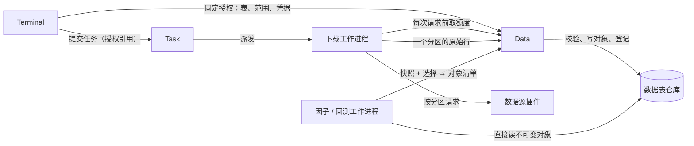

# 全市场数据表：设计

日期：2026-10-11。基线：主目录 `main`，HEAD `e4a6675`。本文是数据层下一阶段的设计依据，
实现进度与验证结果记录在[实施进度](audit-progress.md)。第 1 步（仓库、数据源契约、合约表、
日历、日线、更新任务和界面）已按本文实现，并用真实数据核对过，结果见文末。

## 依据：真实数据试探

2026-10-11 用开发环境的命令接口、应用保存的 Tushare 凭据，在本机开发节点上做了一次真实下载
试探（约 70 次请求，凭据由应用自行读取）。结果分两类：实际观察到的，和由代码推断、尚无直接证据的。

实际观察到的：

| 项目 | 结果 |
| --- | --- |
| 连接验证 | 合约目录、日线、分钟线三项均为已验证 |
| 合约目录 | SHFE rb 217 个合约、CZCE TA 248 个、CFFEX IF 201 个，每次请求约 0.4 秒；商品的每手数量在 `per_unit`，股指的合约乘数在 `multiplier` |
| 日线，SHFE/rb/2025-11（冷门月份） | 成功，243 行，单日成交额最大 48.2 亿元 |
| 日线，SHFE/rb/2025-10、CFFEX/if/2026-09（活跃合约） | 失败：`native plugin operation failed` |
| 日线，CZCE/jr/2026-07、DCE/bb/2026-09（从未成交） | 失败：`native plugin rejected request` |
| 60 分钟线，CFFEX/if/2026-11 | 成功；21 次请求 22 秒，其中 12 次落在周末和节假日，返回 0 行 |
| 1 分钟线，SHFE/rb/2027-09 | 成功；26 次请求 27 秒，3,791 行中只有 206 行有成交；标签是结束时间（10:15 之后是 10:31） |
| 周五夜盘 | 周日 19:20 下载时，10 月 9 日（周五）21:00–23:00 的分钟线没有返回，而存下的版本记为完整到下载时刻 |
| 任务开销 | 提交到工作进程开始运行 1.0–2.7 秒；额度 60 次/分钟时每秒 1 次请求 |
| 失败原因 | 任务记录、工作进程日志、数据服务日志里都只有上面那一句，没有合约、日期或字段 |

由代码推断的：

- 活跃合约失败是成交额溢出。`Decimal` 是 8 位小数的 int64，最大约 922 亿；插件把
  `amount` 从万元换成元后解析（`plugins/data/tushare/tushare.cpp` 的 `decimal(get("amount"), 4)`），
  溢出抛 `std::overflow_error`，不是 `std::invalid_argument`，所以经 `sdk::boundary`
  成为 `AST_FAILED`，正是观察到的那句话。IF 主力每日成交额在 1000 亿元以上，rb 主力放量日
  超过 922 亿元需要约 300 万手，同品种的冷门月份没有问题。
- 无成交合约失败是空值。插件要求开高低收、成交量、成交额、持仓量都有值，数据源在无成交日
  不给开高低价，`text()` 抛 `std::invalid_argument`，成为 `AST_INVALID`，也与观察到的一致。

两条推断都与观察到的错误类别吻合，但当时没有逐行证据：原有接口不让失败说出原因，这本身是要解决的问题之一。
第 1 步实现后读回的真实数据证实了这两条，见文末“真实数据核对”。

## 根本问题

现在的历史数据以“一个合约的一次下载”为单位：请求、任务、目录、版本和读取都按合约组织。
中低频研究需要的是横截面，全市场约 70 个品种、每天约 840 个在市合约、历史上一万多个合约。
这个单位带来的后果不是哪一处的缺陷，而是结构性的：

1. 取数成本与合约数成正比。日线每个合约至少一次请求和一个任务进程；全市场历史是上万个任务。
   而数据源的日线、结算参数等接口可以按交易日和交易所一次返回当天全部合约。
2. 一行不合格，整个下载作废。真实数据里无成交日和大成交额都是常态，5 个合约失败了 4 个。
3. 合约目录和交易日历不落盘。目录只在 Terminal 内存里，日历只在每个工作进程里；
   合约乘数、最小变动价位要用户手填。
4. 每多一种数据都要重复五层。分钟线和日线各有自己的 C 结构、领域类型、Parquet 读写、协议消息和
   仓库代码；结算参数、仓单、成交持仓排名再加三套不可持续。
5. 读取按合约逐个解析，输入整批复制进任务（单个任务最多 200,000 根、20 个合约）。
   全市场面板做不到，这与[目标架构](architecture-design-review.md#历史数据-任务定义-执行尝试需要不同生命周期)
   里“任务通过数据版本身份引用输入”的方向相反。
6. 失败说不出原因。插件边界丢弃全部异常文本以免泄露凭据，结果是连“哪一天哪个合约哪个字段”
   这种不含任何秘密的事实也传不出来。

## 目标与非目标

目标：

- 数据以表为单位：一张表有固定的列、类型和主键，不随数据源变化。
- 下载以“表 × 交易所 × 交易日”为单位，一次请求得到一个分区；更新只取缺少的分区。
- 分区不可变、按内容寻址；每次入库都产生一个可引用的快照，旧快照始终可读，任务可以固定输入。
- 中断、取消或失败不丢已经取到的分区；重新运行只取剩下的。
- 失败能说明是哪张表、哪个交易所、哪一天、哪一行、哪一列、什么问题。
- 新增一张表只需要一份列定义和数据源里的一段映射。

非目标（本设计不做，也不预留空壳）：

- 不做本地 CSV/JSON/Parquet 导入，不伪造或补齐数据；数据源没有的值保持缺失。
- 不做删除、压缩合并和垃圾回收；被新修订取代的分区文件保留。
- 不做定时自动更新；更新由用户发起。
- 不做跨数据源拼接；同一张表的不同来源是互不相干的两个序列。
- 不改分钟线下载。分钟线暴露的两个问题（按自然日请求、按时刻而不是按交易日记完整性）另行设计。
- 不声称数据在历史上何时可知；沿用现有的 `source_availability: unknown`。

## 设计



### 表

表的定义属于领域（`core/domain`），是宿主与数据源之间的契约：表标识、列定义版本、分区周期、
主键列，以及每列的类型和是否可空。类型只有五种：

| 类型 | 含义 | Parquet |
| --- | --- | --- |
| `text` | 非空 UTF-8，不含控制字符，最长 1024 字节 | `VARCHAR` |
| `contract` | 统一合约身份 `交易所/品种/交割年月`，交易所必须等于分区的交易所 | `VARCHAR` |
| `date` | `YYYY-MM-DD` | `DATE` |
| `boolean` | `0` 或 `1` | `BOOLEAN` |
| `decimal(s)` | 精确小数，int64 单位、小数位 `s`，至多 18 位有效数字；超出范围或小数位数的值拒绝，不舍入 | `DECIMAL(18,s)` |

成交额用 `decimal(2)`：以元为单位、保留到分，上限约 1 亿亿元；价格沿用 `decimal(8)`，
与内部 `Decimal` 一一对应；手数用 `decimal(0)`。这解决溢出的根因：不是放宽某一处检查，而是
每一列按它的量纲选精度，成交额不再被塞进为价格设计的类型。

第一批三张表（合约、日历、日线），随后三张（结算参数、仓单、成交持仓排名）：

| 表 | 分区 | 主键 | 列 |
| --- | --- | --- | --- |
| `futures.contracts` | 交易所（整表刷新） | `contract` | 数据源合约代码、名称、上市日、最后交易日、最后交割日、合约乘数、每手数量、交易单位、报价单位、最小变动价位说明、交割方式说明、交易时间说明 |
| `futures.calendar` | 交易所 × 年 | `day` | 是否开市、上一交易日 |
| `futures.daily` | 交易所 × 交易日 | `contract` | 开、高、低、收、结算、昨收、昨结算、成交量、成交额、持仓量、持仓量变化、交割结算价 |
| `futures.settlement` | 交易所 × 交易日 | `contract` | 交易手续费率、交易手续费、平今手续费、交割手续费、买卖投机保证金率、买卖套保保证金率 |
| `futures.receipts` | 交易所 × 交易日 | 品种、行号 | 品种名称、仓库、仓库编号、地区、年度、等级、品牌、产地、折算仓单、昨日仓单量、今日仓单量、增减、单位、升贴水 |
| `futures.rankings` | 交易所 × 交易日 | 合约或品种、会员 | 成交量、持买量、持卖量及各自变化 |

后三张表的列和主键是第 2 步用真实数据定下来的，与动手前的设想不同，原因见“第 2 步”。

除主键外的列一律可空：数据源给了什么就存什么，没给的保持缺失。入库只做结构校验（类型、
精度、主键唯一、合约属于该交易所、日历的日期属于该年）。“最高价不低于最低价”这类行情
合理性不在入库时裁决：一行可疑的数据不应让整个交易所的一天无法入库，也不应被悄悄改掉；
它由使用数据的一方在自己的边界上决定能不能用，并明确报出是哪一行。

合约表保存数据源的原始字段。从 `per_unit`、`multiplier` 和最小变动价位说明推出回测用的
乘数和最小变动价位，是读取方的事，放到回测改读数据表那一步，用真实数据核对后再定。

### 分区、修订与快照

- 一个序列由（表、列定义版本、来源）确定。来源是数据源声明的归一化标识；映射规则变了，
  来源标识就变，成为另一个序列，不与旧数据混在一起。
- 一个分区由（序列、交易所、周期）确定，周期是交易日、年份，或整表。
- 每次入库追加一条登记：序号、分区、内容摘要、对象摘要、行数、取得时间、数据源插件摘要，
  以及快照标识。内容摘要是对规范化后的行算的 SHA-256，与 Parquet 编码无关；对象摘要是文件字节的 SHA-256。
- 同一分区再次入库，内容摘要与当前修订相同则什么都不追加；不同则追加一条新修订。旧修订和它的对象保留。
- 快照标识是一条摘要链：`快照 n = SHA-256(快照 n−1, 登记 n)`。一个快照就是登记的一个前缀；
  在该快照下，每个分区取序号不超过它的最新修订。任务记下快照标识即固定了全部输入；
  仓库被换成另一份历史时，同一标识对不上，读取明确拒绝。

登记用 SQLite（`market` 一词已属于实时行情，仓库目录叫 `tables`）：

```text
<data-directory>/tables/
  ledger.sqlite                      分区登记，只追加
  objects/<前两位>/<对象摘要>.parquet   不可变分区文件，zstd
```

SQLite 提供原子追加和按（序列、交易所、周期）的范围查询，不需要自己处理日志尾部的半条记录，
也不需要在启动时把二十多万条登记读进内存；仓库里已有 SQLite 的用法可循。对象文件经
`durable_file` 先同步临时文件再改名发布。

### 分区粒度

用合成数据比较了四种布局（2,299,148 行，相当于 2010 年至今六个交易所的日线；DuckDB 单线程、
128 MiB，与数据服务里的引擎配置相同；页缓存已热）：

| 布局 | 文件数 | 体积 | 全历史全列 | 近 5 年 6 列 | 一个品种全历史 | 一个合约 | 一天截面 |
| --- | --- | --- | --- | --- | --- | --- | --- |
| 单个文件 | 1 | 59 MB | 120 ms | 82 ms | 8 ms | 3 ms | 5 ms |
| 交易所 × 年 | 105 | 61 MB | 124 ms | 46 ms | 29 ms | 2 ms | 1 ms |
| 交易所 × 月 | 1,917 | 85 MB | 299 ms | 104 ms | 147 ms | 15 ms | 1 ms |
| 每天一个文件 | 4,126 | 108 MB | 441 ms | 162 ms | 311 ms | 39 ms | <1 ms |
| 交易所 × 交易日 | 24,756 | 186 MB | 1,688 ms | 613 ms | 1,364 ms | 194 ms | 1 ms |

最细的布局读完整个历史也只要 1.7 秒（4 线程 0.6 秒），所以粒度按写入的简单和稳妥来定：
交易所 × 交易日。它与一次请求一一对应；分区之间互不依赖，追加不需要读改写；一个交易所的
某一天出问题不影响其他交易所。按月或按年的文件读起来快 4–14 倍，但每天更新都要重写当期文件，
旧版本又不能删，写入路径多出读改写、并发基准和体积放大三件事，换来的是每个任务省不到 1.5 秒。
将来确有需要，可以在不改变“登记前缀即快照”这个模型的前提下把已结束的月份合并，现在不做。

### 数据源契约

新增能力 `asterion.history.tables.v1`（`bindings/plugin/include/asterion/plugin/history_tables.h`）：

- `tables`：声明本插件能提供哪些表、对应的列定义版本、来源标识和交易所。
- `read(表, 列名数组, 交易所, 周期, 取消, 请求额度, 诊断, 回调)`：读一个分区。每行按宿主
  给出的列名顺序交付文本单元格，`NULL` 表示缺失。宿主给列名、插件按名字取值，
  列对不上时插件明确拒绝，不会错位。

单元格是文本而不是定点整数：类型和精度的校验只在宿主一处做，对所有数据源一致，
诊断也在那里生成；插件只负责传输、把供应商字段对到统一的列、换算量纲（万元到元是移动小数点，
不经过浮点）和把供应商代码解析成统一合约身份。

诊断是一个显式回调：读取失败时，插件可以交一句自己写的英文说明，例如
`fut_daily SHFE 2026-10-09: RB2710.SHF is not a listed contract on that day`。它只能由
插件自己的字面量和行情数据里的标识组成；`sdk::boundary` 仍然不让任何异常文本越界，
凭据和供应商返回的报错文本仍然不出插件。失败的类别继续用 `AstStatus` 表达，并决定任务怎么办：

| 状态 | 含义 | 任务 |
| --- | --- | --- |
| `AST_INVALID` | 这个分区的数据不能用（代码对不上、应答结构不对） | 记下这个分区和原因，继续下一个 |
| `AST_PERMISSION`、`AST_LIMIT`、`AST_UNAVAILABLE`、`AST_FAILED` | 这次请求没成（凭据、权限、限流、网络） | 任务失败；已入库的分区保留 |
| `AST_CANCELLED` | 已取消 | 任务取消；已入库的分区保留 |

被拒绝的分区达到 10 个时任务失败：映射规则有系统性错误时，不应把几万次请求额度耗在注定被拒绝的分区上。

### 下载任务与发布语义

这是本设计唯一偏离[目标架构](architecture-design-review.md#历史数据-任务定义-执行尝试需要不同生命周期)
既有约定的地方，单独说明。

现有下载由任务服务裁决发布：工作进程交出候选产物，数据服务校验并保管，任务服务持久记下
发布决定，数据服务据此公开版本，然后任务才算成功。这套过程保证“任务成功”与“版本可见”
恰好一次地绑定在一起，适合“一次下载产出一个版本”。

数据表更新不沿用它，改为：**数据服务在校验通过时就发布每一个分区，任务只是驱动取数的过程。**

- 工作进程每取到一个分区，就把原始行交给数据服务；数据服务校验、写对象、追加登记，
  这个分区随即对读取可见。任务的结果只是一份摘要：入库多少、未变多少、被拒绝的分区及原因、
  数据源没有返回数据的分区，以及结束时的快照。
- 取消和失败不撤回已经入库的分区。架构评估把“已完成分段如何保存”留给了数据业务，这里的
  定义是：已校验的分区就是已发布。
- 任务状态没有“发布中”：排队、运行、成功、失败、取消、中断，与计算任务相同。

为什么可以不要发布决定：分区入库是幂等的（同样内容不产生新修订）、按内容寻址、互不依赖，
可见与否不取决于任务是否成功，所以没有“任务成功 ⟺ 版本可见”需要保证。一个已经失效的
尝试（租约过期后进程还活着几秒）多交一个分区，交的也是按同一授权从数据源取到、经同样校验的
数据，结果与有效尝试交的相同。

为什么不沿用：一次全市场回补是几万个分区、几个小时。作为单个候选，它要么全有要么全无，
校验几万个文件要在一次 RPC 里完成，中途断一次网就要从头再来，完成之前仓库里什么都看不到；
拆成许多个小任务可以缓解，但拆分和编排会落到客户端，任务中心里一次操作变成几百条记录。

保留不变的：凭据仍由数据服务在授权时固定、工作进程按尝试身份从私有通道领取；每次外部请求
前仍向数据服务取共享额度；任务仍固定数据源插件的摘要；交分区只在私有工作通道上接受，
并且要求该尝试已由任务服务领取（有分配记录）。数据服务仍是历史数据的唯一发布者。

### 更新计划

任务定义：数据源、要更新的表、起止日期、请求速率。起始日期可以为空，表示“接着已有的往后取”；
结束日期可以为空，表示“到上海时间已经结束的最后一个日期”。计划在任务运行时由数据服务计算，
因为它依赖运行时才取到的日历。任务服务在提交时就要定下任务的总工作量，并且恢复时要能只凭
固定输入重新算出同一个数，所以这类任务的总量固定为 100，进度按百分比报告：

1. 引用数据先行，分两步，后一步依赖前一步入库的内容：先取每个交易所的合约表（每次都取，
   新合约每天都可能上市）；再取日历，从该交易所最早上市日所在的年份起，取范围内缺少的年份，
   以及不早于今年的年份（未来的休市安排会变）。内容没变就不产生新修订。
2. 对每个（表、交易所），待取的是范围内、日历上开市、不早于该交易所最早上市日、上海时间
   已经结束、且尚未入库的交易日。起始日期为空时，从该（表、交易所）已入库的最后一天之后开始；
   还没有任何数据的（表、交易所）不参与，并在结果里说明需要给出起始日期。
3. 数据源对一个分区返回 0 行时不入库、不登记，在结果里列为“数据源未返回数据”。
   0 行可能只是数据源尚未发布，记成“空”会让它再也不被请求。

只请求已经结束的日期，是现有“下载后续数据”的规则，这里沿用。代价是当天的数据要到次日才取；
好处是不会把数据源只发布了一半的一天当成最终结果存下来。当天临时分区、对已入库分区的重新取数
都没有实现，列在未实现事项里。

### 读取

本阶段提供浏览所需的读取：覆盖情况（每个表每个交易所的起止、已入库交易日数、相对日历缺少的
交易日、最近取得时间、当前快照）和分区内容分页。

因子和回测改读数据表是下一步：任务输入里的选择是“快照 + 品种或合约 + 日期范围”，由数据服务
解析。这一段最初写的是“工作进程直接读 Parquet、任务服务只保管引用”，第 3 步动手前对照
[实施记录](architecture-implementation.md)发现它与已经定下并实现的计算输入方式相反，实际采用的
做法和理由见“第 3 步”。

## 备选方案

| 方案 | 结论 |
| --- | --- |
| 本设计：只追加的分区登记，校验即发布，通用的表与文本单元格 | 采用 |
| 修补按合约的仓库：放宽空值、加宽成交额，在原生层把“全部合约”展开成任务 | 不采用。请求和任务数仍与合约数成正比；按合约的文件回答不了截面查询；目录和日历仍不落盘；新增三种数据要再写三套五层代码 |
| 沿用候选—决定—发布，把更新作为一个或多个候选 | 不采用，理由见“下载任务与发布语义” |
| 把仓库做成一个 DuckDB 数据库文件 | 不采用。单个可变文件没有不可变的版本身份，损坏波及全部数据，写入时其他进程不能读 |
| 每个表一套专用的 C 结构、领域类型、Parquet 读写和协议消息 | 不采用。六张表的生命周期完全相同，只有列不同；专用结构还把精度固定在 ABI 里，成交额的问题会再出现 |
| 插件交付定点整数，由插件解析数值 | 不采用。校验和诊断会散在每个数据源里，各自一套 |
| 按月或按年分区 | 现在不采用，见“分区粒度” |

## 交付步骤

1. 仓库、数据源契约、合约表、日历、日线，更新任务，界面上的覆盖情况、更新和分区浏览。
2. 结算参数、仓单、成交持仓排名（这三个接口单次返回有上限，需要翻页；翻页的行为要用真实数据核对）。
3. 因子读数据表：按品种或合约选，主力序列从表里解析（已完成；仍是 1 个或 3–20 条序列、只取
   共有的交易日）。随后让因子在数据表上一次评价全部品种：每个交易日用当天有数据的品种。
4. 回测改读数据表：合约参数和费用来自数据。完成后删除按合约的日线下载、合约目录命令和
   `asterion.history.v2` 里的 `catalog`、`daily`，只留一种实现。
5. 分钟线：按返回行数上限分页、跳过非交易日、按交易日记完整性。

第 1–3 步期间，按合约的日线下载仍然存在，因为回测的 K 线输入还读它（因子的 K 线和日线版本两种
来源也还在）；它在第 4 步删除。这是分步交付中的过渡状态，不是保留的备用实现。

## 真实数据核对

2026-10-11 第 1 步实现后，仍然经应用自己的路径、用应用保存的凭据，在本机开发节点上更新了
2026-09-28 至 2026-10-09 的日线（5 个交易日 × 6 个交易所）以及合约表和 2026 年日历。
每一轮 42 次请求；映射规则根据看到的数据改了两次，所以一共跑了三轮。最后一轮新入库 30 个分区、
12 个没有变化，没有被拒绝的分区。

| 事项 | 看到的 |
| --- | --- |
| 合约表 | 六个交易所共 10,950 个合约：SHFE 3,593（最早上市 1995-04-17）、DCE 3,241 与 CZCE 2,889（1999-01-04）、CFFEX 692（2010-04-16）、INE 396（2018-03-26）、GFEX 139（2022-12-22） |
| 交易日历 | `trade_cal` 接受全部六个交易所；2026 年 365 行、242 个开市日 |
| 日线 | 每个交易日 852 个合约：CZCE 243、SHFE 238、DCE 232、INE 63、GFEX 48、CFFEX 28 |
| 成交额 | 4,260 行全部是整数元。2026-10-09 一天就有 10 个合约超过 8 位小数 int64 的上限（922 亿）：IM2612 2,841 亿、AU2612 1,863 亿、IC2612 1,639 亿、IM2610、MA2611、TL2612、SC2611、RU2701、T2612、IF2612 |
| 没有竞价成交的合约 | 5 天里 571 个合约日没有开、高、低价。上期所、能源中心的数据源给空值；郑商所、大商所、广期所给 0。其中 8 个合约日有成交量却没有开高低价（大商所、广期所，交割月和期转现的非竞价成交） |
| 身份表示不了的代码 | 大商所 45 个月均价期货（`L2605F.DCE` 等），能源中心 84 个结算价交易代码（`SCTAS2102.INE` 等） |
| 合约参数 | 商品的每手数量在 `per_unit`，金融期货的乘数在 `multiplier`；鸡蛋的 `per_unit` 是 5（吨）而报价单位是元/500 千克，乘数不能由 `per_unit` 直接得出 |
| 请求额度 | 数据服务重启后的第一个完整窗口不发放额度，更新开始后先等了约 70 秒，之后 42 次请求用了约 30 秒（每分钟 60 次） |

据此定下并实现的映射规则：

- 数据源的开、高、低、收为 0 表示没有这个价格，存为缺失。这些市场没有为 0 的价格；与成交量是否为 0 无关。
- 代码不是“一到三个字母加三到四位数字”的行不入库：数据源自己编的主力、连续代码，以及统一合约
  身份还表示不了的月均价期货和结算价交易代码。合约表读取时把被排除的个数和例子写进日志
  （`contracts.outside_identity`）。月均价期货是真实的合约，表示它需要扩展合约身份，另行处理。
- 日线的来源标识是 `tushare.fut_daily.v3`：前两版规则只存在于这次核对，开发节点的仓库里留有它们
  各 5 天的分区，界面不显示，也不会与 v3 的数据混用。

仍未核对的：

- 回补多年历史时是否还有别的数据形态。第 2 步抽查了 1996–2024 年的 10 个交易日（见下），
  日线在这些日期上没有被拒绝的分区，每一行的合约都在当天在市；抽查之外的日期没有看过。
- 按交易日查询的应答里主力、连续代码实际有多少（被跳过的行不入库，从已入库的数据看不出来）。

## 第 2 步：结算参数、仓单日报、成交持仓排名

三张表在动手前只有一行设想（上面表格的旧版本：结算参数含结算价，仓单以“品种、仓库”为主键）。
真实数据否定了其中两处，也暴露了第 1 步的一个缺陷。

### 结算参数：按发布的口径保存，不含结算价

- **不换算单位。** 六个交易所的口径不同（上期所、能源中心的费率是千分比、手续费是每手金额，
  二者只有一个不为 0；郑商所、大商所、广期所只有一个数；中金所两列是同一个数，保证金率是
  百分数），而且后四家的那个数是每手金额还是成交额比例，数据里没有任何字段说明：大商所的豆粕
  和鸡蛋都是 1.5，铁矿石和聚丙烯都是 1。
  备选是由数据源插件换算成统一口径（费率一律为成交额的小数、手续费一律为元每手）。不采用：
  对四家交易所这需要一张“品种按哪种方式收费”的表，数据源不提供；凭数值大小猜会把错的数悄悄
  存成看起来统一的数。原样保存加上文档里的口径表，至少每个数都能对回交易所的公告。
- **不含结算价。** 接口里的结算价与日线表的结算价逐行相同（2026-10-09 五个交易所 824 行，
  中金所为空）。两处各存一份就有了两个来源，只留日线表里的。
- **只含当天在市的合约。** 中金所的回答混有已摘牌的合约（2026-10-09 的 56 行里 28 行）。
  规则是“合约在当天的上市日与最后交易日之间”，被排除的行数记在数据源日志里
  （`settlement.unlisted_contracts`）。
- 表名保留 `futures.settlement`。去掉结算价后曾改名为 `futures.parameters`，但开发节点的任务库里
  已有按原名提交的更新任务，任务库恢复时逐个校验输入，会因为不认识的表名拒绝整个任务库。
  这是既定的拒绝规则，不为它加兼容；名字对应交易所的“结算参数表”，本身也说得通。

### 仓单日报：报表的行，不是有主键的表

最初的主键是（品种、仓库），第一次取数就在三个交易所撞上重复：同一个仓库下按等级、品牌、
年度、地区分行。于是把这些属性都加进主键、允许缺失，并在领域层加了“可缺失的主键列”这个概念
（排序时空值在前，Parquet 里可空）。郑商所仍然重复：839 行里有 159 行在数据源给出的全部属性上
相同。再加一个“第几次出现”的序号才能入库。

到这一步，一个 10 列的主键加一个序号，说明模型错了：仓单日报是一份报表，不是关系表。改为：

- 主键是（品种、行号），行号是数据源返回的顺序里该品种的第几行；其余全是普通列，可以缺失。
- “可缺失的主键列”这个概念撤掉，领域层和 Parquet 读写回到第 1 步的样子。

代价是行号不跨日期：消费方按自己关心的属性汇总，不能按行号对齐两天的数据。这本来就是事实
——无法区分的行在两天之间也对不上——只是旧模型把它藏在了序号里。

备选是入库前把无法区分的行合并（数量相加）。不采用：同组的行升贴水可以不同（玻璃厂库的两行
一行为空、一行为 0），合并要么丢信息要么要再发明规则；而且存下的就不再是交易所发布的行。

### 成交持仓排名：一列表示合约或品种

`instrument` 是文本列，值是合约（`SHFE/cu/2026-11`）或品种（`SHFE/cu`）。备选是分成“合约”
“品种”两列、合约可空，那又需要可缺失的主键列；或者分成两张表，多一张表而两者的列完全相同。

数据源对品种的写法有四种（只有字母、中文名加字母、`PTA`、字母加 `ACTV`），都解析为品种。
没有见过的写法**拒绝整个分区并列出这些写法**，而不是跳过：跳过会在数据源换写法时悄悄存下
不完整的一天。期权（中金所的 `IO`）和上期所回答里的能源中心品种不属于这一类，它们是认得出、
按规则不要的，跳过并记日志。

### 郑商所代码的年代

第 1 步假定数据源会把郑商所的三位代码原样给出、十年后重复，并为此写了“同一个代码取当天在市的
那个”。真实的合约表里代码全部是四位、没有一个重复，这条规则从未生效。真实的问题在另一头：
数据源补年代时个别接口补错了（2019-06-17 的结算参数把 2020 年 3 月的苹果合约写成 `AP1003`）。
苹果没有 2010 年的合约，所以那个分区被拒绝；对有 2010 年合约的品种（例如棉花），同样的错误
按原规则会被静悄悄地对到十年前的合约上。

现在的规则：代码按合约表精确匹配；郑商所的代码在当天没有对应的在市合约时，取“字母和后三位
数字相同、当天在市”的合约。合约表里字母和后三位相同的合约有 622 组，上市期间互不重叠，所以
这样的合约至多一个。第 1 步那条规则和它的测试删除。

### 更新计划的缺陷：起始日期早于交易所成立

第 1 步的计划在一步里同时取合约表和日历，日历的年份从起始日期算起。起始日期早于某个交易所成立
时（例如从 2019 年回补，而广期所 2022 年才成立），计划会去取“广期所 2019 年的日历”，数据源
返回 0 行，任务按“引用数据读不到”失败。第 1 步只核对了最近 5 个交易日，没有发现。

修正是把引用数据分成两步（见“更新计划”）：先入库合约表，日历的年份从该交易所最早的上市日起算。
没有采用“日历返回 0 行就跳过”：那会把“数据源缺了某一年的日历”也变成悄悄少取一年。

### 真实数据核对（第 2 步）

2026-10-11，同样经应用自己的路径。先在 2026-10-09 上把三张表的规则跑通（规则改了几轮），再抽查
10 个更早的交易日：1996-06-17（只取日线）、2010-06-17、2012-06-15、2015-06-15、2017-06-15、
2019-06-17、2021-06-15、2022-12-23、2023-06-15、2024-06-17，四张按日的表全取。最后的结果是
没有被拒绝的分区。各表入库的行数（日线 / 结算参数 / 仓单 / 排名，`-` 表示数据源返回 0 行）：

| 交易日 | SHFE | INE | DCE | CZCE | CFFEX | GFEX |
| --- | --- | --- | --- | --- | --- | --- |
| 1996-06-17 | 11/-/-/- | | | | | |
| 2010-06-17 | 93/-/-/772 | | 73/-/34/856 | 54/-/-/960 | 4/-/-/62 | |
| 2012-06-15 | 114/-/-/783 | | 85/85/42/1011 | 63/63/-/1129 | 4/-/-/59 | |
| 2015-06-15 | 159/-/165/1205 | | 161/161/43/1423 | 134/134/-/1313 | 18/18/-/324 | |
| 2017-06-15 | 161/-/205/1049 | | 164/164/46/1457 | 134/134/-/1246 | 18/-/-/211 | |
| 2019-06-17 | 174/-/212/1421 | 20/-/8/- | 178/178/68/1837 | 154/154/758/2106 | 21/21/-/338 | |
| 2021-06-15 | 186/186/250/1976 | 56/56/43/191 | 219/219/96/2629 | 198/198/758/3153 | 21/21/-/412 | |
| 2022-12-23 | 190/190/262/1992 | 56/56/48/219 | 220/220/100/2511 | 198/198/604/3458 | 25/-/-/463 | 5/-/-/- |
| 2023-06-15 | 190/190/260/2333 | 56/56/48/324 | 220/220/97/2709 | 198/198/770/3346 | 28/-/-/597 | 8/8/-/- |
| 2024-06-17 | 214/214/300/2367 | 62/62/57/351 | 219/219/136/1864 | 223/223/837/2978 | 28/28/-/569 | 24/24/58/181 |
| 2026-10-09 | 238/238/360/2459 | 63/63/48/234 | 232/232/191/3023 | 243/243/839/3438 | 28/28/-/661 | 48/48/83/286 |

对这些入库的数据核对过的：

- 日线和结算参数的每一行，合约都在当天在市；结算参数入库的分区，合约集合都与当天的日线相同。
- 排名里合约级的行，合约都在当天在市。

抽查暴露并已处理的数据形态：2023 年郑商所排名的品种写作 `尿素UR`；2015 年上期所排名有
`CUACTV` 这样的“活跃合约合计”；2019 年郑商所结算参数的年代补错；中金所结算参数混有已摘牌合约；
上期所把国际铜的仓单列在铜的名下。

数据源的覆盖并不完整，这不是规则能补的：结算参数在上期所、能源中心从 2021 年的抽查日才有，
中金所断断续续；仓单日报在郑商所从 2019 年、上期所从 2015 年的抽查日才有；广期所的仓单和排名
到 2024 年的抽查日才有；能源中心的排名从未包含原油。

这一步经应用发出的请求约 450 次，加上第 1 步的约 200 次，当天合计约 650 次。

仍未核对的：

- 抽查之外的日期。回补时遇到没见过的写法会拒绝该分区并说明，达到 10 个分区时任务失败，
  需要补规则后再跑。
- 翻页时数据源返回的顺序是否稳定。排名的主键重复会被发现并拒绝；仓单的行号直接取自顺序，
  顺序变了无从发现。
- 结算参数各列的单位是否在整个历史上保持不变；上面的口径表只来自抽查日。
- 能源中心没有原油排名的原因。

## 第 3 步：因子读取数据表

### 沿用已有的计算输入方式

第 1 步的“读取”一节曾写：任务输入只保管“快照 + 选择”的引用，工作进程核对摘要后直接读 Parquet。
动手前对照[实施记录](architecture-implementation.md)的“再核对：计算 worker 的数据读取边界”，
这与已经比较过并实现的方式相反。那里比较了两种设计：

- 任务服务只保存选择引用，验收和以后核对结果时再去读数据服务。重复的持久数据少，但已完成结果的
  校验证据从此依赖数据服务在线。
- 任务服务继续保管已接纳的不可变输入；领取时只交给工作进程一份小的执行定义，工作进程按固定的
  版本从数据服务重读、重建输入，摘要必须等于提交时固定的输入。

采用的是第二种，回测和因子的现有三种来源都这样工作。数据表不构成推翻它的理由，所以第 3 步
照此实现，并更正了那一节：

- 数据服务把请求解析成**序列**（每个月份在主力期间的收盘价、换月日程、期限结构点），不是分区
  清单。固定输入里只有序列用到的收盘价：20 个品种 10 年约 5 万个，约 1 MB；不是整张日线表。
- 请求自带快照标识，所以工作进程重读时得到完全相同的字节，不需要像按 K 线的主力连续那样把
  已固定的换月日程另行带给工作进程。
- 工作进程仍然不打开数据服务的目录。数据服务是它的仓库唯一的读者和写者。

没有采用的做法：

| 做法 | 为什么不 |
| --- | --- |
| 工作进程直接读 Parquet 对象 | 要给工作进程链接存储库并交给它数据目录的路径，仓库从一个读者变成几个；而数据服务解析 12 个品种只要约 0.1 秒，没有需要绕开它的性能问题 |
| 任务服务只保管快照和选择 | 见上：改变已完成结果的保管边界，与现有三种来源不一致 |
| 把数据表序列塞进现有的 `BarDataset` | 它带合约乘数和最小变动价位，而数据表里没有可靠的这两个值（见“真实数据核对”），只能编造 |
| 每个品种一次请求 | 20 个品种要把同一批分区读 20 遍。一个请求带全部品种，一个交易所的分区只读一遍 |

### 读取的效率

提交任务时任务服务要在 30 秒内从数据服务取得固定输入，所以读取必须快。逐个分区读（每个文件
一次查询）在合成数据上是每个分区约 1.7 毫秒，10 年一个交易所约 4 秒，六个交易所会逼近期限。
改为一个交易所的全部分区用一次查询读完（只取四列、只取所要品种的行），600 个分区从 1005 毫秒
降到 57 毫秒（Debug 构建，每天 240 个合约）。每个文件仍先核对摘要。

### 范围内不允许有洞

范围内哪些天应当有数据，以同一快照下的交易日历为准；缺任何一天就拒绝并列出日期。备选是只读
已入库的日子：那样缺一天时“前一交易日的持仓量”会悄悄取到更早的一天，换月日和收益都会不知不觉
地错位。日历和日线的来源标识都由请求给出，解析只依赖仓库在该快照下的内容，不看当前装了哪些
数据源插件。

### 主力规则的一处区分

换月规则抽成了只读“各月份每天的结算价和持仓量”的函数，按 K 线和按数据表两条路径共用。真实数据
带出了一处需要区分的地方：郑商所粳稻各月份的持仓量都是 0，2026-09 合约到最后交易日
（2026-09-14）仍排在主力的位置上，次日它已经没有行情，原规则以“换月当天旧月份没有 K 线”拒绝。那条要求是为回测定的（旧月份的持仓要在换月日
平掉）；只读收盘价的序列不需要它，次日直接换到后续月份并不需要猜任何东西。于是规则多了一个
参数：要交易的序列要求旧月份在换月日有结算价，只读的序列不要求。没有采用“一律拒绝”：全市场
的品种里总有不活跃的，一个这样的品种会让整批请求失败。

第 4 步回测改读数据表时，这个问题会以另一种形式回来：要交易的主力连续必须在旧月份到期前换月，
那是换月规则本身要解决的事，这里没有预先处理。

### 真实数据核对（第 3 步）

2026-10-11，经应用补取了 2026-08-03 至 2026-10-09 的日线（39 个交易日 × 6 个交易所，234 次
请求，约 5 分钟），连同此前已有的 5 天共 44 个连续交易日。然后经应用的命令接口提交因子任务：

| 事项 | 看到的 |
| --- | --- |
| 品种列表 | 六个交易所的合约表里共 94 个品种，其中 87 个在整个范围内都有合约在市 |
| 全部 87 个品种 | 分 5 批（每批至多 20 个）读成主力连续，全部成功；每个品种 43 个观测（44 个交易日，第一天不算），读取的月份数 1 个的 5 个品种、2 个的 51 个、3 个的 29 个、4 个的 2 个 |
| 螺纹钢 | 2026-08-04 起主力是 2610，2026-08-31 换到 2701，复权比例 1.01350917 |
| 12 个品种的截面 | 价格动量、期限结构、波动率各一次，都成功；提交约 0.12 秒返回，到出结果约 2 秒 |
| 期限结构点 | 87 个品种里 86 个每天都有，菜籽（CZCE/rs）有 41 天 |
| 拒绝 | 范围起点提前到没有入库的 2026-07-27：`futures.daily is missing trading days of the range: SHFE 2026-07-27 2026-07-28 2026-07-29 2026-07-30 2026-07-31`；不存在的品种、单个合约上的期限结构、两个品种的截面各有准确的拒绝说明 |
| 界面 | 在浏览器开发入口里从「研究 → 因子 → 全市场数据表」选 5 个品种提交并打开了一份结果 |

仍未核对的：

- 多年的范围。44 个交易日里没有出现缺少结算价、无法计算复权比例的换月；更长的范围里是否出现、
  频率如何，没有数据。
- 数据源对没有成交的合约也给出收盘价，数值等于结算价（粳稻各月份成交量、持仓量都是 0，
  每天的收盘价和结算价都是 2662）。这样的日子也算一个观测；序列价格不动时因子值没有差别，
  统计量为空。日线表按发布的样子保存，没有把“无成交的收盘价”另作标记。
- 解析的耗时只在 44 天上量过；10 年的范围用合成数据推算，没有实测。
