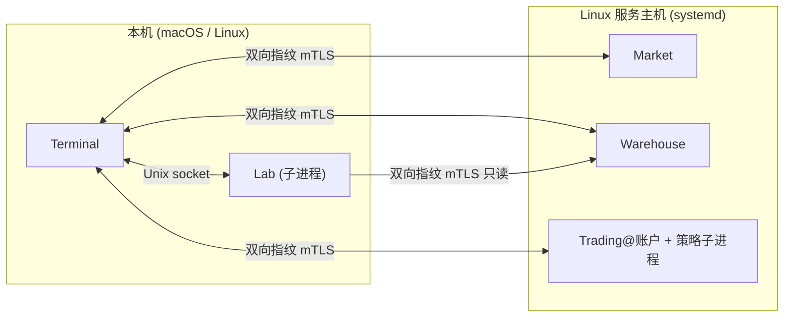

# 服务与部署

部署单元有三类：本机的 Terminal 和 Lab，Linux 上独立部署的 Market 和 Warehouse，以及 Linux 上每个账户一个的 Trading（含策略子进程）。Market、Warehouse 和 Trading 有各自的安装和生命周期，不属于任何客户端。

## 本机 Lab

Lab 是 Terminal 的子进程（`apps/clients/terminal/native/lab_supervisor.*`）：

- 每次启动 Terminal 时在启动画面里启动，没有启停按钮；退出或持续心跳失败后自动重启。
- Lab 以 `--owner-pid` 观察 Terminal，Terminal 退出（包括强杀）后随之退出；关闭 Terminal 不影响 Market、Warehouse 或 Trading。
- 使用首次启动安装的 Python 运行时以 `python3 -I -B -m asterion_lab` 运行；开发与测试通过 `ASTERION_PYTHON` 指定解释器。
- 一个根目录同时只能运行一个 Terminal（`terminal/data/services.lock`）。

## 远程服务

| 服务 | 安装包与目录 | systemd 单元 | 说明 |
| --- | --- | --- | --- |
| **Market** | `Asterion-Market-<版本>-linux-x86_64.sh` → `/opt/asterion/market` | `asterion-market.service` | 单独行情账户，不含下单代码，见[部署](market/deployment.md) |
| **Warehouse** | `Asterion-Warehouse-<版本>-linux-x86_64.sh` → `/opt/asterion/warehouse` | `asterion-warehouse.service` | 历史采集与统一仓库，不连柜台，见[部署](warehouse/deployment.md) |
| **Trading** | `Asterion-Trading-<版本>-linux-x86_64.sh` → `/opt/asterion/trading` | `asterion-trading@<账户>.service` | 每账户一进程，自带离线 Python 运行时；升级前先停全部账户，见[部署](trading/deployment.md#安装与账户配置) |

- 三个服务都以执行 `sudo` 的普通账户运行，凭据为 systemd 加密凭据，启动时自动登录柜台；Trading 重启不恢复授权。
- 安装和升级先核对主机时钟已同步（`timedatectl` 的 `NTPSynchronized`），未同步时拒绝继续；各服务为什么依赖时钟见各自的部署文档。
- Terminal 只是客户端：不安装、启动、升级或备份远程服务。

## 连接

- 本机：Unix socket，位于每次运行私有的 `/tmp/ast-<实例>/`。
- 远程服务：双向固定证书指纹（SHA-256）TLS，双方自签证书，只接受事先登记的对方指纹（同机部署亦然）。
- 断线后重新连接并读取服务端状态；交易命令不自动重发。
- 状态栏显示行情、研究、数据和各 Trading 账户状态；读取中断或服务停滞进入通知中心，账户页保留上次状态并标失联。

## 桌面安装与升级

Terminal 发布包带有 Terminal 和 Lab：macOS 将 `.dmg` 拖入“应用程序”，Linux 用 apt 安装 `.deb`，见[发行](development.md#发行)。升级前等研究结束并关闭 Terminal；卸载只删程序，保留用户资料。

本机数据目录：macOS `~/Library/Application Support/Asterion`，Linux `~/.local/share/asterion`。

## 备份与恢复

只支持**冷备份**：先停止资料拥有者，再复制文件。

| 目标 | 备份前停止 | 需复制路径 | 注意事项 |
| --- | --- | --- | --- |
| 本机 | 等待研究结束，关闭 Terminal 并确认 Lab 退出 | 本机根目录 | `lab/data/lab/warehouse-cache/` 可从 Warehouse 重下，不必备份 |
| Market 主机 | `asterion-market.service` | `/opt/asterion/market/`（配置、TLS 身份） | — |
| Warehouse 主机 | `asterion-warehouse.service` | `/opt/asterion/warehouse/` 与 `warehouse.json` 中 `data` 目录 | `data` 位于其他磁盘时须单独复制；恢复时回到原路径或更新 `data` |
| Trading 主机 | 全部账户实例 | `/opt/asterion/trading/`（账本及 `archives/`、策略包、实例记录）与账户归属目录 | 停止服务不等于撤单；恢复后须重新授权 |

- 加密凭据绑定原主机，不包含在安装目录内；换机恢复时须在新主机重新录入凭据。
- 恢复到原绝对路径，先核对配置和凭据再启动；程序读不懂记录格式时明确失败，不改库绕过。
- 三个 Linux 服务均随安装包内置统一冷备脚本 `/opt/asterion/<服务>/bin/cold_backup.py`（源码位于 `scripts/services/cold_backup.py`，纯标准库 Python 3）执行 `backup`、`verify` 与 `restore`：
  - `backup --service <market|warehouse|trading> --output <归档.tar.gz>`：检查对应 systemd 单元已停止并抢占服务锁（`market.lock`、`warehouse.lock`、Trading `.program.lock` 及账户归属锁），备份前运行 SQLite `PRAGMA integrity_check`（含未合并 `-wal` 侧文件时的隔离副本校验），自动识别 `warehouse.json` / `market.json` 指向的外部 `data` 目录、保留硬链接（如 Warehouse 研究层与来源层共享的 Parquet）与 TLS 私钥权限，生成含逐文件 SHA-256 清单的归档及 `.sha256` 伴随校验文件。
  - `verify --archive <归档.tar.gz>`：核对整包 SHA-256、逐文件 SHA-256、SQLite 完整性及 Warehouse 全部保留版本/分片/分区 SHA-256。
  - `restore --archive <归档.tar.gz> [--target-install-dir ...] [--target-data-dir ...] [--owner <服务用户>]`：先通过完整 `verify` 再写盘并复核落盘 SHA-256，按服务用户恢复属主并将 `config/`、`data/` 目录收紧为 `0700`；目标目录非空默认拒绝，`--force` 覆盖前会清理旧配置与残留 SQLite `-wal`/`-shm`；Trading 迁移到非原路径因 `owners/*.json` 绑定规范路径默认拒绝，显式 `--allow-relocate` 会同步改写 `owners/*.json` 中的规范路径；Warehouse/Market 数据目录变更时自动更新配置中的 `data` 路径。

## 运行日志

每个程序默认在安装目录的 `logs/` 下按日写入日志，保留 30 天。输出由各自的 `config/logging.json` 配置，完整默认文件见[配置文件](configuration.md)。

- `level` 可为 debug、info、warning、error；`file.path` 相对 `bin/`，可用 `{program}` 和 `{pid}`；控制台和文件可分别设置 `pattern`。默认 `[%Y-%m-%d %H:%M:%S.%e %z] [%l] [%n] [%s:%#] %v` 输出带方括号的时间、时区、级别、程序名和调用处文件名/行号，最后是消息。`%s` 是文件名，`%#` 是行号；时区偏移用于对齐不同主机的日志。C++ 使用 spdlog 格式，Lab 支持这里列出的格式符。
- 配置有缺键、多余键或无效值时程序启动失败并报告文件和键；没有这个文件时只写到标准错误。修改后重启生效。
- 日志是自由文本，密码、令牌、授权码和凭据不得写进日志。
- 桌面通过通知中心的“打开本机日志目录”打开本机程序根目录，再进入对应程序的 `logs/`。Market、Warehouse 和 Trading 的日志保存在各自服务主机。

### 崩溃诊断

- Linux Market、Warehouse、Trading 崩溃后，由随包提供的独立解析器自动生成安装目录 `logs/*-crash.report.log`，包含版本、提交、信号、函数名和源码行号。文件名使用 UTC 启动时间（毫秒）和 PID；报告分别记录启动时间和实际崩溃时间，补解析保留原始时间。现场只保留一份 `*-crash.frames`，函数名和源码行号统一由解析器生成。若解析被系统关停打断，下次服务启动会补齐同次构建的待解析报告。Trading 仍需重新授权。
- Lab 捕获的异常在日常日志中保留 Python traceback；解释器启动错误、线程未捕获异常和原生扩展崩溃写入 `lab/logs/python-*.log`。回测子进程的标准错误保留在 Lab 的失败记录中。
- Trading 策略子进程的 traceback 和解释器崩溃信息写入服务的 `logs/strategy-*.log`，服务日志记录实例与文件的对应关系。
- Terminal 的 JavaScript 异常堆栈及子进程退出原因写入 `terminal/logs/electron-*.log`；主进程未捕获异常后退出。
- macOS 和 Linux 桌面的原生崩溃保存在 `terminal/logs/crashes/`。下次打开 Terminal 时自动生成 `*.dmp.report.log`：先使用随包符号输出全部可恢复栈帧，再后台从 Electron 官方符号服务器补充 Chromium 符号。解析不阻塞工作台，转储不上传。

解析工具随安装包提供，无须手动安装调试器。桌面按模块标识缓存符号，升级后仍保留旧版本符号。网络不可用或闭源库缺少符号时，文本报告标明缺失模块，相关帧保留模块名和地址；下次启动继续尝试补全。Release 保留行号信息，前端携带 source map；原始现场和转储同时保留，排查完成后可删除。

崩溃现场只做安全采集，符号解析在独立进程或下次启动进行。Sanitizer 构建保留自身的错误报告。`SIGKILL`（包括系统强制杀进程）不能被进程捕获，这类退出从宿主进程或系统日志查看。
