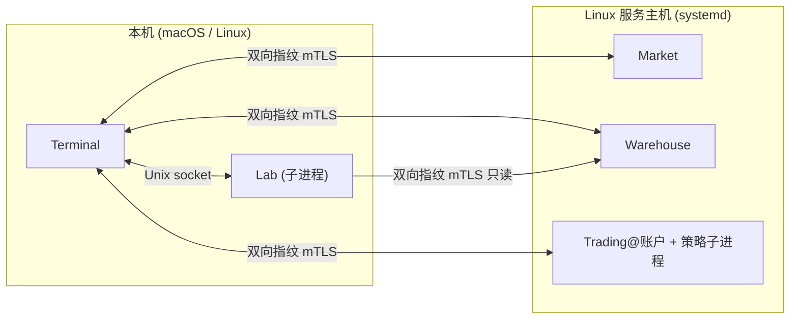

# 服务与部署

系统包含三类部署单元：本机的 Terminal 与 Lab、Linux 主机上独立运行的 Market 与 Warehouse，以及 Linux 主机上每账户独立的 Trading（含策略子进程）。三类远程服务各自独立安装和运行，不隶属于任何客户端。

## 本机 Lab

Lab 是 Terminal 看护的本机子进程（`apps/clients/terminal/native/lab_supervisor.*`）：

- 随 Terminal 启动，在启动画面阶段完成就绪检查，不设手动启停按钮；意外退出或持续心跳失败后自动重启。
- 通过 `--owner-pid` 监听 Terminal 存活状态，Terminal 退出（包括被强制终止）后 Lab 随之退出；关闭 Terminal 不影响远程 Market、Warehouse 或 Trading。
- 使用首次启动安装的独立 Python 运行时，以 `python3 -I -B -m asterion_lab` 运行；开发与测试通过 `ASTERION_PYTHON` 指定解释器。
- 同一本机根目录同时只允许运行一个 Terminal（通过 `terminal/data/services.lock` 互斥）。

## 远程服务

| 服务 | 安装包与目录 | systemd 单元 | 说明 |
| --- | --- | --- | --- |
| **Market** | `Asterion-Market-<版本>-linux-x86_64.sh` → `/opt/asterion/market` | `asterion-market.service` | 独立行情账户，不含下单代码，见[部署](market/deployment.md) |
| **Warehouse** | `Asterion-Warehouse-<版本>-linux-x86_64.sh` → `/opt/asterion/warehouse` | `asterion-warehouse.service` | 历史采集与统一仓库，不连接柜台，见[部署](warehouse/deployment.md) |
| **Trading** | `Asterion-Trading-<版本>-linux-x86_64.sh` → `/opt/asterion/trading` | `asterion-trading@<账户>.service` | 每账户一进程，随包携带离线 Python 运行时；升级前须停止全部账户，见[部署](trading/deployment.md#安装与账户配置) |

- 三个服务均以执行 `sudo` 的普通用户运行，凭据以 systemd 加密凭据保存在主机；Market 和 Trading 启动后自动连接柜台，Warehouse 不连接柜台，Trading 重启不恢复授权。
- 安装与升级前先检查主机时钟已同步（`timedatectl` 的 `NTPSynchronized` 为 `yes`），未同步时拒绝继续；各服务对时钟同步的依赖原因见各自的部署文档。
- Terminal 仅作为客户端，不负责安装、启动、升级或备份远程服务。

## 连接

- **本机**：Unix socket，位于每次运行私有的 `/tmp/ast-<实例>/`。
- **远程服务**：双向固定证书指纹（SHA-256）TLS 1.3，双方使用自签证书，仅接受事先登记的对方指纹（同机部署亦然）。
- 断线后自动重连并读取服务端最新状态；交易命令绝不自动重发。
- 状态栏依次展示行情、研究、数据与各 Trading 账户状态；读取中断或服务停滞写入通知中心，账户页保留上次快照并标记失联。

## 桌面安装与升级

Terminal 发布包同时包含桌面应用与 Lab：macOS 将 `.dmg` 拖入“应用程序”，Linux 使用 `apt` 安装 `.deb`，见[发行](development.md#发行)。升级前等待研究任务结束并关闭 Terminal；卸载仅删除程序，保留用户数据。

本机根目录：macOS 为 `~/Library/Application Support/Asterion`，Linux 为 `~/.local/share/asterion`。

## 备份与恢复

系统仅支持**冷备份**：先停止状态拥有者，再复制或归档数据。

| 目标 | 备份前停止 | 需备份路径 | 注意事项 |
| --- | --- | --- | --- |
| 本机 | 等待研究结束，关闭 Terminal 并确认 Lab 已退出 | 本机根目录 | `lab/data/lab/warehouse-cache/` 可从 Warehouse 重建，不必备份 |
| Market 主机 | `asterion-market.service` | `/opt/asterion/market/`（配置、TLS 身份） | — |
| Warehouse 主机 | `asterion-warehouse.service` | `/opt/asterion/warehouse/` 及 `warehouse.json` 指向的 `data` 目录 | `data` 位于独立磁盘时须单独备份；恢复至原路径或更新 `data` 配置 |
| Trading 主机 | 全部账户实例 | `/opt/asterion/trading/`（账本及 `archives/`、策略包、实例记录、账户归属目录 `owners/`） | 停止服务不撤单；恢复后须重新授权 |

- systemd 加密凭据绑定原主机，不包含在安装目录内；换机恢复时须在新主机重新录入凭据。
- 恢复时应放回原绝对路径，核对配置与凭据后再启动；程序遇到无法识别的记录格式直接报错，不通过修改数据库绕过。
- 三个 Linux 服务安装包均内置统一冷备脚本 `/opt/asterion/<服务>/bin/cold_backup.py`（源码位于 `scripts/services/cold_backup.py`，仅依赖 Python 3 标准库），支持 `backup`、`verify` 与 `restore`：
  - `backup --service <market|warehouse|trading> --output <归档.tar.gz>`：确认对应 systemd 单元已停止并获取服务独占锁（`market.lock`、`warehouse.lock`、Trading `.program.lock` 及账户归属锁），对 SQLite 执行 `PRAGMA integrity_check`（存在 `-wal` 侧文件时在隔离副本校验）；自动纳入 `warehouse.json` / `market.json` 指向的外部 `data` 目录，保留硬链接（如 Warehouse 研究层与来源层共享的 Parquet）和 TLS 私钥权限，最终写出含逐文件 SHA-256 清单的归档及 `.sha256` 校验文件。
  - `verify --archive <归档.tar.gz>`：校验归档整体与逐文件 SHA-256、SQLite 完整性，以及 Warehouse 全部保留版本、分片和分区的 SHA-256。
  - `restore --archive <归档.tar.gz> [--target-install-dir ...] [--target-data-dir ...] [--owner <服务用户>]`：先通过完整 `verify` 再写盘并复核落盘 SHA-256，按服务用户还原属主并将 `config/`、`data/` 权限收紧为 `0700`。目标目录非空默认拒绝，`--force` 覆盖前清理旧配置及残留 SQLite `-wal`/`-shm`；Trading 迁移到非原路径因 `owners/*.json` 绑定规范路径默认拒绝，显式传入 `--allow-relocate` 会同步更新绑定路径；Warehouse / Market 更改数据目录时自动更新配置中的 `data` 字段。

## 运行日志

各程序默认按日将日志写入安装目录下的 `logs/`，保留 30 天。具体输出由各自的 `config/logging.json` 控制，默认文件清单见[配置文件](configuration.md)。

- `level` 支持 `debug`、`info`、`warning`、`error`；`file.path` 相对 `bin/` 解析，支持 `{program}` 和 `{pid}` 占位符；控制台与文件输出均可独立设置 `pattern`。默认格式 `[%Y-%m-%d %H:%M:%S.%e %z] [%l] [%n] [%s:%#] %v` 依次输出时间、时区偏移、级别、程序名、源文件名/行号与消息正文（时区偏移便于跨主机对齐日志）。C++ 使用 spdlog 格式，Lab 支持同等格式符。
- 日志配置存在缺键、多余键或非法值时，程序启动即失败并报告文件路径与键名；配置文件缺失时退回仅输出标准错误。修改配置后重启生效。
- 日志为自由文本，密码、token、授权码等凭据严禁写入日志。
- 桌面端可通过通知中心的“打开本机日志目录”直达本机根目录，再进入对应程序的 `logs/`；Market、Warehouse、Trading 的日志保留在各自服务主机。

### 崩溃诊断

- **Linux 远程服务**：崩溃后由随包分发的独立解析器自动在 `logs/` 生成 `*-crash.report.log`（含版本、提交号、信号、函数名与源码行号）。文件名按 UTC 启动时间（毫秒）与 PID 命名，报告同时记录启动时间与实际崩溃时间；现场只写原始栈帧 `*-crash.frames`，符号化统一由解析器完成。若解析因系统关停中断，下次服务启动会自动补齐同次构建的待解析报告（Trading 仍须重新授权）。
- **Lab**：捕获异常在日常日志中保留 Python traceback；解释器启动错误、未捕获线程异常与原生扩展崩溃写入 `lab/logs/python-*.log`；回测子进程的标准错误随失败记录保存在 Lab 中。
- **Trading 策略子进程**：traceback 与解释器崩溃写入服务目录的 `logs/strategy-*.log`，服务日志记录实例 ID 与日志文件的映射。
- **Terminal**：JavaScript 异常堆栈与子进程退出原因写入 `terminal/logs/electron-*.log`，主进程遇未捕获异常后退出。macOS 与 Linux 原生崩溃转储保存在 `terminal/logs/crashes/`，下次启动时后台自动生成 `*.dmp.report.log`——先用随包符号还原全部可解析栈帧，再异步从 Electron 官方符号服务器补充 Chromium 符号（不阻塞工作台，不上传转储文件）。

解析工具随安装包分发，无需手动安装调试器。桌面端按模块标识缓存符号，升级后保留旧版符号；离线或闭源库缺符号时报告标注缺失模块并保留模块名与地址，下次启动继续补全。Release 构建保留行号信息，前端携带 source map；原始栈帧与转储文件一并保留，排查完毕可手动清理。

崩溃现场只做信号安全采集，符号解析放在独立进程或下次启动执行。Sanitizer 构建保留其自身报告。`SIGKILL`（含系统强制杀进程）无法被进程捕获，须通过宿主进程日志或系统日志排查。
