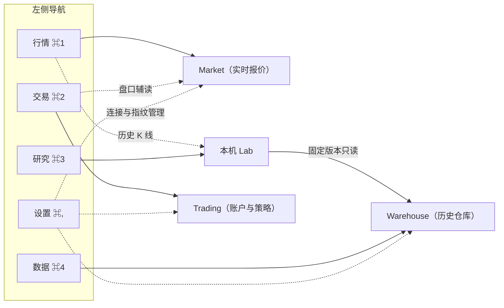
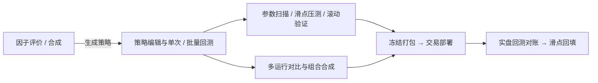

# 终端界面

本文说明 Terminal 的界面结构与核心交互；组件边界与通信时序见[开发者导读](architecture.md)，安装与目录见[部署与运行](deployment.md)。

## 视觉语言与全局框架

设计令牌位于 `src/ui/theme/tokens.css`，通用控件样式位于 `src/ui/theme/style.css`。

| 维度 | 约定 |
| --- | --- |
| 色彩语义 | 单一强调色标示交互焦点；红绿严格保留给涨跌、买卖与盈亏；动态状态用带圆点 `StatusBadge`（正常绿点配中性文字、注意琥珀、危险红），静态属性用方角 `Tag`；撤单、停止、平仓、删除等不可逆操作统一用危险色 |
| 排版与数值 | 六级字号分三层（关键指标主数 / 正文 / 弱化辅助文字）；数值一律等宽右对齐并加千分位，日期统一 `YYYY-MM-DD` |
| 界面即表达 | 用布局、对齐与视觉编码传递层级，不写教学引导语，表内不铺源码注释（悬停或代码视图查看）；空状态仅留一行状态与直达动作；交易安全确认与不可逆后果提示始终显式保留 |
| 导航与持久态 | 盘中模块（行情、交易）在前，盘后模块（研究、数据）在后；`⌘B` / `Ctrl+B` 折叠导航，`F11` 全屏；切页保持挂载（`hidden`）并暂停隐藏页轮询；启动恢复上次模块与草稿，若任一交易账户已允许下单或正在运行策略则优先切至交易页 |
| 通知与状态栏 | 底部左侧展示各服务及账户连接状态（点击直达对应页或设置，磁盘低于 5 GB 内联预警），中央展示数据/研究后台进度条与任务浮层，右侧汇总未读通知；表单校验留在表单内，服务连接、协议不匹配与柜台异常统一归入通知中心（同因合并、支持复制诊断与打开本机日志） |
| 首次启动与键盘 | 首次启动自动安装 Python 运行时（失败可重试）；浮层支持 `Tab` / `Esc` / 外部点击关闭；源码编辑器保留 `Tab` 缩进与接口补全（`Esc` 后可用 `Tab` 跳出焦点）；长列表采用虚拟滚动与粘性表头 |

## 行情（`⌘1`）

| 区域 | 核心能力 | 关键约束与状态 |
| --- | --- | --- |
| 左侧分组行情表 | 分类筛选（自选、期货全景、主力合约、各交易所）、品种概览/全部月份切换、搜索与表头定制；全景随窗宽多列排布且不拆组 | “品种＋主连”指向当前持仓最大月份，非拼接连续 |
| 右侧 K 线图表 | 分时、Tick、1/5/10 分、日 K 及周/月/季/年与历史 K 线（未入库直达采集）；分时/分钟副图叠加持仓量；有账户持仓或挂单时只读叠加均价与挂单线 | 价格保持原始十进制字符串，纵轴按最小变动价位至少留 20 档 |
| 盘口与期限结构 | 五档盘口（量条按昨结着色）、当日指标、同品种其他月份与跨期期限结构曲线（点击切换合约） | 当日无成交时开高低显示 `—` |
| 断线与新鲜度 | 配置后自动重连，窗体隐藏时照常更新 | 单合约 30 秒无新报价标“暂无新报价”；全源 30 秒无报价才标“行情未更新” |

## 交易（`⌘2`）

多账户时左侧展示账户列表，单账户自动隐藏；实盘账户标题行整行标红警示，读取失败保留上次快照并标记失联。

| 区域 / 视图 | 核心能力 | 安全与交互边界 |
| --- | --- | --- |
| 账户与风控概览 | 标题行展示环境、连接与持仓核对徽标，右侧突出“已允许下单 / 未允许下单”与“停止下单”；次行展示四个主数（盯市净值、当日盈亏、可用资金、保证金占用率，其余收于“资金明细”浮层）与按占比变绿/黄/红的风控占用条 | 已允许但柜台未就绪时转黄；运行策略时上方展策略卡，偏离目标净持仓标黄 |
| 工作台（三栏联动） | 左列持仓与自选，中栏图表与持仓/委托/成交/绩效明细，右栏五档盘口与下单面板；Market 不可用时自动收拢为记录与下单区，不阻断交易 | 点选合约或持仓仅预填下单区并清空限价，绝不自动发单；按回车不触发下单；非白名单合约禁下单 |
| 手工下单与撤单 | 显示动态可开/可平手数与带账户名的买卖按钮；超单笔上限自动拆腿逐笔发送并在失败处停止；委托表支持筛选可撤与“全部撤单”；成交按选定交易日锁定总笔数导出 CSV；绩效页按时间加权法剔除出入金绘制净值与回撤 | 行情断线或超 30 秒禁止点选五档填价（仍可手输）；实盘下单二次弹窗确认，全部撤单二次点击确认，失败绝不重发 |
| 开通账户与策略视图 | 开通时配置白名单与风控限额（可从成功回测带入上限）；策略视图左侧管理运行实例（状态、目标对照、执行选项、事件、实盘对账与三项独立干预按钮），右侧管理策略版本（从冻结回测或当前目录部署） | 交易授权始终独立显式确认；停止命令走独立紧急通道；异常与放弃批次同步写入通知中心并弹出桌面通知 |

## 研究（`⌘3`）

- **通用机制**：内置模块只读（可复制为可写副本），自建项支持新建、重命名与二次确认删除，外部编辑切回窗口自动刷新；品种选择器优先列已入库品种并提供内置板块与**共享品种池**；详情页支持“报告 / 代码 / 分屏”与 `⌘Enter` / `Ctrl+Enter` 保存并运行；条件区坚持**工作草稿与显式预设分离**（微调不生成幽灵预设）；所有评价、回测与对账均支持星标、一句话备忘及一键复制 Markdown 摘要。

| 子视图 | 列表页 | 详情与分析报告 |
| --- | --- | --- |
| **因子** | 按当前条件排名各因子最新评价（IC、留出 IC、ICIR、t 值、换手率）；支持批量评价与多因子相关性/合成评价 | 右侧调参、选合成因子与正交剥离基准（折叠列出导入本模块的策略）；报告含 IC 衰减、样本内外与分年度稳定性、相关性热力图、每日/累计 IC、分组扣费多空曲线与换手率；单因子和等权合成可一键“生成策略”（保留清洗、正交与血缘） |
| **策略** | 按当前条件排名最新成功回测与上线阶段（失败、异条件、未回测分列下方）；支持批量回测与多选对比合成 | 已有回测默认展报告（标出相对上次成功运行的指标 Δ）；右侧配单值/多值参数（多值触发网格/LHS/贝叶斯扫描）、滚动验证与并发数；成功候选直达“滑点压力测试”或“去部署” |
| **回测** | 全量运行与扫描分页列表（搜索、排序、星标筛选、入口直达“实盘对账”）；勾选 2–6 次可并排对比相关性矩阵、多策略试算并一键生成 `CombinedStrategy` | 单次报告含核心指标、研究体检提示、概览（权益与等权基准、水下回撤、月度热力表）、归因诊断（PSR/DSR/HAC/Bootstrap、成本瀑布、敞口时序、Top 5 回撤、分品种/板块/时段归因、QuantStats 尾部指标）、K 线买卖点、成交、每日资金与血缘复现；扫描报告含邻域高原排序、PBO 体检、盈亏平衡滑点与二维投影热力图；实盘对账核对一致率、差异归因与滑点分布 |

> 组合试算与月收益/回撤保留期末零或负权益的真实损失；共同区间内出现非正权益后停止跨日收益率推算，原始净值曲线照常显示（理由：后续已无有效本金）。

## 数据（`⌘4`）

数据页直连 Warehouse，围绕行情序列分为**采集**与**浏览**两个子视图，底层来源与版本规则见 [Warehouse](../warehouse/README.md)。

- **采集视图**：顶栏在“日线 / 分钟线”间切换，整页仅聚焦所选频率（理由：覆盖与采集成本差异巨大）；下方“品种 → 合约”两级列表按已采在前、已退市折叠于底部排布且更新不跳行；每行以 100% 生命周期进度条着色表达状态；行内“采集”直接发起不弹窗（可在“最近活动”取消），点击合约在右侧浮层查看历史 K 线而不改变列表宽度。

| 状态 | 含义 | 点击“采集”时的动作 |
| --- | --- | --- |
| 齐全 | 上市至最新交易日或下市均已采集，未到期不算缺失 | — |
| 待更新 | 已有数据连续，仅最新若干交易日未采 | 采集剩余最新日期 |
| 缺 N 天 | 首尾已有数据之间存在未入库的缺失开市日 | 仅补采缺失日期（不重复拉取已有分区） |
| 前段未采 | 上市初期尚未采集，不计入缺口 | 补采前段日期 |
| 未采集 | 该合约尚无任何数据 | 采集整个存续期 |
| 来源无数据 | 全部支持来源均返回空且已过 2 个交易日，或交易所日线已入库但当日无该合约 | 不再重复请求 |

- **浏览与版本**：分基本面（仓单、会员持仓、库存周报）与交易参数（结算参数、历史报价单位、合约表、交易日历）两组；默认从最新日期向后翻页并自动跟随最新数据版本，点入旧版本时顶部标示只读并支持一键回最新。日历、合约表、结算参数、历史报价单位与三张基本面表均由 Warehouse 后台自动维护，浏览页不设手动采集按钮。

## 设置（`⌘,`）与扩展边界

| 设置页 | 管理内容 |
| --- | --- |
| 偏好设置 | 界面语言（简体中文 / 英文，启动自动校验双语键名与占位符一致）、显示密度、涨跌配色 |
| 行情 / 数据服务 | 单个 Market / Warehouse 连接（主机、端口、服务端证书指纹，在线展示版本号与磁盘空间） |
| 交易服务 | 按 `asterion-trading@<账户>` 实例登记多个 Trading 连接，便于同机多账户管理 |
| 关于 | 产品版本与本机客户端证书指纹（单击全选，各远程服务共用同一身份）；柜台与数据源凭据始终留在服务主机 |

- 功能注册位于 `src/host/feature-registry.ts` 与 `src/features.ts`，各功能仅能调用声明的原生命令（`runtime.snapshot`、`market.watch` / `market.call`、`warehouse.call`、`trading.call`），页面统一读写生成的 Protobuf 类型；协议哈希不匹配时标记中断并将诊断写入通知中心。
