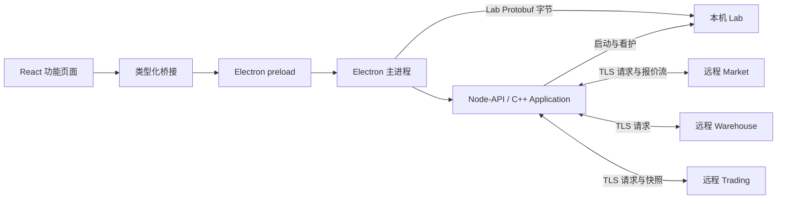
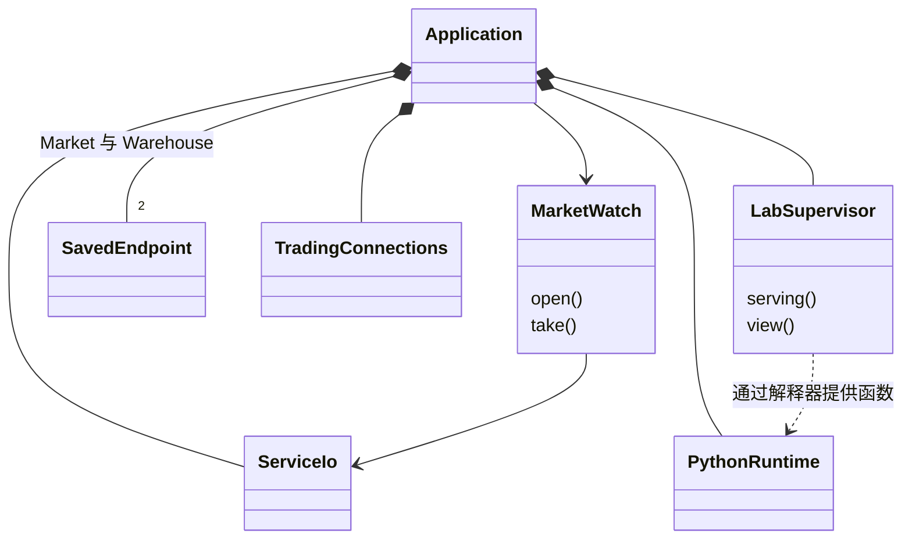
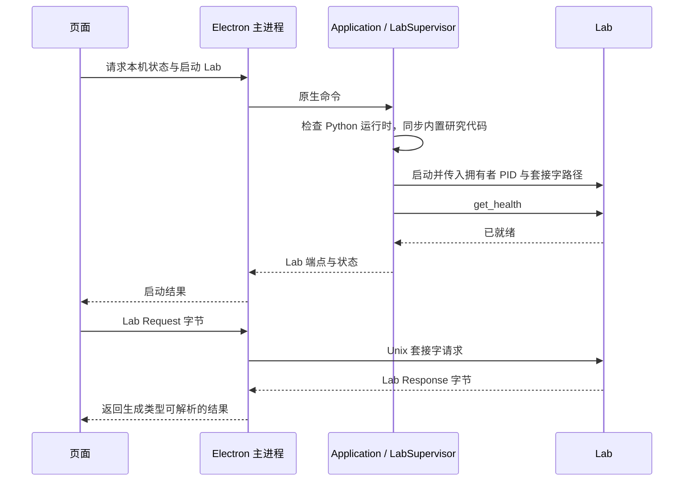
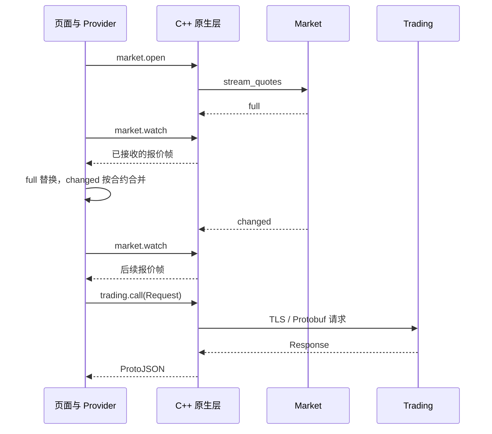

# Terminal 开发者导读

界面行为见[终端界面](README.md)，安装和本机目录见[部署与运行](deployment.md)。Terminal 是桌面操作入口，远程业务状态仍由 Market、Warehouse 和 Trading 管理。

## 组件边界

- `features/` 负责业务页面与操作，`src/host/` 负责工作台、共享视图状态和通知，`src/settings/` 管理连接与偏好。
- 页面使用生成的 Protobuf 类型构建请求；桥接层负责将消息送到正确通道。功能只能调用其声明的原生命令。
- Electron 主进程管理窗口、系统交互和 Lab 字节通道；预加载脚本只暴露允许的接口。
- C++ `Application` 管理连接设置、TLS 身份、Market 报价流与 Lab 看护。Market、Warehouse 和 Trading 的业务字段由页面读取，不另建一套原生层视图模型。
- 行情与交易状态由页面端共享 Provider 维护，`runtime.snapshot` 提供本机服务与设置状态。理由：多个页面看到同一份连接状态，远程账户状态保持服务端权威。
- 交易账户显示只跟随串行读取，命令回复只报告操作结果。理由：并发命令的回复可能逆序到达，旧快照会回退授权显示。

## 原生层核心关系

图中的成员由 `Application::Impl` 持有。交易请求通过函数 `call_trading()` 发送，没有与之对应的 `TradingClient` 业务类；行情普通请求通过 `call_market()`，持续报价使用 `MarketWatch`；Warehouse 请求通过 `call_warehouse()`。

## 启动与研究请求

首次运行缺少 Python 环境时显示安装流程，完成后启动 Lab。Lab 异常退出由原生层重启；研究任务的结果与中断状态由 Lab 管理。

## 行情与交易通信

`market.watch` 是页面读取原生层已接收报价帧的命令；`stream_quotes` 才是 Market 服务协议。断线或页面缺少完整首帧时重开报价流；无新帧且连接状态未变时保持同一视图引用，避免触发无效重绘。其他行情请求通过 `market.call`；数据页通过 `warehouse.call` 读 Warehouse。Market、Warehouse 和 Trading 请求按证书与私钥时间戳缓存 `SSL_CTX`，并在 `ServiceIo` 内按端点复用健康客户端通道。

交易命令的回复不替代柜台后续状态；账户 Provider 持续读取 `get_account` 与健康状态。紧急交易命令（下单、撤单、撤销授权、停止与平仓）拥有独立准入槽位与执行通道，不被慢速或离线轮询阻塞。发送失败显示在操作位置，后台中断进入通知中心，不自动补发交易命令。

## 生命周期与错误边界

| 情况 | 界面与宿主行为 |
| --- | --- |
| 未配置远程连接 | 业务页显示添加入口，进入对应设置页 |
| 已配置连接 | 显示正式内容及连接状态；修改、删除在设置页完成 |
| 远程读取中断 | 显示中断原因，已有账户状态保留并标记失联 |
| 操作失败 | 在相关表单显示错误，原始诊断可复制 |
| Lab 异常退出 | 显示研究状态并自动重启，远程服务不受影响 |
| 关闭 Terminal | 结束本机 Lab 和连接，Market、Warehouse 与 Trading 继续运行 |

## 代码阅读路线

| 顺序 | 入口 | 阅读目标 |
| --- | --- | --- |
| 1 | [main.cjs](../../apps/clients/terminal/electron/main.cjs)、[preload.cjs](../../apps/clients/terminal/electron/preload.cjs) | 窗口、IPC 与桌面生命周期 |
| 2 | [Workbench.tsx](../../apps/clients/terminal/src/host/workspace/Workbench.tsx)、[features.ts](../../apps/clients/terminal/src/features.ts)、[feature-registry.ts](../../apps/clients/terminal/src/host/feature-registry.ts) | 页面装配与功能边界 |
| 3 | [bridge](../../apps/clients/terminal/src/bridge)、[Node-API 入口](../../apps/clients/terminal/bindings/node/terminal.cpp) | 页面命令、消息编码与原生调用 |
| 4 | [terminal_application.cpp](../../apps/clients/terminal/native/terminal_application.cpp)、[application_impl.hpp](../../apps/clients/terminal/native/application_impl.hpp) | 原生命令与共享状态 |
| 5 | [market_client.cpp](../../apps/clients/terminal/native/market_client.cpp)、[trading_client.cpp](../../apps/clients/terminal/native/trading_client.cpp)、[lab-channel.cjs](../../apps/clients/terminal/electron/lab-channel.cjs) | 三条服务通道 |
| 6 | [lab_supervisor.cpp](../../apps/clients/terminal/native/lab_supervisor.cpp)、[python_runtime.cpp](../../apps/clients/terminal/native/python_runtime.cpp) | Lab 看护和解释器准备 |
| 7 | [market.tsx](../../apps/clients/terminal/src/host/market.tsx)、[trading-accounts.tsx](../../apps/clients/terminal/src/host/trading-accounts.tsx)、[notifications.tsx](../../apps/clients/terminal/src/host/notifications.tsx) | 共享视图状态与通知 |

组件测试放在对应源码旁，Electron 验证见 [tests/desktop](../../tests/desktop)。构建与隔离测试命令见[开发指南](../development.md)。

图表组件位于 [src/charts](../../apps/clients/terminal/src/charts)，供行情和研究页面共用。输入保留精确小数字符串，浮点只用于绘制坐标；数据获取、校验、聚合和文案由调用方负责。
