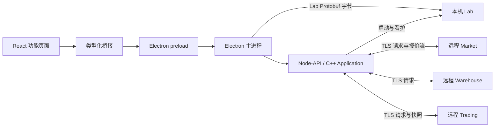
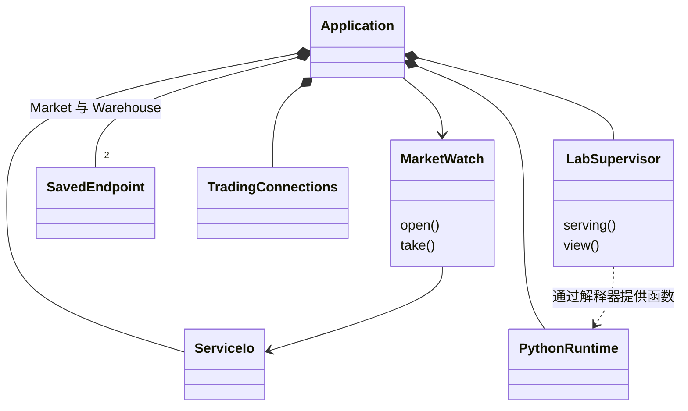
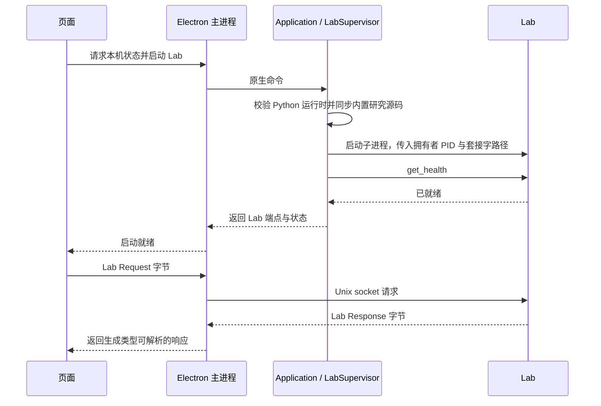
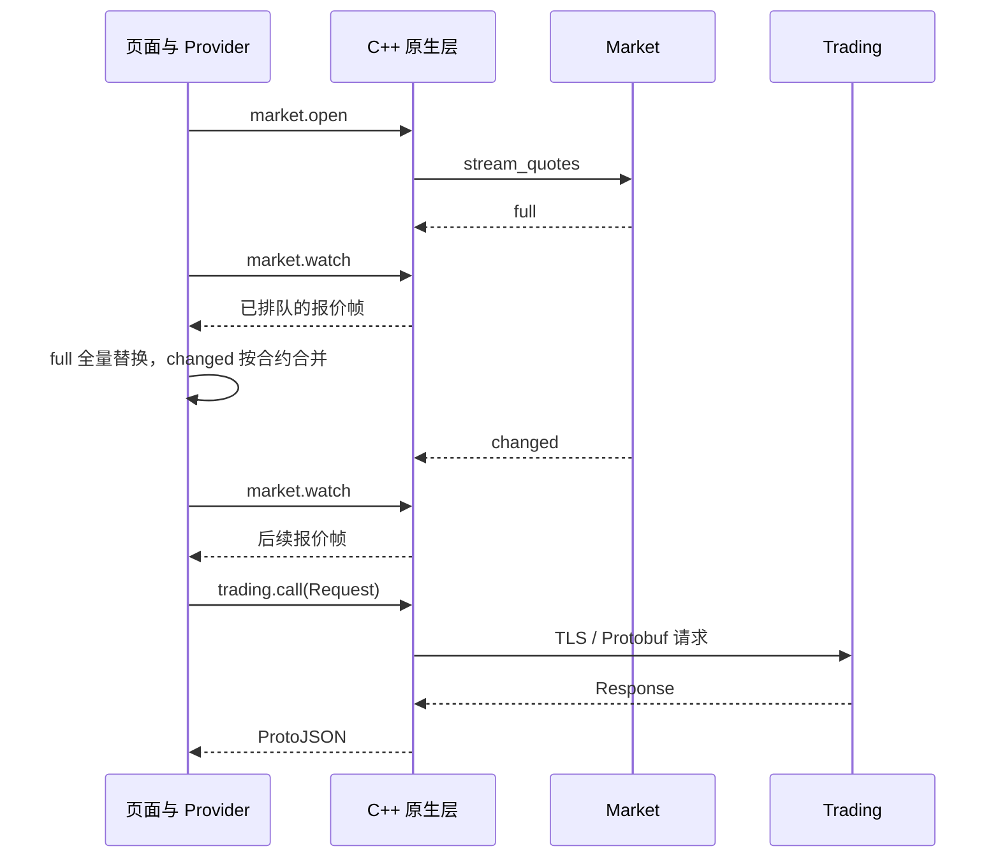

# Terminal 开发者导读

界面行为与交互规范见[终端界面](README.md)，安装与本机目录见[部署与运行](deployment.md)。Terminal 仅作为桌面操作入口，全部远程业务状态仍由 Market、Warehouse 与 Trading 各自权威拥有。

## 组件边界

- `features/` 承载四个业务页面与操作，`src/host/` 管理工作台外壳、共享数据 Provider 与通知中心，`src/settings/` 管理服务连接与界面偏好。
- 业务视图与源码编辑器均按需懒加载，避免启动期解析未访问模块；`App` 通过 `hidden` 保活已访问视图，并借助 `WorkspaceActiveContext` 在视图隐藏时自动暂停页面级轮询、切回时静默刷新。语言资源与共享服务 Provider 随工作台初始化。
- 页面直接使用生成的 Protobuf TypeScript 类型组装请求，桥接层负责路由至对应通道，且功能只能调用其声明的原生命令。
- Electron 主进程管理窗口、系统交互与本机 Lab 字节转发；预加载脚本仅向渲染进程暴露受控接口。
- C++ `Application` 负责连接配置、TLS 身份、Market 报价流与 Lab 看护，不额外维护 Market、Warehouse 或 Trading 的业务视图模型。
- 行情、数据与交易状态统一收口于 `src/host/` 的共享 Provider（`polling.ts`、`market.tsx`、`warehouse.tsx`、`trading-accounts.tsx`、`lab.ts`），`runtime.snapshot` 提供本机服务与连接快照。理由：状态栏与各业务页共享同一份连接与轮询状态，杜绝重复请求并确保远程服务权威。
- 交易账户视图在每次轮询读取与账户命令返回时均通过按账户递增的修订号门控校验：若期间已有更新的状态被接纳，较早发起的过期回复直接丢弃。理由：防止并发请求逆序到达导致旧快照回退授权或持仓显示。

## 原生层核心关系

图中成员均由 `Application::Impl` 持有。远程请求采用零 DOM 的 ProtoJSON 字符串直通路径与结构化辅助函数并存：交易经 `call_trading_json()` / `call_trading()`（无独立 `TradingClient` 类），行情普通请求经 `call_market_json()` / `call_market()`、报价流经 `MarketWatch::take_json()` / `take()`，Warehouse 经 `call_warehouse_json()` / `call_warehouse()`。

## 启动与研究请求

首次启动缺少 Python 运行时则先走安装向导，就绪后再启动 Lab。Lab 意外退出由原生层自动重启，研究任务的持久化与中断状态由 Lab 自身维护。

## 行情与交易通信

- `market.watch` 是页面从原生层拉取已收报价帧的本地命令，`stream_quotes` 才是 Market 服务端流协议。断线或页面缺少完整首帧时重开报价流；无新帧且连接状态未变时保持对象引用不变，避免触发无意义重绘。其余行情请求走 `market.call`；数据状态与采集任务由共享 `WarehouseProvider` 经 `warehouse.call` 统一轮询。
- 原生层按证书与私钥时间戳缓存 `SSL_CTX`。非紧急的只读查询（Market 全部非流式请求、Warehouse 除采集/取消/更新外的只读请求，以及 Trading 的 `get_account`、`get_health`、`get_strategies`、`get_day`、`get_orders`、`get_catalog`、`query_costs`）通过按端点隔离的共享 `RpcClient` 复用保活 TLS 长连接（空闲连接若被对端关闭，仅对幂等只读查询自动重连一次）；写操作与紧急控制请求每次仍新建独立 TLS 连接。
- 交易命令回复不替代柜台后续推送，账户 Provider 持续轮询 `get_account` 与健康状态。紧急交易操作（下单、撤单、撤销授权、停止与平仓）拥有独立的原生准入槽位与执行通道，不被慢速或离线轮询阻塞；操作失败就地提示，后台中断进入通知中心，绝不自动补发交易命令。

## 生命周期与错误边界

| 情况 | 界面与宿主行为 |
| --- | --- |
| 未配置远程连接 | 业务页显示添加服务入口并跳转对应设置页 |
| 已配置连接 | 自动连接并展示权威数据与连接状态；修改、删除统一在设置页完成 |
| 远程读取中断 | 写入通知中心，账户页保留上次状态并标记失联 |
| 操作失败 | 在原表单就地报错，支持复制原始技术诊断 |
| Lab 异常退出 | 状态栏与通知中心提示并自动重启，不影响远程服务 |
| 关闭 Terminal | 在 `will-quit` 阶段立即关闭本机 Lab 通道、中止后台崩溃解析并停止原生 `LabSupervisor` 与 `ServiceIo`；Linux 下原生层将 `RLIMIT_CORE` 软上限设为 `0`，防止 `systemd-coredump` 接管崩溃进程导致退出阻塞（本地 minidump 仍由 Crashpad 写入）；远程 Market、Warehouse 与 Trading 照常运行 |

## 代码阅读路线

| 顺序 | 入口 | 阅读目标 |
| --- | --- | --- |
| 1 | [main.cjs](../../apps/clients/terminal/electron/main.cjs)、[preload.cjs](../../apps/clients/terminal/electron/preload.cjs) | 窗口管理、IPC 通道与桌面退出生命周期 |
| 2 | [Workbench.tsx](../../apps/clients/terminal/src/host/workspace/Workbench.tsx)、[features.ts](../../apps/clients/terminal/src/features.ts)、[feature-registry.ts](../../apps/clients/terminal/src/host/feature-registry.ts) | 工作台装配、视图保活与功能边界 |
| 3 | [bridge](../../apps/clients/terminal/src/bridge)、[Node-API 入口](../../apps/clients/terminal/bindings/node/terminal.cpp) | 页面命令、消息编解码与原生桥接 |
| 4 | [terminal_application.cpp](../../apps/clients/terminal/native/terminal_application.cpp)、[application_impl.hpp](../../apps/clients/terminal/native/application_impl.hpp) | 原生命令分发与共享运行状态 |
| 5 | [market_client.cpp](../../apps/clients/terminal/native/market_client.cpp)、[warehouse_client.cpp](../../apps/clients/terminal/native/warehouse_client.cpp)、[trading_client.cpp](../../apps/clients/terminal/native/trading_client.cpp)、[lab-channel.cjs](../../apps/clients/terminal/electron/lab-channel.cjs) | 四条服务通道与只读长连接复用 |
| 6 | [lab_supervisor.cpp](../../apps/clients/terminal/native/lab_supervisor.cpp)、[python_runtime.cpp](../../apps/clients/terminal/native/python_runtime.cpp) | Lab 进程看护与本机 Python 运行时准备 |
| 7 | [market.tsx](../../apps/clients/terminal/src/host/market.tsx)、[warehouse.tsx](../../apps/clients/terminal/src/host/warehouse.tsx)、[trading-accounts.tsx](../../apps/clients/terminal/src/host/trading-accounts.tsx)、[notifications.tsx](../../apps/clients/terminal/src/host/notifications.tsx) | 共享视图 Provider、修订号门控与通知中心 |

UI 组件测试紧邻源码放置，Electron 宿主测试位于 [tests/desktop](../../tests/desktop)，构建与隔离测试命令见[开发指南](../development.md)。

共用图表组件位于 [src/charts](../../apps/clients/terminal/src/charts)，供行情与研究页面复用：输入保留精确十进制字符串，浮点仅用于屏幕坐标绘制，数据拉取、校验、聚合与文案由各业务调用方负责。
