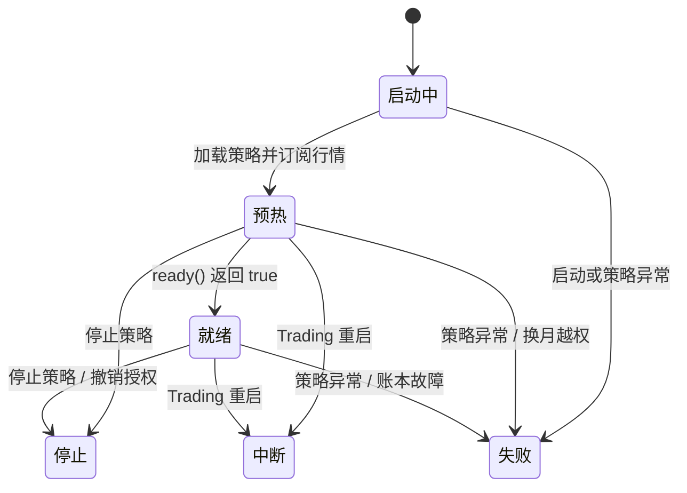

# 交易与风控

Trading 通过 CTP 直连期货公司柜台（SimNow 等仿真环境或实盘）。每个 CTP 账户独立运行一个 Linux 进程，不依赖 Terminal、Lab、Market 或 Warehouse 在线。下单必须遵守的核心约束见[交易规则](../safety.md)。

回测与实盘共用同一套订单限额实现；回测账本、费用与撮合口径见文末。内部架构与通信时序见[开发者导读](architecture.md)，安装、账户配置与目录结构见[部署与运行](deployment.md)。

## 策略包

- **打包与冻结**：界面上称为“策略版本”。从成功回测点击“去部署”时，Lab 读取该次运行冻结的源码副本并打包上传至交易主机；交易页也可显式选择从当前策略目录打包。打包仅静态解析策略模块及其传递导入的本地模块，不执行代码；若导入了既不在目录内、也不在 Trading 运行时（Python 标准库、NumPy、SciPy、`asterion_strategy`）中的依赖，准备阶段直接报错并指出模块名。理由：上线所选研究结果时必须严格对应当时的代码。包名为策略标识（如 `ma_cross.MaCross`），版本为打包时间戳（如 `20261103-231502`），每次部署均生成新版本。
- **包体积与元数据**：单包上限 64 个 Python 文件、合计 512 KiB。从回测生成的包附带来源运行 ID、参数、周期、研究品种、数据版本与权重预算，不含账户、行情或回测结果表。策略通过共享模块 `asterion_strategy` 继承 `Strategy`，与研究侧接口完全一致。
- **幂等与目录**：同名同版本不可覆盖；回复丢失时先查询主机包列表，不自动重发。发布策略包不会启动实例，也不会授予交易授权。包存放在 `data/<账户>/strategies/packages/<名称>/<版本>/`。
- **离线运行时**：Trading 安装包自带 CPython 3.12、NumPy 2.3.5、SciPy 1.17.1 与 Protobuf 5.29.3，安装与运行全程无需联网。

## 策略实例

每个账户同时只允许运行一个策略实例（需账户已同步，启动前核对配置；启动不等于授权，实例 ID 不可复用）。实例运行期间禁止手动新增委托，撤单、撤销授权与停止策略始终可用。

- **实例配置**：包含实例 ID、包名与版本、固定合约或主力连续品种（如固定月份 `SHFE.rb2610`，或主力连续 `SHFE.rb` 及其升序在市交割月列表，共 1–64 项）、周期（1/5/10/15/30/60 分钟或日线）与参数覆盖；权重策略另填总/净权重预算及可选的保证金占用率上限（`max_margin_ratio`）和最小调仓偏离（`min_rebalance_weight`）。从回测包启动时自动带入周期、参数与预算，实际合约须由使用者核对选择。
- **录制与实盘回测对账**：`data/<账户>/strategies/runs/<实例>.sqlite` 记录配置、每批交付 K 线、每次就绪状态与决策目标及行情断连事件；`data/<账户>/strategies/bars.sqlite` 持久保存本地聚合的实时 K 线并提供只读查询。收盘后可用 Lab Python 运行时执行 `build/electron-resources/python/bin/python3 -I -B -m asterion_lab.reconcile --trading-account <data/账户> --lab-dir <lab数据目录>`，将 `bars.sqlite`、`runs/<实例>.sqlite` 与 `journal.sqlite`（含 `archives/`）成交明细和同固定版本 Lab 回测逐根比对，输出 K 线、目标仓位（标明是否源于 K 线差异）与成交差异报告。
- **主力连续与自动换月**：策略侧看到的 `bar.symbol` 为 `EXCHANGE/product`，`bar.contract` 为当前主力交割月 `EXCHANGE/product/YYYY-MM`。每日按前一交易日持仓量选定主力且只向后换月；换月首根新合约 K 线附带前一交易日新旧结算价比值 `roll_ratio`（四舍五入 8 位，取自换月当日柜台行情，缺失则停实例告警），驱动层即时对 `ctx.history` 执行当时比值复权（与[Lab 主力连续](../lab/README.md#主力连续)一致），并经同一条下单路径先平旧月、再开新月。同时在当前主力之后的在市月份中按前一交易日持仓量选定次主力，按同根收盘价计算年化对数展期收益率 `roll_yield`（四舍五入 8 位，纳入预热 SHA-256 摘要，不随换月缩放）。若账户白名单仅授权具体月份且下一主力不在白名单中，换月前立即终止实例并告警。
- **热重启与历史预热**：使用新实例 ID、相同包名/合约/周期启动时，可按以下方式预热（允许同时切换包版本、参数或权重预算；预热回放仅更新策略内部状态，绝不下单；缺失持仓量在策略侧表示为 `NaN`）：

| 预热来源 | 机制与约束 |
| --- | --- |
| 旧实例记录 | 重放指定已结束实例记录中保存的历史 K 线 |
| 本地录制 K 线 | 重放本机 `bars.sqlite` 已录制的实时 K 线 |
| Lab 固定版本历史预热 | 启动时随请求注入固定 Warehouse 版本的历史 K 线（含换月复权因子、小写品种标识，Lab 从最新分区向前截断至所需根数）；Trading 校验时间升序、合约对齐与 SHA-256 摘要后写入实例记录。与本地或旧实例并用时按结束时间去重衔接（重叠保留固定版本，其后接当日已完成本地 K 线）；运行期仍不连接 Warehouse |

- **三项独立干预操作**（彼此隔离，绝不混做）：

| 操作 | 需确认 | 对挂单与持仓的影响 | 对实例与授权的影响 |
| --- | --- | --- | --- |
| **暂停新增** | 否 | 在发送许可处拦截开仓（写盘中或排队中不再发出，已发按柜台回报），仅允许减仓 | 实例继续运行，可随时恢复 |
| **平仓** | 是 | 对所选合约按 10 秒内有效报价下零手目标，走同一条下单路径 | 实例自动切入暂停新增并继续运行 |
| **停止策略并撤单** | 是 | 撤掉该实例挂单，**不平仓** | 实例结束，**不撤销账户授权** |

- **资源限制与脱机告警**：策略子进程硬限 1 GiB 地址空间、64 个文件描述符并禁止派生子进程/线程，加载限时 10 秒、每批 K 线限时 2 秒（用于防自身代码故障，非安全沙箱）。Terminal 打开时每 5 秒轮询各账户实例状态，失败或放弃批次触发桌面通知（同一事件仅通知一次）；主机若配置加密 Webhook，则在策略异常结束、放弃批次、柜台拒单、出现未确认委托、触发资金/撤单硬风控、柜台断线、账本需恢复或 Trading 重启（授权随之失效）时后台异步推送去重 JSON 告警，不阻塞交易主路径。

## 实时 K 线与现场预热

- **直连行情**：仅在策略实例启动后按需订阅所选合约，直连账户配置的 `market_front`。
- **聚合口径**：
  - **分钟线**：按 `core/config/futures-sessions.json` 与固定 N 分钟时钟边界聚合，集合竞价与小节闭市秒并入对应交易分钟；跳过启动首根，进入下一根时上一根封口交付。
  - **日线**：按行情会话交易日聚合（见 [Market](../market/README.md)），跳过首个交易日，观测到下一交易日行情后交付（不按 15:00 钟点截断，理由：国债期货 15:15 收盘且盘后有结算快照），时间标签记为当日 15:00；休市或无成交不补造。
- **多合约对齐**：同一时间窗口在全部合约均出现更晚行情时立即交付；否则任一合约越过结束时刻 10 秒（日线为进入下一交易日 10 秒）后交付，缺席合约不补造也不阻塞，迟到报价的成交量计入下一根。
- **断线与异常处理**：
  - 跨越断线、重连半途或累计成交量回退的 K 线标记为不完整并跳过（不把断线期未知量并入重连首根），下一完整周期自动恢复，不终止实例；落后超 10 秒或早于已处理时刻的报价直接丢弃。
  - 首次登录超 30 秒、登录或订阅被拒、行情队列溢出丢观测、行情乱序或超前主机时钟 2 秒以上，以及策略异常/超时/输出非法时，立即终止实例并撤其挂单。
- 实盘策略必须显式实现 `ready(ctx)`，未就绪期间输出的目标全部丢弃。

## 目标执行

就绪目标统一经账户唯一下单路径执行（未授权或未同步时仅记录不执行），每笔委托记录附带实例 ID、目标序号与分腿号（权重单另记权益、权重、参考价与整数目标）。

- **手数与权重换算**：
  - 手数目标仅更新列出的合约（`0` 表示平仓），未列合约维持原目标。
  - 权重目标覆盖全部所选合约并校验总/净权重预算；账户刷新资金持仓后冻结当批 CTP `Balance` 与保证金缩放系数（配置 `max_margin_ratio` 时自动查询合约保证金率并在超限时同比例缩权），对具备新鲜报价的合约按最新价与乘数向零取整换算手数；配置 `min_rebalance_weight` 时，同向非零小偏离维持原手数（零权重且零持仓直接视为就位）。先换算的目标扣减当批保证金额度，额度耗尽后其余合约目标归零（理由：因小偏离保留的持仓同样占用保证金）。
- **跨时段推进**：组合同时包含夜盘（21:00）、早盘（09:00）与中金所（09:30）品种时，未开盘合约保留待换算权重或待执行手数，按完整组合校验预算；各时段开盘报价陆续到达后，沿用当批冻结权益与缩放系数增量执行。
- **拆单、开平与并发**：按实际今昨仓分多空规划（上期所、能源中心先平昨再平今，其余使用普通平仓）；先完成当前有盘口合约的全部减仓，再执行开仓。超单笔上限自动拆腿，同合约逐笔顺序推进并在成交核对后重算；互不冲突的不同合约可在途并发，开仓并发受在途委托上限约束（上限已满时排队等待成交并仍受 10 秒超时约束，减仓不受限）。买入挂卖一、卖出挂买一。已有在途委托的合约不规划新委托；账户一旦出现未确认委托，策略暂停全部规划（含减仓与平仓），直至柜台核实标记后恢复。报单与撤单合计每秒最多发出 5 笔，避开柜台流控。
- **目标持续有效**：最近就绪目标（含待开盘权重与零手平仓目标）持续生效，后续无新目标的 K 线按当前持仓补差执行，直至到位、被新目标替换、策略退出就绪或实例结束（理由：与回测每根重挂语义保持一致）。
- **异常处置分级**：

| 异常情况 | 处理范围 | 实例状态 |
| --- | --- | --- |
| 单合约执行超 10 秒（自收到新鲜报价起算并扣减报价年龄）、无对手价、触发价格偏离/风控拒单、委托被撤或被柜台拒单 | 仅放弃该合约当批目标并撤其未成交挂单 | 继续运行（其余及待开盘合约不受影响） |
| 账户连接变化，或新目标/平仓替换未完成批次 | 放弃旧批次（旧腿因发送依据失效退出不影响新批；他腿成交导致敞口变化且未调 SDK 时原地重评不放弃） | 继续运行 |
| 策略输出非法目标或超预算、账本进入恢复、撤销授权或停止实例 | 撤掉实例全部未完成挂单（保留持仓） | 实例结束 |

## 风控设置与授权

- **开通与修改风控政策**：选取最多 64 项合约或品种级白名单（支持具体月份 `SHFE.rb2610` 或品种级 `SHFE.rb` 自动适配主力换月；Market 在线时复用其目录，否则由 Trading 直查柜台并缓存），填写五项必填限额及可选四项资金/撤单硬风控（价格偏离与保证金率按百分数填写，如 `2` 表示 2%），追加写入账本。修改风控政策要求账户已同步、持仓已核对且无未确认委托，生效后自动断开柜台并撤销授权。
- **授权**：界面称“允许下单”，撤销授权称“停止下单”。勾选确认账户身份后方可允许下单；授权在柜台断线重连与跨交易日后保持有效，在停止下单、修改政策、账本需恢复或 Trading 重启后立即失效。
- **账户费率查询**：账户就绪后可向 CTP 查询各白名单合约的保证金率与手续费率，用于核对期货公司加收标准（回测不使用该值）。

## 下单检查

每笔委托必须按顺序通过以下五道关口，任一步不满足即拒绝，绝不发送：

- **价格检查（第 3 步）**：限价须在当日涨跌停范围内，且与最新价（当日无成交取昨结算价）的偏离不超上限；手动下单先查柜台行情（受 CTP 频控约等 1 秒），策略单使用实例直连行情，报价 10 秒内有效。
- **风控规则与开平仓适用范围（第 4 步）**：

| 风控项 | 必填/可选 | 计算口径 | 开仓 | 平仓 / 减仓 |
| --- | --- | --- | --- | --- |
| 单笔手数、价格偏离 | 必填 | 单笔委托手数；限价相对参考价的偏离幅度 | 限制 | 限制（手动超单笔上限自动拆单，且不超可平量） |
| 单合约持仓、账户总持仓 | 必填 | 柜台持仓 + 在途开仓 + 未确认委托 + 未对账开仓成交（多空相加，不抵消） | 限制 | 豁免 |
| 在途委托数 | 必填 | 当前未终结委托总数 | 限制 | 豁免 |
| 日内亏损限额 | 可选 | `(PreBalance + Deposit - Withdraw) - dynamic_equity`（盯市净值，剔除出入金） | 限制 + 告警 | 豁免 |
| 最大回撤限额 | 可选 | 出入金对齐后的历史 `peak_equity`（随收盘快照延续）与 `dynamic_equity` 之差 | 限制 + 告警 | 豁免 |
| 保证金率上限 | 可选 | 首次开仓查费率取多空较高值；预估占用含持仓、未对账开仓、在途/未确认及本笔（不低于柜台已用+冻结）；缺资金/费率或仅返加收值时拒开 | 限制 + 告警 | 豁免 |
| 单合约日撤单上限 | 可选 | 按交易日与合约统计的撤单请求次数 | 限制 + 告警 | 豁免 |

- **限价与持仓核对**：仅支持限价单；上期所、能源中心普通平仓仅计昨仓。存在未对账成交时暂停受影响合约开仓；手动平仓基于上次确认持仓扣减后续平仓成交、在途平仓与未确认平仓（新开成交须核对后才计入可平量）。持仓查询期间若交错收到新委托或成交回报，沿用上次确认持仓并触发重查（理由：避免混入半同步持仓导致重复占额）。

## 交易记录、断线与恢复

- **轻快照与分页查询**：`get_account` 仅返回资金、持仓、在途委托与计数；委托与成交明细另行分页读取，当日或历史 CSV 导出按选定交易日读取全天成交与收盘快照。
- **账本与幂等**：事件持久化至 `data/<账户>/journal.sqlite`，旧事件自动封存至 `archives/`。相同 `request_id`、请求内容与政策版本的下单/撤单视为重试，直接返回当前账户而不重发；内容或政策版本不符则返回 `CONFLICT`。授权与撤销授权的 `request_id` 不可复用。
- **成交、撤单与收盘快照**：
  - 撤单同样先记账后发送，以柜台回报为准；按交易日与合约统计撤单及拒撤次数并随收盘快照落盘。
  - 每笔成交按 `(交易日, 成交编号)` 去重入库，跨日与重启保留，当日即可导出对账 CSV。
  - 每次同步后将最新快照（含 `PreBalance`、`Deposit`、`Withdraw`、`dynamic_equity`、`peak_equity`、持仓与撤单统计）写入 `data/<账户>/ctp-flow/latest_close.pb`，跨交易日时归档进账本供历史日对账与导出。
- **断线、重启与冷备**：断线、超时与重启绝不重发委托；重连后以柜台事实为准重新同步。账本已记为发送但柜台未回报的委托标为“未确认”并持续占额（跨日不释放），须在柜台核实后手动标为“已核实”。CTP SDK 本地拒绝的请求（`-1` 无连接、`-2` 未处理请求超限、`-3` 每秒请求超限）并未发出，直接记为未发送并释放额度。正常停机先停止接纳新单、停策略并撤单再断开柜台；进程强杀不保证撤单。冷备份前须停止全部账户并复制整个账户目录（含 `archives/`）及 `owners/`。

## 回测的账本、费用与撮合

回测由 `core` 中的 `FuturesAccount` 与 `PaperExecution` 替代真实柜台：

| 维度 | 回测口径 |
| --- | --- |
| 账本与结算 | 单币种、整数手；保证金与手续费 = 每手固定 + 名义金额 × 费率（精确到分四舍五入），区分多空保证金与开/平今/平昨费率；日内按开仓价、日结按结算价重算保证金（不计跨品种优惠）；权益 = 资金 + 浮盈，可用资金不含浮盈 |
| 历史费率 | 取固定数据集当日交易所结算参数（不含期货公司加收）；缺保证金或开平费率即停止，缺平今费率仅在当日产生平今委托/成交时停止，绝不补零或推算 |
| 撮合与滑点 | 仅在后续 K 线成交：买限在最低价触及时按 `min(开盘价, 限价)` 成交，卖限相反；单根 K 线所有腿合计不超过该根成交量的 10%；固定 N 跳滑点计入成交价；触价即成交（视同队首）。存在当日涨跌停价时，涨停封板（`low >= upper_limit`）不成交买单、跌停封板（`high <= lower_limit`）不成交卖单，且含滑点成交价不越出 `[lower_limit, upper_limit]` |
| 目标到委托 | 第 N 根决策目标在第 N+1 根按开盘价 ± 滑点主动成交；反手先平后开，超单笔上限拆成多腿（`order_id`、`order_id.2`…），在 10% 量限与可用资金内于同根完成，余量收盘后撤单，保持目标则在后续 K 线续做（与实盘吃盘口拆单对齐）。主力换月见[Lab 回测引擎与换月](../lab/README.md#回测引擎与换月) |
| 未建模项 | 盘口排队、冲击成本、强行平仓、自成交 |
