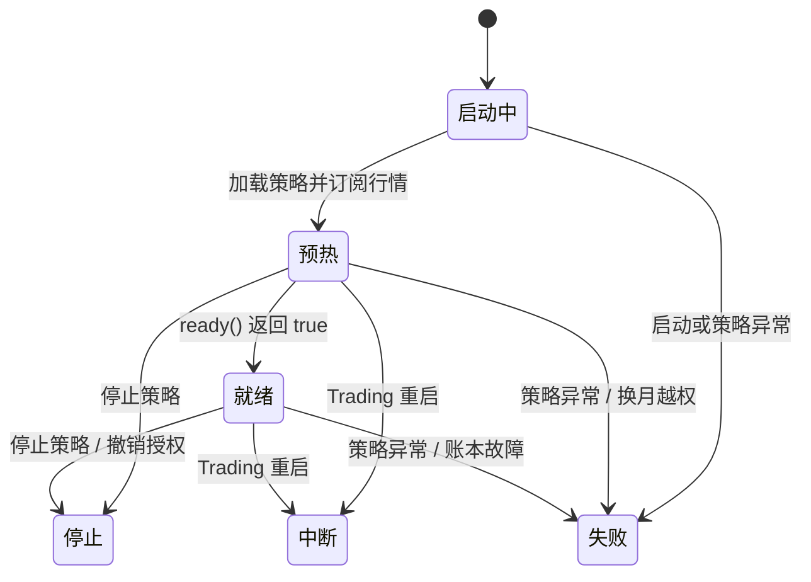

# 交易与风控

Trading 通过 CTP 连接期货公司柜台（SimNow 等仿真环境，或实盘）。每个账户一个 Trading 进程，跑在 Linux 交易主机上，不依赖 Terminal、Lab、Market 或 Warehouse。下单必须遵守的规则见[交易规则](../safety.md)。

回测与实盘共用同一套订单限额风控；回测的账本、费用和撮合见文末。内部模块和通信时序见[开发者导读](architecture.md)，安装、账户配置及目录见[部署与运行](deployment.md)。

## 策略包

- 界面上把策略包叫“策略版本”。从成功回测“去部署”时，“部署”读取该次运行的源码副本，打包并安装到此交易主机；交易页也可选策略，从当前目录部署。打包包含策略模块及它逐层导入的本地模块，不执行代码；导入的模块既不在目录里、也不在 Trading 的运行环境（Python 标准库、numpy、scipy、`asterion_strategy`）里时，准备失败并指出模块名。理由：部署所选研究结果时必须使用当时的代码。包名是策略标识（如 `ma_cross.MaCross`），版本是准备时刻（如 `20261103-231502`），每次部署都是新版本。
- 一个包最多 64 个 Python 文件、合计 512 KiB。从回测准备的包另带来源运行、参数、周期、研究品种、数据版本和权重预算；不含账户、行情或回测结果表。策略从共享模块 `asterion_strategy` 导入 `Strategy`，与研究使用同一套接口。
- 同名同版本不能覆盖；结果不明时先读取主机上的包列表，不自动重发。部署不启动实例，也不授权。
- 包存放在 `data/<账户>/strategies/packages/<名称>/<版本>/`。
- Trading 安装包自带 CPython 3.12、NumPy 2.3.5、SciPy 1.17.1 和 Protobuf 5.29.3，安装和启动都不联网。

## 策略实例

每个账户同时运行一个策略实例（需账户已同步，启动前核对配置，启动不等于授权，实例 ID 不可复用）。实例运行期间拒绝手动新增委托；撤单、撤销授权和停止策略始终可用。

- **配置项**：实例 ID、包名与版本、实际合约或主力连续品种（固定月份如 `SHFE.rb2610`，或主力连续 `SHFE.rb` 及其在市月份列表，共 1–64 项）、周期（1/5/10/15/30/60 分钟或日线）、参数覆盖；权重策略另填总权重/净权重预算及可选的保证金占用率上限（`max_margin_ratio`）和最小调仓偏离阈值（`min_rebalance_weight`）。从回测包启动时自动带入周期、参数与预算，合约由使用者核对选择。
- **持久化与对账**：`data/<账户>/strategies/runs/<实例>.sqlite` 记录配置、每根交付的 K 线、每次就绪状态与目标及行情断连时间；`data/<账户>/strategies/bars.sqlite` 保留各合约各周期实时聚合 K 线，并提供只读接口。收盘后可用 Lab Python 运行时执行 `build/electron-resources/python/bin/python3 -I -B -m asterion_lab.reconcile --trading-account <data/账户> --lab-dir <lab数据目录>`，将 `bars.sqlite`、`runs/<实例>.sqlite` 决策与 `journal.sqlite`（含 `archives/`）成交明细和同固定版本 Lab 回测逐根对比，输出 K 线、目标仓位（标明是否由 K 线差异引起）与成交差异报告。
- **主力连续与自动换月**：策略看到的 `bar.symbol` 为 `EXCHANGE/product`，`bar.contract` 为当前主力交割月 `EXCHANGE/product/YYYY-MM`。按前一交易日持仓量选当日主力且只向后换月；换月首根新合约 K 线附带前一交易日新旧结算价比值 `roll_ratio`（四舍五入 8 位，均取自换月当日柜台行情，缺失则停实例告警），驱动层即时对 `ctx.history` 比值复权（与 [Lab 主力连续](../lab/README.md#主力连续)一致），并沿同一条下单路径先平旧月再开新月。同时在当前主力之后的在市月份中按前一交易日持仓量选次主力，按同根 K 线收盘价计算并随 K 线交付 `roll_yield`（年化对数展期收益率，四舍五入 8 位，预热时纳入 SHA-256 摘要校验，不随换月缩放）。若账户白名单仅授权具体月份且下一主力不在其中，换月前立即停实例告警。
- **热重启与历史预热**：用新实例 ID、同包名/合约/周期启动时，可按以下方式预热（允许同时更新包版本、参数和权重预算；所有预热回放只更新策略状态、不下单；缺失持仓量在策略侧表示为 `NaN`）：

| 预热来源 | 机制与约束 |
| --- | --- |
| 旧实例记录 | 回放指定已结束实例记录中的历史 K 线 |
| 本地录制 K 线 | 回放本机 `bars.sqlite` 已录制的实时 K 线 |
| Lab 固定版本历史预热 | 启动时随请求注入固定 `Warehouse` 版本历史 K 线（含换月复权因子，小写品种标识，Lab 从最新分区向前按需截断）；Trading 校验时间升序、合约对齐与 SHA-256 摘要并写入实例记录。与本地/旧实例并用时按结束时间去重衔接（重叠保留固定版本，其后接当日已完成本地 K 线）；运行期仍不连 Warehouse |

- **干预操作**（彼此独立，绝不混做）：

| 操作 | 需确认 | 对挂单与持仓的影响 | 对实例与授权的影响 |
| --- | --- | --- | --- |
| **暂停新增** | 否 | 发送许可处拦截开仓（写盘中或排队中不再发送，已发按柜台回报），只允许减仓 | 实例继续运行，可恢复 |
| **平仓** | 是 | 对所选合约按 10 秒内报价下零手目标，走同一条下单路径 | 实例切入暂停新增并继续运行 |
| **停止策略并撤单** | 是 | 撤掉实例挂单，**不平仓** | 实例结束，**不撤销授权** |

- **资源与监控告警**：策略子进程限 1 GiB 地址空间、64 个 FD、禁启子进程/线程，加载限 10 秒、每批 K 线限 2 秒（防自身代码错误，非安全沙箱）。Terminal 打开时每 5 秒轮询各账户实例状态，失败或放弃批次触发桌面通知（同一事件只通知一次）；若主机配置了加密 Webhook，异常结束、放弃批次、拒单、未确认委托、触发资金/撤单硬风控、柜台断线、账本需恢复或 Trading 重启（授权随之失效）时，后台异步推送去重 JSON 告警，不阻塞主路径。

## 实时 K 线与现场预热

- **直接行情**：实例启动后才订阅所选合约，行情直连账户 `market_front`。
- **聚合口径**：
  - 分钟线按 `core/config/futures-sessions.json` 与固定 N 分钟时钟边界聚合，集合竞价与小节闭市秒归入对应交易分钟，启动首根跳过，进入下一根时上一根完成。
  - 日线按行情会话交易日聚合（见 [Market](../market/README.md)），首个交易日跳过，观测到下一交易日行情后交付（不按 15:00 钟点，理由：国债期货 15:15 收盘且盘后有结算快照），时间标签为当日 15:00；休市或无成交不补。
- **多合约对齐**：同时间窗口在全部合约都有更晚行情时立即交付；否则任一合约越过结束时间 10 秒（日线为进入下一交易日 10 秒）后交付，缺席合约不补也不阻塞，迟到报价的成交量计入下一根。
- **断线与异常处置**：
  - 跨越断线、重连半途或累计量回退的 K 线标为不完整并跳过（不把断线期未知量并入重连首根），下一完整周期自动恢复，不结束实例；落后超 10 秒或早于已处理时刻的报价直接丢弃。
  - 首次登录超 30 秒、登录/订阅被拒、行情队列丢观测、行情乱序或超前主机时钟 2 秒以上，或策略异常/超时/无效输出时结束实例。
- 策略须显式实现 `ready(ctx)`；未就绪时丢弃目标。

## 目标执行

就绪目标经账户唯一下单路径执行（未授权或未同步时只记录不执行），每笔委托记录附带实例 ID、目标序号、分支号（权重单另记权益、权重、价格与整数目标）。

- **手数与权重换算**：
  - 手数目标只更新列出的合约（`0` 为平仓），未列出合约保持原目标。
  - 权重目标覆盖全部所选合约并校验总/净权重预算；账户刷新资金持仓后冻结当批 CTP `Balance` 及保证金缩放系数（配置 `max_margin_ratio` 时自动查合约保证金率并在超限时同比例缩权），对已有新鲜报价的合约按最新价和乘数向零取整换算手数；配置 `min_rebalance_weight` 时，同向非零小偏离保持原手数（零权重零持仓直接视为就位）。先换算的目标扣减当批保证金额度，额度耗尽时后续报价合约的目标归零，理由：小偏离保留的仓位也占用额度。
- **跨时段多合约推进**：混合夜盘（`21:00`）、早盘（`09:00`）与中金所（`09:30`）品种时，未开盘合约保留待换算权重或待执行手数，按完整组合校验预算；随各时段开盘报价到达，沿用当批冻结权益与缩放系数增量执行。
- **拆单、开平与并发**：按实际今昨仓分多空处理（上期所/能源中心先平昨再平今，其余用普通平仓）；先完成当前有盘口合约的全部减仓再开仓。超单笔限额按合约手数拆分，同合约单笔顺序执行并在成交核对后重算，互不冲突的不同合约可在途并发。买入用卖一、卖出用买一。有在途委托的合约不规划新委托；账户存在未确认委托时策略暂停全部规划（含减仓和平仓），在柜台核实并标记后恢复。报单与撤单每秒最多发出五笔，避开柜台的请求流控。
- **目标保持**：最近就绪目标（含待开盘权重与平仓零手目标）持续有效，后续无新目标的 K 线按实际持仓补差执行，直到到位、换新目标、未就绪或实例结束（理由：与回测每根 K 线重挂语义一致）。
- **异常处置分级**：

| 异常情况 | 处理范围 | 实例状态 |
| --- | --- | --- |
| 单合约执行超 10 秒（自获得新鲜报价起算，扣减报价年龄）、无对手价、触发价格偏离/风控拒绝、委托被撤或被拒 | 仅放弃该合约当批目标并撤其未成交挂单 | 继续运行（其余及待开盘合约不受影响） |
| 账户连接变化，或新目标/平仓替换未完成批次 | 整批放弃（旧委托因发送依据失效退出不影响新批；他腿成交引发敞口变更且未调 SDK 时重评不放弃） | 继续运行 |
| 策略输出非法目标/超预算、交易记录需恢复、撤销授权或停止实例 | 撤掉实例全部未完成挂单（保留持仓） | 实例结束 |

## 风控设置与授权

- **开通与修改风控设置**：选择最多 64 项可交易合约或品种级白名单（支持 `SHFE.rb2610` 或品种级 `SHFE.rb` 自动适配换月；Market 在线复用其目录，否则由 Trading 直接查柜台并缓存），配置五项必填限额及可选四项资金/撤单硬风控（价格偏离与保证金率按百分数填写，2 即 2%），追加写入交易记录。修改风控设置须账户已同步、持仓已核对且无未确认委托，生效后自动断开并撤销授权。
- **授权**：界面上叫“允许下单”，撤销授权叫“停止下单”。勾选确认账户后点击“允许下单”；断线重连和换日后保持有效；停止下单、修改风控设置、Trading 重启或账本需恢复时失效。
- **账户费率**：就绪后可向 CTP 查询各可交易合约保证金率与手续费率用于核对券商加收（回测不使用此值）。

## 下单检查

每笔委托按顺序通过五道关口，任一步失败即拒绝，绝不发送：

- **价格检查**（第 3 步）：限价须在涨跌停内，与最新价（当日无成交取昨结）偏离不超上限；手动单先向柜台查行情（受 CTP 频控约等 1 秒），策略单用实例行情，报价 10 秒内有效。
- **风控规则与开平仓适用范围**（第 4 步）：

| 风控项 | 类型 | 计算口径 | 开仓 | 平仓 / 减仓 |
| --- | --- | --- | --- | --- |
| 单笔手数、价格偏离 | 必填 | 单笔委托手数与对手/最新价偏离 | 限制 | 限制（手工超限自动拆单，且不超可平量） |
| 单合约持仓、账户总持仓 | 必填 | 柜台持仓 + 未成交开仓 + 未确认委托 + 未对账开仓成交（多空相加，不抵消） | 限制 | 豁免 |
| 在途委托数 | 必填 | 当前未终结在途委托总数 | 限制 | 豁免 |
| 日内亏损限额 | 可选 | `(PreBalance + Deposit - Withdraw) - dynamic_equity`（盯市净值，剔除银期出入金） | 限制 + 告警 | 豁免 |
| 最大回撤限额 | 可选 | 出入金对齐后的历史 `peak_equity`（随收盘快照延续）与 `dynamic_equity` 之差 | 限制 + 告警 | 豁免 |
| 保证金率上限 | 可选 | 首次开仓查费率取多空较高值；预估占用含持仓、未对账开仓、在途与未确认及本笔（不低于柜台已用+冻结）；缺资金/费率或仅返加收值时拒开 | 限制 + 告警 | 豁免 |
| 单合约日撤单上限 | 可选 | 按交易日与合约统计撤单请求次数 | 限制 + 告警 | 豁免 |

- **限价与持仓核对**：只支持限价单；上期所、能源中心普通平仓只计昨仓。存在未对账成交时暂停受影响合约开仓，手工平仓按上次确认持仓扣减后续平仓成交/挂单/未确认平仓（新开成交须核对后才计入可平量）。查询期间若交错收到新委托/成交回报，沿用上次确认持仓并重查（理由：避免混用部分包含未对账成交的持仓导致重复占额）。

## 交易记录、断线与恢复

- **轻快照与分页查询**：账户状态只返回当前资金、持仓、在途委托和计数值；委托/成交按页查完整记录，当日或历史 CSV 导出按选定交易日读取全天成交与收盘快照。
- **账本与幂等**：记录保存在 `data/<账户>/journal.sqlite`，旧事件自动封存至 `archives/`。相同请求编号、内容与政策版本的下单/撤单视为重试，直接返回当前账户不重发；内容或版本不同返回 `CONFLICT`。授权/撤销授权编号不可复用。
- **成交、撤单与收盘快照**：
  - 撤单同样先记录后发送，以柜台回报为准；按交易日和合约统计撤单与拒撤次数并随收盘快照落盘。
  - 每笔成交按（交易日, 成交编号）去重写入账本，换日与重启保留；当日即可导出对账 CSV。
  - 每次同步后将最新快照（含 `PreBalance`、`Deposit`、`Withdraw`、`dynamic_equity`、`peak_equity`、持仓与撤单统计）落盘 `data/<账户>/ctp-flow/latest_close.pb`，跨交易日时写入账本供历史日对账与导出。
- **断线、重启与冷备份**：断线、超时与重启绝不重发；重连后以柜台为准同步状态。账本有记但柜台未报的委托标为“未确认”并持续占额（跨日不释放），须柜台核实后手动标为“已核实”。CTP 接口在本地拒绝的请求（返回 -1 无连接、-2 待处理请求过多、-3 超过每秒请求数）没有发出，记为未发送并释放额度。正常停止先停发送、停策略并撤单再断开；强杀不保证撤单。冷备份须先停账户再复制整个账户目录（含 `archives/`）及账户归属目录。

## 回测的账本、费用与撮合

`core` 的 `FuturesAccount` 和 `PaperExecution` 在回测里代替柜台：

| 维度 | 回测口径 |
| --- | --- |
| 账本与结算 | 单币种、整数手；保证金与手续费 = 每手固定 + 名义金额 × 费率（分四舍五入），多空保证金与开/平今/平昨费率分开；日内按开仓价、日结按结算价重算保证金（无跨品种优惠）；权益 = 资金 + 浮盈，可用资金不含浮盈 |
| 历史费率 | 取固定数据集当日交易所结算参数（不含券商加收）；缺保证金或开平费率即停止，缺平今费率仅在当日产生平今委托/成交时停止，不用零值或推算代替 |
| 撮合与滑点 | 只在后续 K 线成交：买限在最低价触及时取 `min(开盘价, 限价)`，卖限相反；单根 K 线所有腿合计 ≤ 10% 成交量；固定 N 跳滑点计入成交价；触及即成交（视同队首）。提供当日涨跌停价时，涨停封板（`low >= upper_limit`）不成交买单、跌停封板（`high <= lower_limit`）不成交卖单，且含滑点成交价不越出 `[lower_limit, upper_limit]` |
| 目标到委托 | 第 $N$ 根决策目标在第 $N+1$ 根按开盘价 ± 滑点主动成交；反手先平后开、超单笔上限拆成多腿（`order_id`、`order_id.2`…），在 10% 量限与可用资金内于同根 K 线完成，余量该根后撤单，保持目标则在后续 K 线续做（与实盘吃盘口拆单对齐）。主力换月见 [Lab 回测引擎](../lab/README.md#回测引擎与换月) |
| 未建模项 | 盘口排队、冲击成本、强平、自成交 |
