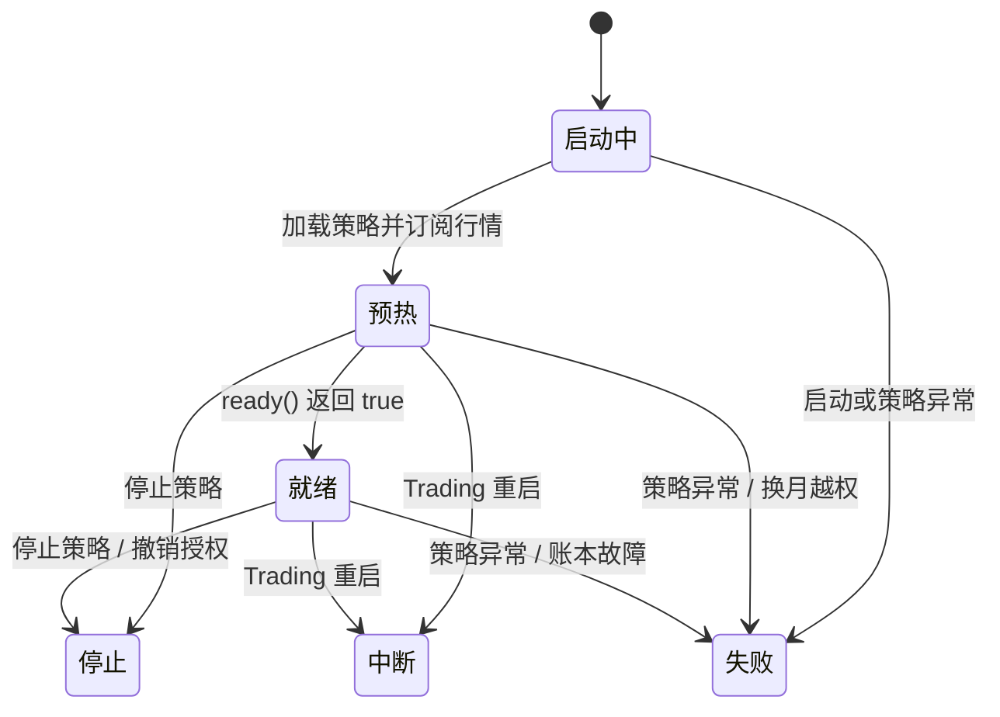

# 交易与风控

Trading 通过 CTP 直连期货公司柜台（仿真或实盘）。每个账户独立运行一个 Linux 进程，不依赖 Terminal、Lab、Market 或 Warehouse 在线。下单必须遵守的红线见[交易规则](../safety.md)，内部架构见[开发者导读](architecture.md)，安装与目录见[部署与运行](deployment.md)。

## 策略包

| 维度 | 约定 |
| --- | --- |
| 冻结与静态校验 | 界面称“策略版本”；从成功回测部署时直接打包其冻结源码副本（亦可显式从当前目录打包），静态解析模块与传递导入的本地文件，禁止引入运行时外依赖（仅限标准库、NumPy、SciPy、`asterion_strategy`） |
| 体积与元数据 | 上限 64 个 Python 文件、合计 512 KiB；命名 `<策略标识>/<打包时间戳>`，附带来源运行 ID、参数、周期、品种、数据版本与权重预算，不含账户或回测明细 |
| 幂等与目录 | 存于 `data/<账户>/strategies/packages/<名称>/<版本>/`，同名同版本不可覆盖；回复丢失先查列表不重发；发布不启动实例也不授予授权 |
| 离线运行时 | 安装包内置 CPython 3.12、NumPy 2.3.5、SciPy 1.17.1 与 Protobuf 5.29.3，安装与运行全程无需联网 |

## 策略实例

每账户同时最多运行一个策略实例（需账户已同步，实例 ID 不可复用）；运行期间禁止手动新增委托，撤单、撤销授权与停止策略始终可用。



- **配置与主力自动换月**：支持 1–64 项固定合约或主力连续品种（1/5/10/15/30/60 分钟或日线）及参数/权重预算覆盖。主力连续每日按前日持仓量选定主力且只向后换月，换月首根附带 `roll_ratio`（缺失即停实例告警）即时执行当时比值复权（与[Lab 主力连续](../lab/README.md#主力连续)一致）并先平旧再开新；同步计算次主力 `roll_yield`（纳入预热摘要、不随换月缩放）。若白名单仅含具体月份且新主力不在白名单中，换月前终止实例并告警。
- **录制与盘后对账**：`runs/<实例>.sqlite` 记录配置、每批 K 线、就绪状态、决策目标与行情断连；`bars.sqlite` 持久保存本地聚合实时 K 线。收盘后可用 `asterion_lab.reconcile` 逐根核对回测，或用 `asterion_lab.post_close` 串联数据自检、多账户对账与去重 Webhook 告警。
- **资源隔离与脱机告警**：策略子进程受物理内存限制（`strategy_memory_limit_mb` 默认 2048 MiB，经 systemd cgroup `MemoryMax` + `MemorySwapMax=0` + `oom_score_adj=500` 保证触顶仅杀子进程不波及 Trading）、64 fd、禁派生子进程/线程、加载限时 10 秒、每批限时 2 秒（防故障隔离，非安全沙箱）。配置主机加密 Webhook 时，策略异常、放弃批次、柜台拒单、未确认委托、触风控线、断线、账本恢复或重启均异步推送去重 JSON 告警。

```mermaid
flowchart LR
  Fixed["Lab 固定版本历史（校验升序与 SHA-256）"] --> Merge["按结束时间去重衔接（重叠保留固定版本）"]
  Local["本地 bars.sqlite / 旧实例记录"] --> Merge
  Merge --> Warm["回放预热（仅更新策略状态，绝不下单）"]
  Warm -->|ready() 为真| Live["切入实时行情与执行"]
```

| 预热来源 | 机制与约束（热重启允许切换包版本、参数或权重预算；缺持仓量传 `NaN`） |
| --- | --- |
| 旧实例记录 | 重放指定已结束实例保存的历史 K 线 |
| 本地录制 K 线 | 重放本机 `bars.sqlite` 已录制的实时 K 线 |
| Lab 固定版本历史 | 启动时随请求注入固定 Warehouse 版本历史（含换月复权因子与 `roll_yield`），Trading 校验 SHA-256 并写入实例记录；运行期不连接 Warehouse |

**三项独立干预操作**（彼此隔离，绝不混做）：

| 操作 | 需确认 | 对挂单与持仓的影响 | 对实例与授权的影响 |
| --- | --- | --- | --- |
| **暂停新增** | 否 | 在发送许可处拦截开仓，仅允许减仓 | 实例继续运行，可随时恢复 |
| **平仓** | 是 | 对所选合约按 10 秒内有效报价下零手目标，走唯一下单路径 | 自动切入暂停新增并继续运行 |
| **停止策略并撤单** | 是 | 撤掉该实例挂单，**不平仓** | 实例结束，**不撤销账户授权** |

## 实时 K 线与现场预热

| 维度 | 口径与边界 |
| --- | --- |
| 直连行情 | 仅在实例启动后按需订阅所选合约，直连 `market_front`；实盘策略必须显式实现 `ready(ctx)`，未就绪丢弃全部目标 |
| 分钟 / 日线聚合 | 分钟线按 `core/config/futures-sessions.json` 与固定时钟边界聚合（集合竞价与闭市秒并入对应分钟），跳过启动首根；日线按行情会话交易日聚合，跳过首日并在次日行情到达后交付（记为 15:00，兼顾国债 15:15 收盘与盘后快照） |
| 多合约对齐 | 同窗口全部合约出现更晚行情即交付，否则越过结束时刻 10 秒后交付；缺席合约不补造不阻塞，迟到成交量计入下一根 |
| 断线与异常 | 跨断线、重连半途或成交量回退的 K 线标不完整并跳过（下一完整周期自动恢复）；落后超 10 秒或早于已处理时刻的报价丢弃；首登超 30 秒、登订被拒、队列溢出、乱序、超前主机时钟 2 秒以上或策略异常/超时时立即停实例并撤单 |

## 目标执行


- **手数、权重与跨时段**：手数目标仅更新所列合约；权重目标覆盖全组合并校验总/净预算，冻结当批 `Balance` 与保证金缩放系数按现价向零取整换算（支持 `max_margin_ratio` 缩权与 `min_rebalance_weight` 小偏离死区，先换算目标扣减当批额度）。跨夜盘/早盘/中金所组合保留未开盘合约待到达报价后沿用同批冻结系数增量执行；最近就绪目标持续生效，后续无新目标的 K 线按持仓补差。
- **拆单、并发与未确认冻结**：上期所/能源中心先平昨再平今；超单笔上限拆腿顺序推进并在成交核对后重算；不同合约可并发（开仓受在途上限排队，减仓不受限）。账户出现未确认委托时暂停全部新规划（含减仓与平仓），直至核实后恢复。

默认买入挂卖一、卖出挂买一；可选受控执行选项（`ExecutionOptions`）：

| 选项 | 参数范围 | 行为与安全边界 |
| --- | --- | --- |
| 超价跳数 | `aggressive_ticks`（`0–5`） | 在对手价基础上让价 N 跳并钳位至涨跌停，仍强制接受价格偏离校验 |
| 有限追价 | `max_reprices`（`0–5`），间隔 `1–30s`（默认 `3s`） | 仅对柜台已确认在途且无未确认委托的挂单，超时且对手价不利移动时在日撤单上限内经 WAL 撤单、待已撤确认后再发新单，绝不重发未确认单 |
| Mini-TWAP 切片 | `twap_slices`（`1–10`），间隔 `1–60s`（默认 `5s`） | 将单合约目标差量拆为整数手时间片顺序推进（一键平仓不延迟），批次窗口延展上限 5 分钟，每笔仍校验 10 秒新鲜报价与全套风控 |

**异常处置分级**：

| 异常情况 | 处理范围 | 实例状态 |
| --- | --- | --- |
| 单合约超 10 秒、无对手价、触发风控/偏离拒单、被撤或柜台拒单 | 仅放弃该合约当批目标并撤其未成交挂单 | 继续运行（其余与待开盘合约不受影响） |
| 账户连接变化，或新目标/平仓替换未完成批次 | 放弃旧批次（他腿成交引起敞口变化且未调 SDK 时原地重评） | 继续运行 |
| 非法目标/超预算、账本恢复、撤销授权或停止实例 | 撤掉实例全部未完成挂单（保留持仓） | 实例结束 |

## 风控设置与授权

- **风控政策**：配置最多 64 项合约或品种级白名单（`SHFE.rb` 自动适配换月；优先复用 Market 目录，否则直查柜台缓存）、五项必填限额与四项可选资金/撤单硬风控，追加写入账本。修改政策须在账户同步、持仓核对且无未确认委托时进行，生效后自动断开柜台并撤销授权。
- **授权与费率查询**：界面称“允许下单 / 停止下单”，须确认账户身份；授权跨日与重连有效，撤销授权、改政策、账本恢复或 Trading 重启立即失效。就绪后可查柜台实盘保证金与手续费率核对加收标准（回测不使用）。

## 下单检查

每笔委托必须依次通过五道关口，任一步不满足即拒绝：


- **价格与持仓核对**：当日涨跌停均须有效，限价不越界且相对参考价（最新价，无成交取昨结）偏离不超上限；手动单先查柜台行情（受 CTP 频控约 1 秒），策略单用实例直连 10 秒内报价。仅限价单；有未对账成交时暂停受影响合约开仓；持仓查询期间若交错收到新回报则沿用上次确认持仓并触发重查。

| 风控项 | 级别 | 计算口径 | 开仓 | 平仓 / 减仓 |
| --- | --- | --- | --- | --- |
| 单笔手数、价格偏离 | 必填 | 单笔手数；限价相对参考价偏离幅度 | 限制 | 限制（手动超上限自动拆单，不超可平量） |
| 单账户自成交防护 | 内建 | 同合约反向在途或未确认挂单价格交叉（买 ≥ 卖）即拒单 | 限制 | 限制 |
| 自然人交割月禁开仓 | 内建 | 商品与中金所国债期货在 `交易月 >= 交割月` 时拒开（股指除外） | 限制 | 豁免 |
| 单合约 / 账户总持仓 | 必填 | 柜台持仓 + 在途开仓 + 未确认 + 未对账开仓（多空相加不抵消） | 限制 | 豁免 |
| 在途委托数 | 必填 | 当前未终结委托总数 | 限制 | 豁免 |
| 日内亏损 / 最大回撤限额 | 可选 | 剔除出入金后的盯市净值相对日初或历史峰值 `peak_equity` 差额 | 限制 + 告警 | 豁免 |
| 保证金率上限 | 可选 | 含持仓、未对账、在途/未确认及本笔预估占用（缺资金或费率拒开） | 限制 + 告警 | 豁免 |
| 单合约日撤单上限 | 可选 | 按交易日与合约统计的撤单请求次数 | 限制 + 告警 | 豁免 |

## 交易记录、断线与恢复

| 维度 | 机制与规则 |
| --- | --- |
| 账本与幂等 | 事件持久化至 `data/<账户>/journal.sqlite`（旧事件自动归档至 `archives/`）；`get_account` 返回轻快照，委托/成交分页查询。同 `request_id`、内容与政策版本幂等返回现状，不符报 `CONFLICT`；授权/撤销 `request_id` 不可复用 |
| 成交与收盘快照 | 撤单先记账后发；成交按 `(交易日, 成交编号)` 去重留存并支持按日导出 CSV；同步后写 `ctp-flow/latest_close.pb`，跨日先归档昨日快照再存今日 |
| 断线与未确认 | 断线、超时与重启绝不自动重发；重连以柜台为准同步。已记账无回报标“未确认”并跨日占额直至人工核实标记；CTP SDK 本地拒收（`-1/-2/-3`）未发出，直接记未发送并释放额度 |
| 停机与冷备 | 正常停机先停接单、停策略撤单再断柜台（强杀不保证撤单）；冷备前停全部账户并复制整个账户目录（含 `archives/`）及 `owners/` |

## 回测的账本、费用与撮合

回测由 `core` 中的 `FuturesAccount` 与 `PaperExecution` 替代真实柜台：

| 维度 | 回测口径 |
| --- | --- |
| 账本与结算 | 单币种、整数手；保证金与手续费 = 每手固定 + 名义金额 × 费率（分位四舍五入），区分多空保证金与开/平今/平昨；日内按开仓价、日结按结算价重算保证金；权益 = 资金 + 浮盈，可用资金不含浮盈 |
| 历史费率 | 取固定数据集当日交易所结算参数（不含期货公司加收）；缺保证金或开平费即停，缺平今费仅当日产生平今时停，绝不补零 |
| 撮合与滑点 | 仅在后续 K 线成交：买限触及最低价按 `min(开盘, 限价)`，卖限相反；单根 K 线合计不超成交量 10%；固定 N 跳滑点；日线含涨跌停时封板不成交且含滑点价不越板 |
| 目标到委托 | 第 N 根决策在第 N+1 根按开盘价 ± 滑点主动成交；反手先平后开、超单笔拆腿在 10% 量限内完成，余量收盘撤单并在后续 K 线续做；主力换月见[Lab 回测引擎与换月](../lab/README.md#回测引擎与换月) |
| 未建模项 | 盘口排队、冲击成本、强行平仓、自成交 |
