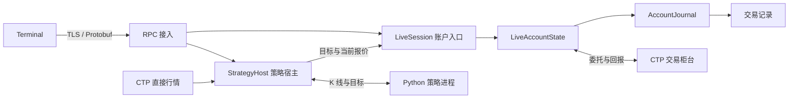
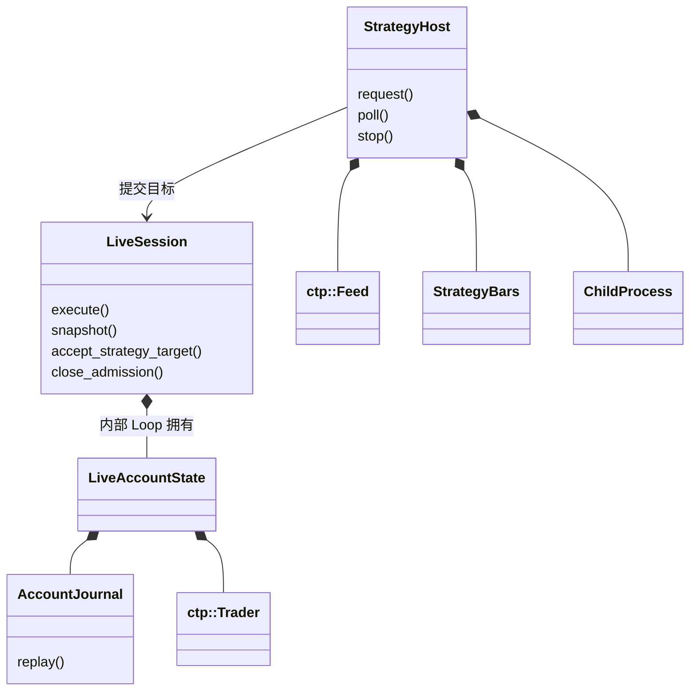
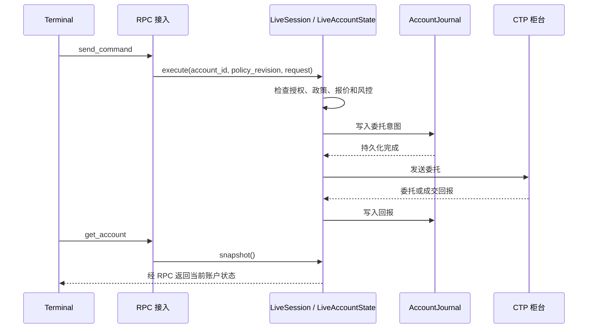
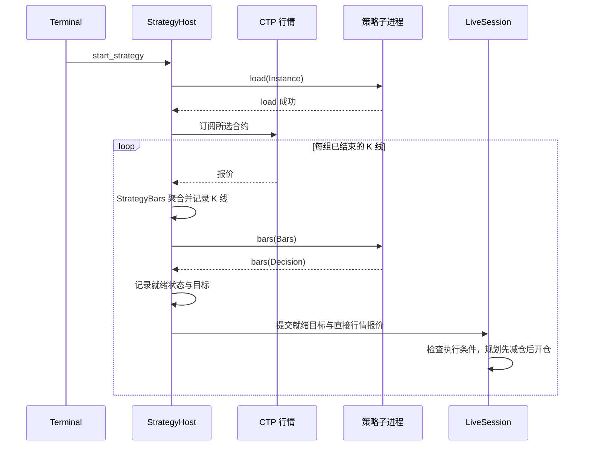

# Trading 开发者导读

先读[交易与风控](README.md)和[交易规则](../safety.md)，部署路径见[部署与运行](deployment.md)。本文说明账户状态、策略运行与柜台执行之间的边界。

## 服务边界

Trading 是每个账户独立运行的 Linux 服务。Terminal 提交操作并读取结果；策略子进程只返回目标。账户拥有授权、风控、委托和交易记录，只有账户执行路径可以向柜台发送委托。

- RPC 层验证消息与客户端身份，不持有账户业务状态。
- `LiveSession` 将外部命令和策略目标交给账户执行路径；`LiveAccountState` 维护账户事实并检查发送条件。
- `AccountJournal` 串行持久化记录，完成结果交回账户处理。理由：写入成功之前不能发送委托。
- `StrategyHost` 管理策略包、行情、K 线与 Python 进程，通过私有 Unix 套接字交换 Protobuf 消息；它通过账户入口执行目标，不直接调用交易 SDK。
- Trading 自行连接行情前置。Market 停机、Lab 计算失败或 Terminal 退出均不结束交易服务。

## 核心类关系

图中省略内部 `Loop`、`State` 和辅助执行类型。账户命令、持久化完成与柜台回报最终在账户状态拥有者处合并；策略文件与子进程操作在策略宿主中处理。

## 委托通信时序

图中展示成功路径；任一步失败按[交易规则](../safety.md)处理。`send_command` 的成功回复不是成交确认，成交以柜台回报为准。回复丢失后先读取账户状态，不能直接重发。

## 策略通信时序

策略就绪与账户授权是两个条件。热重启先向新子进程重放旧实例记录，只恢复策略状态，不执行重放期间的目标。行情中断时的聚合、批次超时与停止行为见[策略实例](README.md#策略实例)及[目标执行](README.md#目标执行)。

## 生命周期与错误边界

| 情况 | 行为与入口 |
| --- | --- |
| 服务启动 | 读取账户配置、恢复记录并连接柜台，授权初始无效，见 `main.cpp` |
| 客户端断开 | 账户和策略继续，见 RPC 接入与 `LiveSession` |
| 策略失败 | 结束实例并处理其未完成委托，持仓保留，见 `strategy_host.cpp` |
| 柜台断线 | 同步恢复前停止发送，不重发委托，见 `ctp_reconciliation.cpp` |
| 交易记录故障 | 账户进入恢复处理，停止正常发送，见 `LiveAccountState` |
| 正常停止 | 关闭新操作接纳、停止策略、处理撤单并释放柜台资源，见 `main.cpp` |

## 代码阅读路线

| 顺序 | 入口 | 阅读目标 |
| --- | --- | --- |
| 1 | [main.cpp](../../apps/services/trading/main.cpp)、[settings.cpp](../../apps/services/trading/settings.cpp) | 启动、RPC 分派、配置与停止 |
| 2 | [live_session.hpp](../../apps/services/trading/live_session.hpp)、[account_loop.cpp](../../apps/services/trading/account_loop.cpp) | 账户入口与状态所有权 |
| 3 | [live_session.cpp](../../apps/services/trading/live_session.cpp)、[account_journal.cpp](../../apps/services/trading/account_journal.cpp) | 检查、记录与发送 |
| 4 | [ctp_trader.cpp](../../apps/services/trading/ctp/ctp_trader.cpp)、[ctp_reconciliation.cpp](../../apps/services/trading/ctp/ctp_reconciliation.cpp) | SDK 适配和柜台事实核对 |
| 5 | [strategy_host.cpp](../../apps/services/trading/strategy_host.cpp)、[strategy_bars.cpp](../../apps/services/trading/strategy_bars.cpp)、[strategy_runner.py](../../apps/services/trading/python/strategy_runner.py) | 策略进程、K 线与就绪目标 |
| 6 | [strategy_execution.cpp](../../apps/services/trading/strategy_execution.cpp)、[strategy_orders.cpp](../../apps/services/trading/strategy_orders.cpp) | 目标到委托、批次推进与撤单 |

隔离验证见 [tests/trading](../../tests/trading)，真实柜台操作按[仿真验收](../acceptance/ctp-simulation.md)执行。
