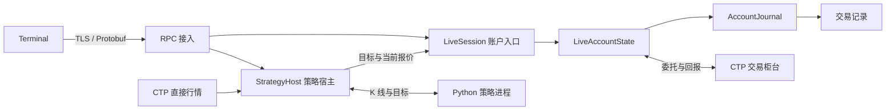
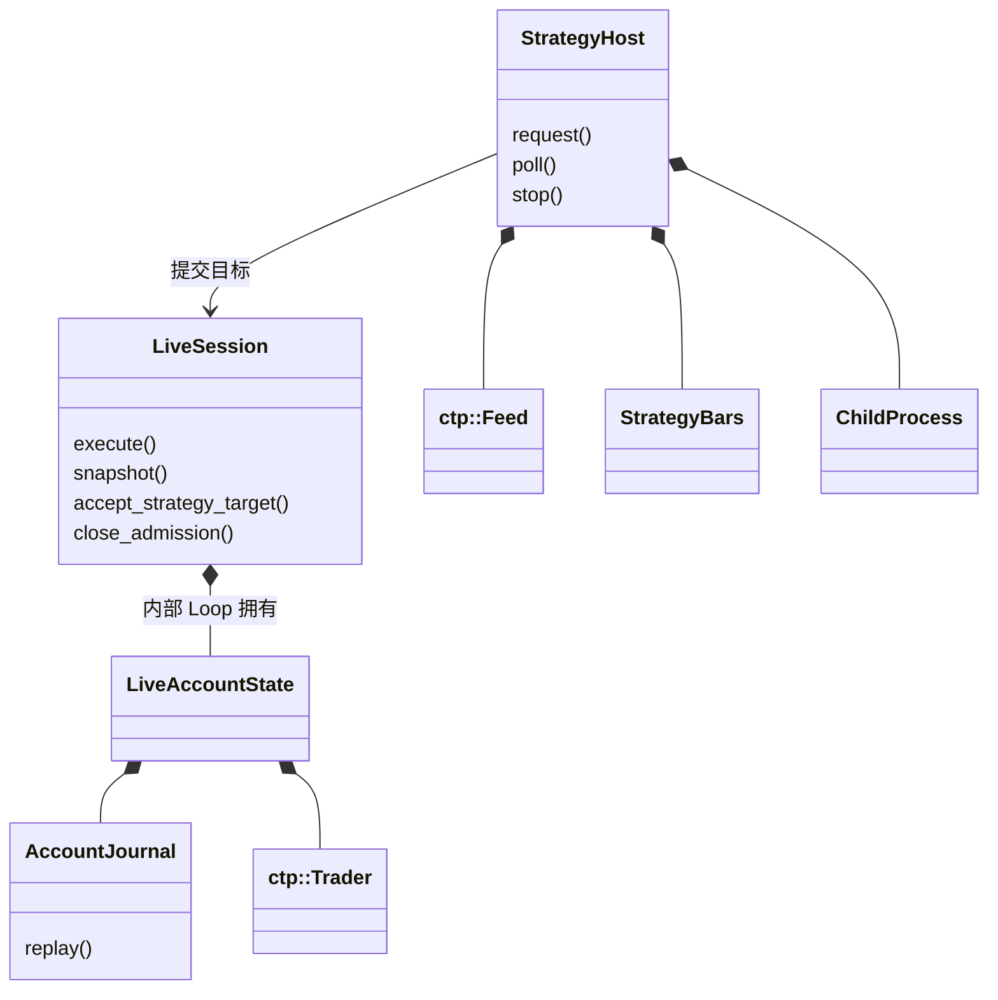
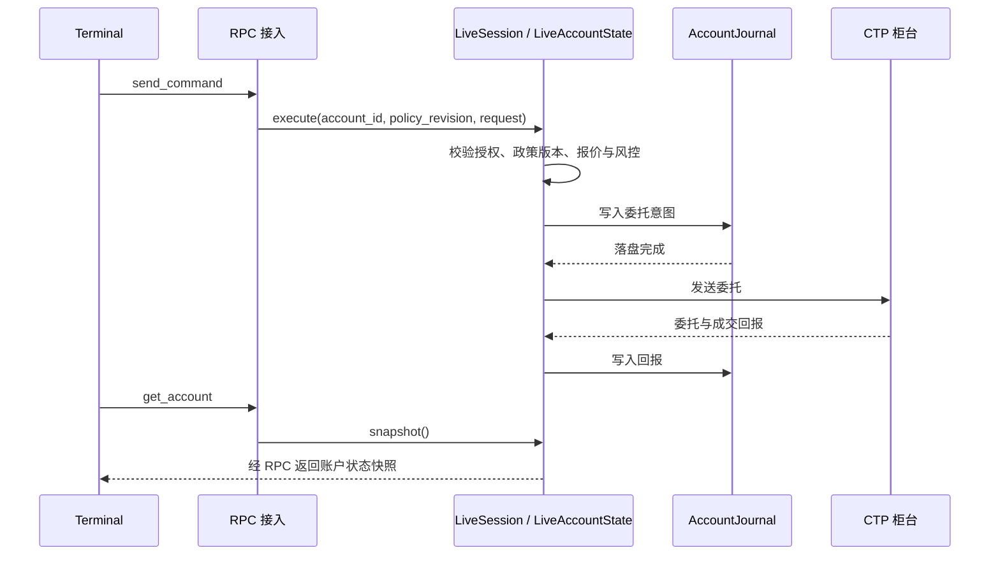
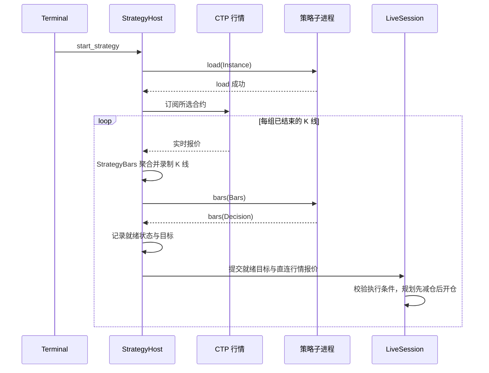

# Trading 开发者导读

建议先阅读[交易与风控](README.md)与[交易规则](../safety.md)，部署与目录布局见[部署与运行](deployment.md)。本文说明账户状态、策略宿主与柜台执行之间的职责边界与通信时序。

## 服务边界

Trading 是每账户独立运行的 Linux C++ 进程。Terminal 仅提交意图与读取快照，策略子进程只返回目标仓位或权重；账户内核独占授权、风控、委托与交易记录，只有账户执行路径能够向柜台报单。

- RPC 层仅负责帧解析、协议校验与客户端证书认证，不持有账户业务状态。
- `LiveSession` 将外部命令与策略目标交由单线程账户事件循环串行推进，同一时刻仅执行一条持久化命令；等待柜台报价的手动下单会先释放执行槽，让已记录委托的撤单与策略停机撤单优先推进，并在入队与柜台回报边界通过互斥发送门控（`BrokerSendGate`）阻断过期发送。`LiveAccountState` 维护账户权威状态并校验全部风控与发送条件。
- `AccountJournal` 串行落盘事件并将完成结果交回账户循环。理由：落盘成功前绝不允许向柜台发送委托。
- `StrategyHost` 管理策略包、直连行情、K 线聚合与 Python 子进程，经私有 Unix socket 交换 Protobuf 消息；策略目标统一经 `LiveSession` 执行，绝不直接调用交易 SDK。
- Trading 自行直连行情与交易前置；Warehouse 停机、Lab 故障或 Terminal 退出均不影响其持续运行。

## 核心类关系

图中省略内部 `Loop`、`State` 与辅助执行类型。账户命令、落盘回调与柜台回报最终汇聚于账户状态拥有者；策略包管理与子进程交互收口于策略宿主。

## 委托通信时序

上图展示正常路径，任一步骤失败均按[交易规则](../safety.md)处置。`send_command` 返回成功仅代表委托已落盘发送，成交以柜台回报为准；回复丢失时必须先调 `get_account` 查询现状，严禁重发。

## 策略通信时序

策略就绪与账户授权相互独立。热重启与历史预热会先向新子进程重放历史 K 线，仅恢复策略状态、不下单；行情中断聚合、批次超时与停机行为见[策略实例](README.md#策略实例)及[目标执行](README.md#目标执行)。

## 生命周期与错误边界

| 情况 | 行为与代码入口 |
| --- | --- |
| 服务启动 | 读取账户配置、重放账本并连接柜台，初始授权恒为无效（`main.cpp`） |
| 客户端断开 | 释放连接，账户与策略照常运行（RPC 接入、`LiveSession`） |
| 策略异常 | 终止实例并撤掉其未成交挂单，保留持仓（`strategy_host.cpp`） |
| 柜台断线 | 重连并重新同步完成前停止发送，绝不重发委托（`ctp_reconciliation.cpp`） |
| 账本写入或完整性异常 | 账户进入 `recovery_required`，停止常规发送（`LiveAccountState`） |
| 收到停止信号 | 关闭新操作接纳、停策略、撤挂单并释放柜台资源（`main.cpp`） |

## 代码阅读路线

| 顺序 | 入口 | 阅读目标 |
| --- | --- | --- |
| 1 | [main.cpp](../../apps/services/trading/main.cpp)、[settings.cpp](../../apps/services/trading/settings.cpp) | 启动流程、RPC 分派、配置校验、看门狗与优雅停机 |
| 2 | [live_session.hpp](../../apps/services/trading/live_session.hpp)、[account_loop.cpp](../../apps/services/trading/account_loop.cpp) | 账户入口与单线程状态所有权 |
| 3 | [live_session.cpp](../../apps/services/trading/live_session.cpp)、[account_journal.cpp](../../apps/services/trading/account_journal.cpp) | 风控检查、先记录后发送与账本持久化 |
| 4 | [ctp_trader.cpp](../../apps/services/trading/ctp/ctp_trader.cpp)、[ctp_reconciliation.cpp](../../apps/services/trading/ctp/ctp_reconciliation.cpp) | CTP SDK 适配、请求流控与柜台对账 |
| 5 | [strategy_host.cpp](../../apps/services/trading/strategy_host.cpp)、[strategy_bars.cpp](../../apps/services/trading/strategy_bars.cpp)、[strategy_runner.py](../../apps/services/trading/python/strategy_runner.py) | 策略子进程、实时 K 线聚合与预热回放 |
| 6 | [strategy_execution.cpp](../../apps/services/trading/strategy_execution.cpp)、[strategy_orders.cpp](../../apps/services/trading/strategy_orders.cpp) | 目标换算、拆单并发与批次撤单 |

隔离测试位于 [tests/trading](../../tests/trading)，真实柜台验收按[CTP 仿真验收](../acceptance/ctp-simulation.md)执行。
