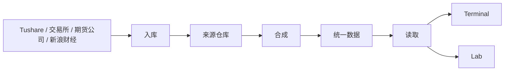
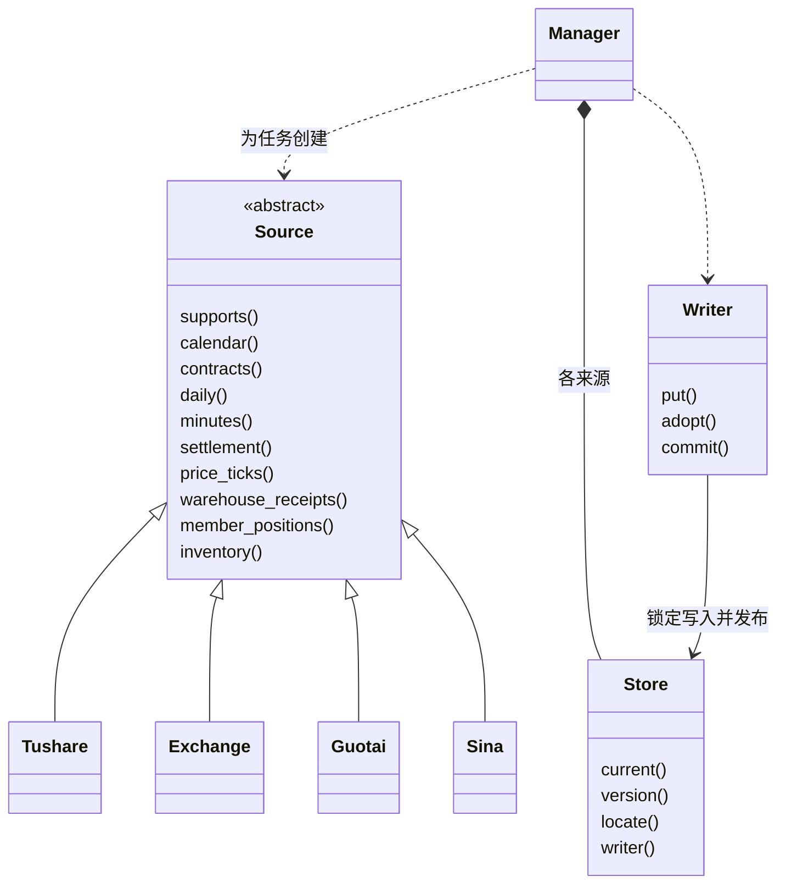
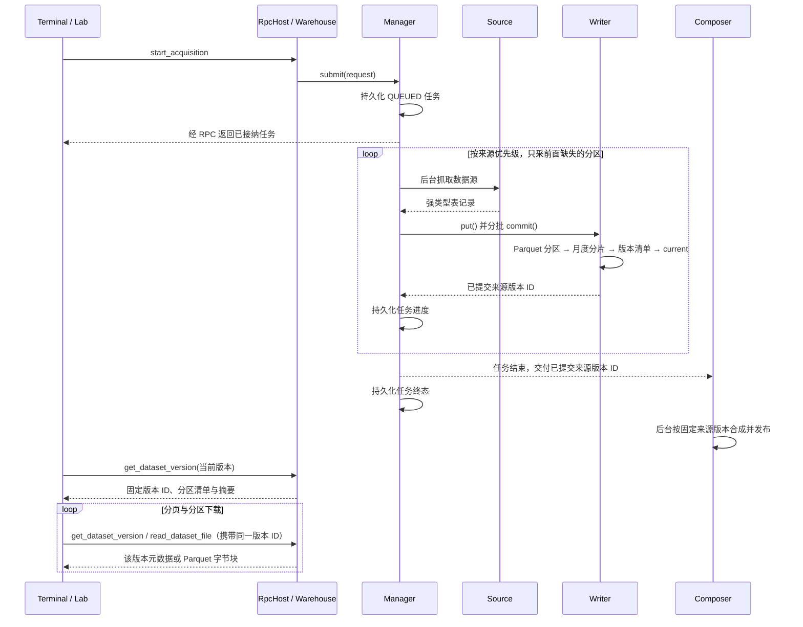

# Warehouse 开发者导读

建议先阅读[功能与协议](README.md)，再对照本文定位代码入口；安装与目录布局见[部署](deployment.md)，全局边界见[架构](../architecture.md)。下文类图对应当前 C++ 实现，省略私有辅助类型与字段。

## 服务边界与数据流

Warehouse 是由 systemd 看护的 Linux C++ 进程，独立拥有采集任务与正式历史仓库；Terminal 与 Lab 仅作客户端。实时行情由 [Market](../market/README.md) 负责，交易由 [Trading](../trading/README.md) 直连柜台，三类服务互不通信，任一故障或升级均不影响其余两者。

数据流严格单向向右，下游模块绝不反向调用上游模块：

| 模块 | 代码路径（相对 `apps/services/warehouse/`） | 只回答 | 不负责 |
| --- | --- | --- | --- |
| 入库 | `acquisition/` | 某来源某日的数据是否已取回 | 研究应选用哪份来源 |
| 合成 | `composer.*`、`composition.*` | 统一数据集应选用哪份分区 | 数据从何处、如何抓取 |
| 读取 | `reader.*`、`service.cpp` | 某固定版本包含哪些数据与覆盖 | 缺口如何补采 |

各来源只写自身仓库，统一数据集只由合成写入，客户端只读统一数据集。

## 核心类关系

RPC 层负责收发帧，`Composer` 在独立线程中增量合成统一数据集。每个请求的执行通道由 `service.cpp` 中的 `lane()` 唯一决定：耗时的全量扫描走独立分析通道，确保 Lab 分区下载与任务查询不受阻塞。

| 请求类别 | 调度通道 |
| --- | --- |
| 摘要、覆盖、参考表浏览、版本历史与对比、更新到最新 | 分析通道 |
| 状态、版本清单、分区读取、采集选项、任务提交/查询/取消 | 读取通道 |

- `Reader` 随服务常驻，按不可变版本 SHA-256（含北京昨日日期与 `empty-*.txt` 文件签名）缓存版本元数据、版本对比、摘要与覆盖率（单品种查询直接复用全量覆盖缓存），消除切换页面时的重复扫描。
- `Composer` 维护 `SourceCache`，版本前进时仅增量加载变更月份的分片，再以硬链接合成统一版本。
- 来源适配器将外部响应转为强类型表记录（`records.hpp` 中的 `DailyBar`、`Settlement` 等），各表列序唯一定义在 `records.cpp`，`Manager` 落盘前再转为行。理由：若按位置手拼列，字段错位在编译与入库期都难以发现。

## 采集、发布与固定版本读取

统一数据集的来源选择与发布规则见[功能文档](README.md#仓库与固定版本)。来源顺序唯一维护于 `sources_of()`，供 `Manager` 与合成共用；`Writer::adopt()` 通过硬链接复用选中分区，旧版本继续指向原文件。`Composer` 在启动及任务结束后触发合成，失败不影响采集任务终态并在稍后重试；重试可合并此后新结束的任务，绝不读取运行中来源的 `current`（理由：来源按批提交进度，对外发布的可见边界必须是任务结束）。

## 生命周期与错误边界

| 情况 | 行为与代码入口 |
| --- | --- |
| 客户端断开 | 释放该连接；已接纳采集任务照常执行（`service.cpp`） |
| 某来源失败 | 后续来源继续补缺，任务最终标为失败（`Manager::work()`） |
| 任务终态写盘失败 | 任务保留原错误并标失败；存储恢复后，下次提交前先补写终态再接纳新任务，不重复采集（`Manager::reap()`） |
| 收到停止信号 | 优雅结束后台采集与合成后退出（`main.cpp`、`service.cpp`） |
| 服务重启 | 未完成的历史采集任务标为中断；损坏的任务文件只影响其自身（`Manager`） |

启动时若无法读取任一来源的版本指针则立即失败并报错路径。理由：接纳新采集前必须明确已有数据的发布边界。

## 代码阅读路线

| 顺序 | 入口 | 阅读目标 |
| --- | --- | --- |
| 1 | [main.cpp](../../apps/services/warehouse/main.cpp)、[settings.cpp](../../apps/services/warehouse/settings.cpp) | 启动参数、GC 子命令、数据目录锁、TLS 身份与优雅停止 |
| 2 | [service.cpp](../../apps/services/warehouse/service.cpp)、[reader.cpp](../../apps/services/warehouse/reader.cpp) | 请求路由通道、定时任务调度与固定版本缓存读取 |
| 3 | [manager.cpp](../../apps/services/warehouse/acquisition/manager.cpp)、[source.hpp](../../apps/services/warehouse/acquisition/source.hpp) | 来源适配接口、任务优先级调度与批量提交 |
| 4 | [records.hpp](../../apps/services/warehouse/records.hpp)、[store.cpp](../../apps/services/warehouse/store.cpp)、[composition.cpp](../../apps/services/warehouse/composition.cpp)、[composer.cpp](../../apps/services/warehouse/composer.cpp) | 表结构、不可变版本、月度分片与增量来源合成 |
| 5 | [通信协议](../protocol.md)、[warehouse.proto](../../protocol/proto/asterion/warehouse.proto) | 客户端契约与固定版本读取协议 |

模块测试见 [tests/warehouse](../../tests/warehouse)，跨客户端并发与重启测试见 [concurrency_process.py](../../tests/warehouse/concurrency_process.py)。
