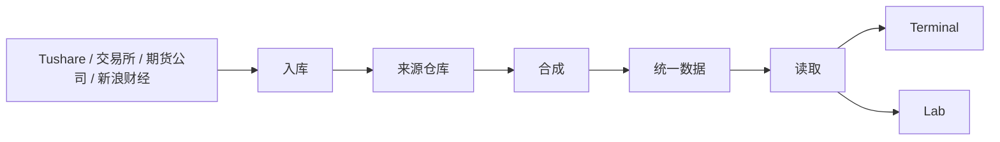
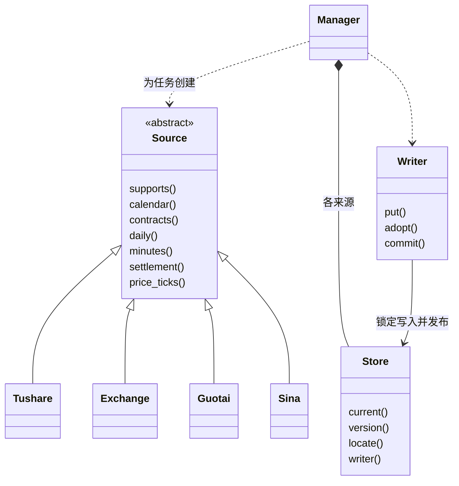
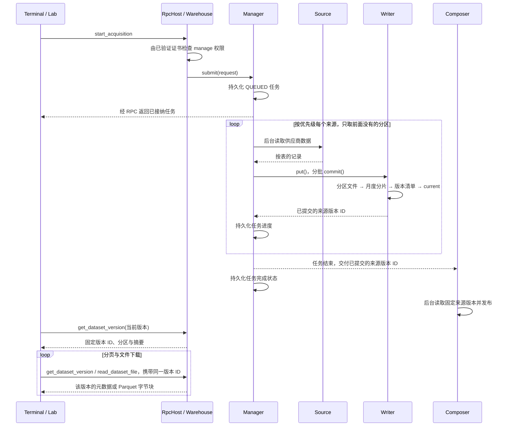

# Warehouse 开发者导读

先读[功能与协议](README.md)，再按本文的图找到代码入口；安装和数据目录见[部署](deployment.md)，产品边界见[总体架构](../architecture.md)。图中的类名对应当前 C++ 实现，省略私有辅助类和字段。

## 服务边界与数据流

Warehouse 是由 systemd 看护的 Linux C++ 进程，拥有采集任务和正式仓库。Terminal 与 Lab 是客户端；实时行情在 [Market](../market/README.md)，Trading 独立连接柜台。理由：三类服务各管一件事，彼此没有通信，一个的问题和升级不影响另外两个。

箭头只往右走，后面的模块不调用前面的模块。

| 模块 | 代码 | 只回答 | 不管 |
| --- | --- | --- | --- |
| 入库 | `acquisition/` | 这个来源这一天的数据取回来了吗 | 研究该用哪份 |
| 合成 | `warehouse/composer`、`warehouse/research` | 研究该用哪份 | 数据从哪取、怎么取 |
| 读取 | `warehouse/reader`、`service.cpp` | 这个固定版本里有什么 | 数据缺了怎么办 |

- 每个来源只写自己的仓库，统一数据只由合成写入，客户端只读统一数据。

## 核心类关系

RPC 接入负责收发帧；`Composer` 在自己的线程里更新统一数据。每个调用走哪条路径，只由 `service.cpp` 的 `route()` 决定。可能耗时的扫描单独排队，理由：Lab 下载和任务查询不等它们。

| 调用 | 路径 | 权限 |
| --- | --- | --- |
| `start_acquisition`、`cancel_acquisition` | 读取线程 | `manage` |
| 摘要、覆盖、参考表、版本历史与比较 | 分析线程 | `read` |
| 其余调用 | 读取线程 | `read` |

来源适配器负责供应商数据转换，`Manager` 负责任务与提交，`Store` 负责固定版本。客户端看不到来源：协议只有一份数据集。来源按表返回记录（`records.hpp` 的 `DailyBar`、`Settlement` 等），每张表的列顺序只在 `records.cpp` 定义一次；`Manager` 写入前把记录转成行。理由：按位置拼行时字段写错位置，编译和入库都发现不了。

## 采集、发布与固定版本读取

`research` 的来源选择与发布规则见[功能文档](README.md#仓库与固定版本)。来源顺序只在 `sources_of` 维护，`Manager` 和合成共用。`Writer::adopt()` 用硬链接引用选中的分区，旧版本仍引用原文件。`Composer` 在启动和任务结束后合成，失败不影响采集任务，稍后重试；重试可纳入此后已结束的任务，不能重新读取运行中来源的 `current`。理由：来源按批保存进度，合成读取的边界必须是任务结束。

## 生命周期与错误边界

| 情况 | 行为与代码入口 |
| --- | --- |
| 客户端关闭 | 释放该连接；已接纳的采集继续，见 `service.cpp` |
| 来源失败 | 后面的来源照常补缺，任务最后标为失败，见 `Manager::work()` |
| 任务结束状态写入失败 | 任务显示失败并保留原错误；存储恢复后，下次提交先补写失败记录再接纳新任务，不重采，见 `Manager::reap()` |
| 服务正常停止 | 结束后台任务后退出，见 `main.cpp` 与 `service.cpp` |
| 服务重新启动 | 旧采集任务标为中断，损坏的任务文件只影响它自己，见 `Manager` |

启动时若无法读取来源的版本指针，则启动失败并报告路径，理由：接纳新采集前必须先确定已有数据的发布边界。

## 代码阅读路线

| 顺序 | 入口 | 阅读目标 |
| --- | --- | --- |
| 1 | [main.cpp](../../apps/services/warehouse/main.cpp)、[settings.cpp](../../apps/services/warehouse/settings.cpp) | 配置、数据目录锁、TLS 身份、权限和停止流程 |
| 2 | [service.cpp](../../apps/services/warehouse/service.cpp) | 调用路径表 |
| 3 | [manager.cpp](../../apps/services/warehouse/acquisition/manager.cpp)、[source.hpp](../../apps/services/warehouse/acquisition/source.hpp) | 来源扩展、任务生命周期与批量提交 |
| 4 | [records.hpp](../../apps/services/warehouse/records.hpp)、[store.cpp](../../apps/services/warehouse/store.cpp)、[composition.cpp](../../apps/services/warehouse/composition.cpp)、[composer.cpp](../../apps/services/warehouse/composer.cpp) | 表结构、不可变版本、月度分片、来源合成 |
| 5 | [通信协议](../protocol.md)、[warehouse.proto](../../protocol/proto/asterion/warehouse.proto) | 客户端契约与固定版本读取 |

模块测试见 [tests/history](../../tests/warehouse)；跨客户端与重启行为看 [concurrency_process.py](../../tests/warehouse/concurrency_process.py)。
